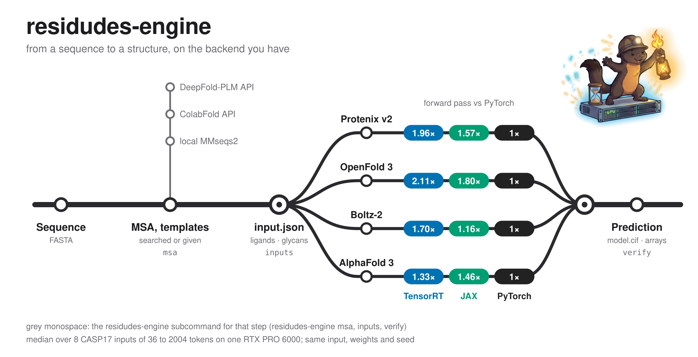

# RESIDUDES


Protein structure prediction software used by the DeepFold team in CASP17 (group 077). The repository contains
three components: an agent that carries a target from its sequence to a slate of five submitted models, halting at
the points where a human decision is required; a prediction toolkit; and a quality-assessment stack for ranking
the resulting models.

| Component | Description |
|---|---|
| [`residudes/`](residudes/) | campaign agent: target analysis, input construction, structural gates, slate assembly, and two human checkpoints |
| [`residudes-engine/`](residudes-engine/) | prediction toolkit: five predictors (Protenix v2, OpenFold 3, Boltz-2, AlphaFold 3, ESMFold2) from a single input file, on PyTorch, TensorRT or JAX backends |
| [`residudes-qa/`](residudes-qa/) | quality assessment: scoring, clustering and visualisation of a prediction pool |
| [residudes-decoy](https://residudes-decoy.deepfold.org) | released dataset: 726,097 unfiltered CASP17 predictions over 82 targets, each with the input that produced it ([description](docs/residudes-decoy.md)) |

The first three are in this repository; the fourth is the data they produced, released so that the predictions
behind the CASP17 entry, and the inputs that generated them, can be examined independently.

[](docs/figures/overview.svg)

**The three components applied to one target.** The agent's stages are shown along the top, with the two
human checkpoints in orange. Below, a sequence is expanded into a pool of predictions, and the pool is reduced to a
ranked selection. All steps after slate assembly require human action.

## Installation

```sh
git clone https://github.com/DeepFoldProtein/RESIDUDES && cd RESIDUDES
residudes/bin/residudes setup                # does the installation with you, then checks it
```

`setup` asks first what this machine already has — the AlphaFold 3 databases are 630 GB and
`af3.bin` is licensed per person, so finding them matters more than fetching them — and then
obtains the published images, installs what is missing and runs `containers/verify.sh` at the end.
It hands the work to whichever agent CLI is present (Claude Code, Codex, Antigravity, Gemini);
`--manual` asks the questions itself, and with no CLI on the machine it falls back to that by
itself.

Then a target:

```sh
cd residudes
bin/residudes target add T1234 --fasta T1234.fasta --stoich A3
bin/residudes chat T1234                     # talk to the agent about it; the session keeps running
bin/residudes agent step T1234               # or one step per stage; `daemon --target T1234` keeps going
```

`chat` opens that target's conversation: ask what it is doing, steer it, leave with `ctrl-b d`,
come back to the same thread. There is **one agent per target** — the daemon works through the
same conversation rather than starting a second agent beside it, so there is one context and you
can watch or interrupt. All of them live as windows of a single tmux session, so `tmux ls` stays
one line, you arrive in the target you asked for, and `ctrl-b w` pages to the others. `residudes`
on its own lists every target, which are in conversation and which are waiting on a person.

[`docs/setup.md`](docs/setup.md) documents the installation in full: container images or virtual
environments, the MSA databases, and the three components that must be obtained by the user
(AlphaFold 3 parameters, a Rosetta build and a MODELLER licence key).

## Documentation

| Topic | Document |
|---|---|
| Example run | [`residudes/examples/H1388`](residudes/examples/H1388/): registered and left alone, to a packaged slate in 45 minutes - 15 agent steps, $6.81, 300 models predicted for the run, both checkpoints answered by the agent; dossier, write-up, figures and every transcript |
| Component documentation | [`residudes/README.md`](residudes/README.md) · [`residudes-engine/README.md`](residudes-engine/README.md) · [`residudes-qa/README.md`](residudes-qa/README.md) |
| Effect of model selection | [`residudes/docs/casp17_cases.md`](residudes/docs/casp17_cases.md): per-target intervals, including cases where selection lost accuracy |
| Setup and containers | [`docs/setup.md`](docs/setup.md) · [`containers/README.md`](containers/README.md) |
| Released sampling pool | [`docs/residudes-decoy.md`](docs/residudes-decoy.md) |
| Motivation and scope | [`docs/why.md`](docs/why.md) |
| Tests, CI and figure checks | [`docs/testing.md`](docs/testing.md) |
| Licence terms in full | [`docs/licences.md`](docs/licences.md) |

## Components

[](residudes/docs/figures/overview.svg)

`residudes`: the stage sequence of the agent. Human checkpoints are shown in orange.

[](residudes-engine/docs/figures/overview.svg)

`residudes-engine`: construction of a single input file, five predictors, and measured throughput per backend.

[](residudes-qa/docs/figures/overview.svg)

`residudes-qa`: scoring, clustering and visualisation of a prediction pool.

[](https://residudes-decoy.deepfold.org)

[residudes-decoy](https://residudes-decoy.deepfold.org): the released sampling pool, browsable per target and per
predictor, with every structure viewable in place. Each model carries the input that produced it — predictor,
input variant and seed — so a record can be reproduced rather than only scored
([layout and terms](docs/residudes-decoy.md)).

## Citation

Please cite the CASP17 abstract of group 077. The same reference covers the
[residudes-decoy](docs/residudes-decoy.md) pool, so that the software and the data it produced are cited together.
[`CITATION.cff`](CITATION.cff) carries equivalent metadata for GitHub's "Cite this repository" function.

```bibtex
@misc{residudes_casp17,
  title  = {Protein Complex Structure Prediction with RESIDUDES in CASP17},
  author = {Bae, Hanjin and Park, Gunwoong and Jo, Gyeonpil and Kim, Kunwoo and Kim, Minsoo and
            Yoo, Jaemin and Kim, Beomseok and Shin, Jaeoh and Kim, Hosung and Kim, Iljung and
            Noh, Yung-Kyun and Yoo, Jejoong and Joo, Keehyoung},
  year   = {2026},
  note   = {CASP17 abstract}
}
```

Use of structures from the pool additionally requires citation of the predictor that generated them; the
AlphaFold 3 subset requires the AlphaFold 3 paper.

## Licence

Code and documentation original to this repository are released under the **[MIT](LICENSE)** licence. Two
categories are excluded. First, vendored upstream code retains the licence of its authors; AlphaFold 3 is
CC BY-NC-SA 4.0 (**non-commercial**). Second, the **[residudes-decoy](docs/residudes-decoy.md) dataset** retains,
for each structure, the terms of the predictor that generated it: the 194,183 AlphaFold 3 structures are
non-commercial and **may not be used to train structure-prediction, scoring or ranking models**. Full terms are
given in [`docs/licences.md`](docs/licences.md) and should be consulted before any reuse.
