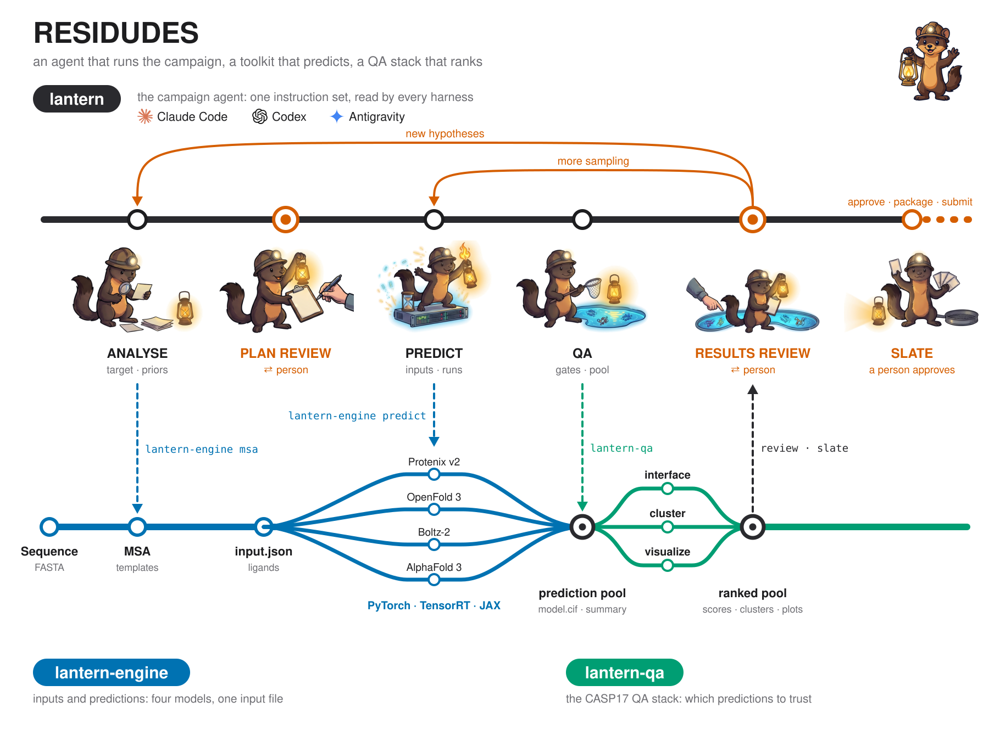
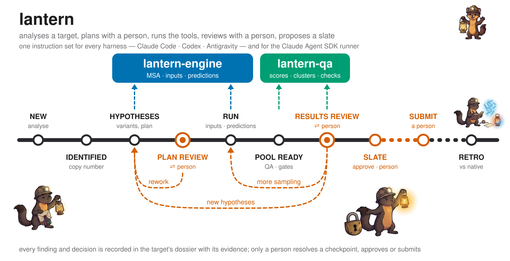
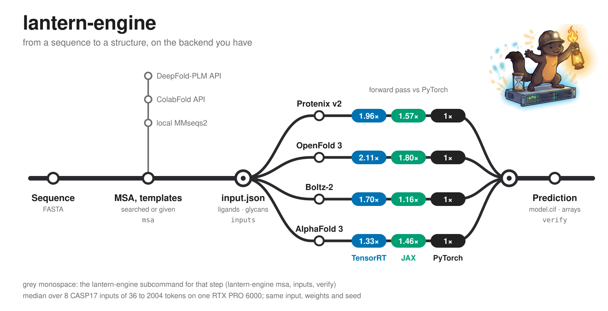
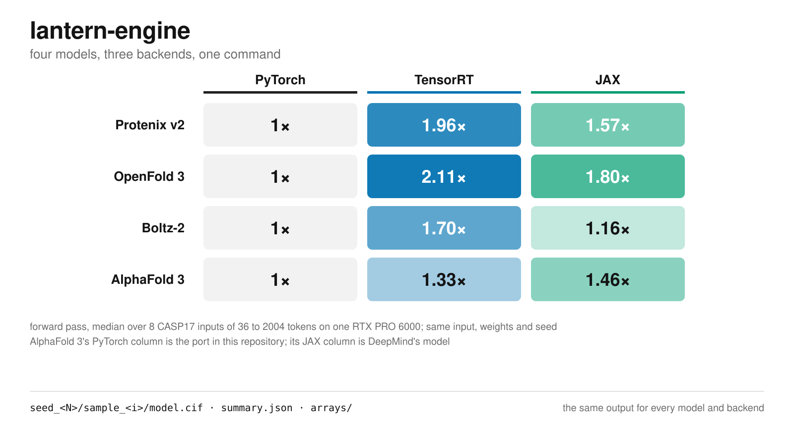
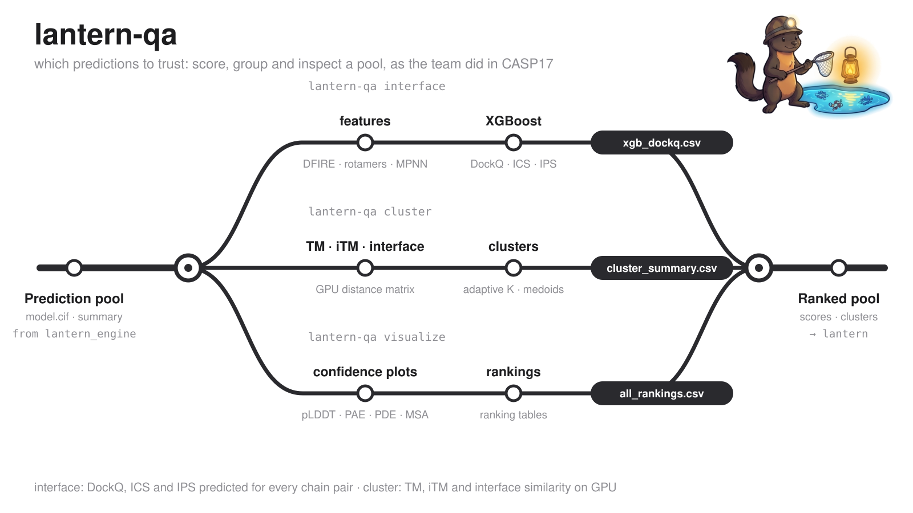
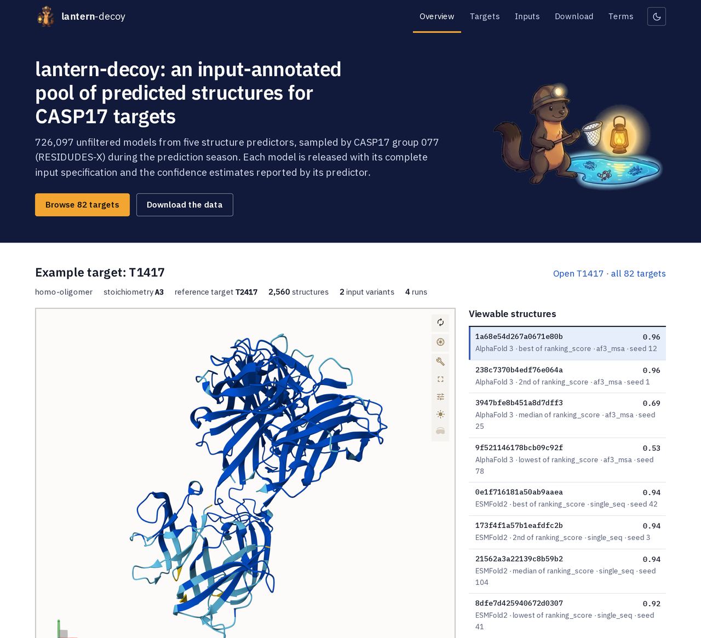

# RESIDUDES


Structure prediction tools from the DeepFold team's CASP17 entry. There are three of them, and they work together:

- [`lantern/`](lantern/) is the campaign agent. It takes a target from its sequence to a slate of five models, deciding
  in between with Claude, and stops wherever a person has to approve.
- [`lantern-engine/`](lantern-engine/) makes the predictions. It builds the input and runs Protenix v2, OpenFold 3,
  Boltz-2 and AlphaFold 3 on PyTorch, TensorRT or JAX.
- [`lantern-qa/`](lantern-qa/) assesses the pool: it scores, clusters and plots every prediction to show which ones to
  trust.

And the pool itself is public: **[lantern-decoy](https://lantern-decoy.deepfold.org)** — 726,097 unfiltered
CASP17 predictions with the input that produced each one ([what it is and how to get it](docs/lantern-decoy.md)).



**Figure 1. The three tools on one target.** lantern's stations run along the top, the two in orange being the
points where a person decides; lantern-engine's lane turns a sequence into a pool of predictions and
lantern-qa's turns that pool into a ranked one. Dashed arrows mark which station drives which tool. After the
slate, everything is a person's move.

## The campaign agent: lantern

[`lantern/`](lantern/) drives a target from its sequence to a slate of five models.
- **It analyses the target first:** identity, literature, public structures, MSA depth, sites, chemistry the FASTA
  leaves out, stoichiometry evidence. Every decision cites the priors it rests on (`lantern report`).
- **It builds better inputs when the defaults fall short:** a family crawl for an empty MSA (T1331), MODELLER
  assemblies as AF3 multimer templates (T2461o, H2422), a phosphosite the description implies (H2388).
- **It selects by what it knows, then by confidence:** sites and reference structures become structural gates
  (`lantern gate`), and confidence only orders the models that pass. The measured effect, its intervals and the
  targets where it did worse are [case by case](lantern/docs/casp17_cases.md).
- **It works it out with a person at two checkpoints:** the prediction plan after the analysis, and the first results
  before the slate. Any round of re-sampling or new hypotheses is decided there.
- **It runs the tools:** lantern-engine for inputs and predictions, lantern-qa for the pool. The structures come
  from AlphaFold 3, Protenix v2, OpenFold 3, Boltz-2 and ESMFold2, and the scores from lantern-qa; what the agent
  decides is which of them to run, on what input, and which of their models to keep.
- **One instruction file for every harness:** Claude Code, Codex and Antigravity read the same `AGENTS.md` and
  skill set, and so does the Claude Agent SDK runner (`lantern agent step`, `lantern daemon`). It has been run in
  Claude Code and through the SDK; for the other two, only the layout is tested, against their documented rules.
- **Guardrails and budgets bound every step.** Only a person resolves a checkpoint, approves a slate or submits it.

```sh
cd RESIDUDES/lantern
uv sync && bin/lantern setup               # resources, databases, config, skills; with you
bin/lantern target add T1234 --fasta T1234.fasta --stoich A3
bin/lantern agent step T1234               # one step; `bin/lantern target show T1234` for the dossier
bin/lantern daemon --target T1234          # or let the scheduler step it until a person is needed
```



**Figure 2. The stage machine.** One dossier per target; each station is one agent step that records what it
found and why. Orange marks the stations only a person can pass, and the three dashed curves are the loops back:
rework the plan, sample more, or form new hypotheses.

[`lantern/examples/H1388`](lantern/examples/H1388/) is one live run on a CASP17 target — human 14-3-3 gamma with a
LARP1 phosphopeptide — from `target add` to the question a person has to answer: four agent steps for $2.15, with
the dossier, the agent's write-up and figures, the open plan checkpoint, and the transcript of every step.

## Predictions: lantern-engine

[`lantern-engine/`](lantern-engine/) is one toolkit that runs Protenix v2, OpenFold 3, Boltz-2 and AlphaFold 3 from one
input file, on PyTorch or on its TensorRT and JAX backends. It was called foldmux until November 2026.
- It builds that input from a sequence: MSA search through the DeepFold-PLM and ColabFold APIs or a local MMseqs2,
  templates, ligands, glycans, constraints.
- Its TensorRT engines finish the forward pass 1.3 to 2.1 times faster than each model's PyTorch path, with the same
  weights and the same structures, up to 2004 tokens on one GPU.



```sh
git clone https://github.com/DeepFoldProtein/RESIDUDES.git
cd RESIDUDES/lantern-engine
export PATH="$PWD/bin:$PATH"                            # or: pip install -e .
lantern-engine setup site --checkpoints <weights dir> --engines <engines dir>
lantern-engine setup all                                   # runtime venv, model weights, doctor
lantern-engine prepare --fasta target.fasta                # MSA search, then input.json
lantern-engine predict --model pt2 --input engine_out/target_inputs/input.json
```



Start with [`lantern-engine/README.md`](lantern-engine/README.md). The speed numbers are
in [`lantern-engine/docs/benchmark.md`](lantern-engine/docs/benchmark.md), the input
toolbox in [`lantern-engine/docs/inputs.md`](lantern-engine/docs/inputs.md).

## Assessing the pool: lantern-qa

[`lantern-qa/`](lantern-qa/) is the QA stack the team used in CASP17, packaged with uv. It scores and inspects
what lantern-engine produces:
- interface DockQ, ICS and IPS predicted with XGBoost for every chain pair;
- GPU clustering by TM, iTM and interface similarity;
- pLDDT, PAE, PDE, distogram and MSA plots with ranking tables.



```sh
cd RESIDUDES/lantern-qa
uv sync --extra cu130 && uv run lantern-qa data fetch && uv run lantern-qa doctor
uv run lantern-qa interface run-ppi-v4 --target-dir <target> --sto A3 -o <out>
uv run lantern-qa cluster <target> --sto A3 --method tm
uv run lantern-qa visualize <target>
```

## The data: lantern-decoy

The sampling pool behind all of this is released as it was sampled, not as it was submitted:
**[lantern-decoy.deepfold.org](https://lantern-decoy.deepfold.org)** · `s3.deepfold.org/lantern-decoy`.

[](https://lantern-decoy.deepfold.org)

The site browses the pool straight from object storage — no API: the target list and the input recipes come
from the manifests, the per-target page draws its distributions from a summary JSON and shows structures in
Mol\*, and the full per-structure index is one click away.

| | |
|---|---|
| Structures | **726,097**, unrelaxed and unfiltered — the models we submitted and the ones we rejected |
| Targets | **82** CASP17 targets (47 `H`, 31 `T`, 4 `M`) at the official stoichiometry |
| Predictors | AlphaFold 3, OpenFold 3, Protenix, Boltz-2, ESMFold2 — 860 inference runs |
| Provenance | every structure carries its input specification (MSA source, templates, pairing, stoichiometry, ligands) and the confidence its predictor reported, over **107** named input variants |
| Size | 114.9 GB in 312 zstd shards, public, no credentials |

```sh
curl -O https://s3.deepfold.org/lantern-decoy/index/structures.csv.gz          # what is in it
curl -O https://s3.deepfold.org/lantern-decoy/structures/T1416/af3.tar.zst     # one target, one predictor
```

A set of best models shows what a pipeline chose; a pool shows what it chose *from*, which is what work on
ranking, selection and decoy discrimination needs. **Shards are split by predictor because their terms differ**:
the 194,183 AlphaFold 3 structures are non-commercial and may not be used to train structure-prediction models,
while the other 531,914 are Apache-2.0 or MIT and carry no such restriction.
[`docs/lantern-decoy.md`](docs/lantern-decoy.md) has the layout, the index columns, the record linkage and the
caveats; the [terms page](https://lantern-decoy.deepfold.org/terms) has the licences in full.

## Tests

GitHub Actions ([`.github/workflows/tests.yml`](.github/workflows/tests.yml)) lints and tests lantern and
lantern-engine on every pull request; neither needs a GPU. lantern-qa needs its CUDA stack, so its tests run on the
cluster (`cd lantern-qa && uv run pytest`, through sbatch).

The overview diagram above is drawn by [`docs/figures/make_figures.py`](docs/figures/make_figures.py).

## Why it exists

A CASP season is not limited by how well any one predictor folds a sequence. Over 154 CASP17 targets the team
produced 1,337,148 models, and the gap between the best model in a pool and the model actually submitted was
larger than the gap between predictors: picking by raw confidence gave a mean DockQ of 0.564 over 37 complexes
([what the metrics mean](lantern/docs/metrics.md)),
while the best model available in the same pools averaged 0.751. The work that closes that gap — identifying the
construct, reading what is known about the target, building an input that reflects it, and selecting against that
knowledge rather than against confidence alone — is slow, has to be repeated per target under a deadline, and is
rarely written down in a form that can be checked afterwards.

These three tools do that work and record it. The audience is a prediction team running a campaign with deadlines:
people who need the analysis behind each submitted model to be inspectable, repeatable, and attributable to the
evidence it rested on.

## Relation to other work

AlphaFold 3, Boltz-2, OpenFold 3 and Protenix are the predictors; lantern-engine runs them behind one input format
rather than replacing them. Automated CASP pipelines usually select by the predictors' own confidence
(ranking_score, ipTM, pLDDT); lantern instead applies structural gates derived from what the analysis found about
the target and uses confidence only to order the models that pass, which on CASP17's released natives moved model 1
from a mean DockQ of 0.564 to 0.651 over the same pools (paired difference +0.088 over 37 complexes, Wilcoxon
p = 0.001; against af3's confidence alone, +0.059). Agent frameworks for science generally optimise for
autonomy; lantern is built the other way, stopping at two fixed checkpoints and refusing to approve or submit
anything itself.

## Citation

Cite the CASP17 abstract of group 077 — the same citation as the [lantern-decoy](docs/lantern-decoy.md) pool, so
the code and the data it produced are one reference. [`CITATION.cff`](CITATION.cff) carries the same metadata, so
GitHub's "Cite this repository" gives it directly.

```bibtex
@misc{residudes_casp17,
  title  = {Protein Complex Structure Prediction with RESIDUDES in CASP17},
  author = {Bae, Hanjin and Park, Gunwoong and Jo, Gyeonpil and Kim, Kunwoo and Kim, Minsoo and
            Yoo, Jaemin and Kim, Beomseok and Shin, Jaeoh and Kim, Hosung and Kim, Iljung and
            Noh, Yung-Kyun and Yoo, Jejoong and Joo, Keehyoung},
  year   = {2026},
  note   = {CASP17 abstract}
}
```

If you use structures from the pool, cite the predictor that produced them as well — the per-predictor citations
are in the dataset's `TERMS.md`, and the AlphaFold 3 subset requires the AlphaFold 3 paper.

## Licence

**[MIT](LICENSE)** for this repository's own code and documentation — lantern, lantern-engine, lantern-qa, the
mascot scripts and the docs.

Two things it does **not** cover, and both matter before you reuse anything:

- **Vendored upstream code**, which keeps the licence its authors gave it:
  `lantern-engine/core/models/alphafold3/` (CC BY-NC-SA 4.0 — **non-commercial**),
  `lantern-engine/core/models/protenix/` and `…/openfold-3/` (Apache-2.0), ProteinMPNN and MassiveClustering under
  `lantern-qa/licenses/` (MIT). Model weights and databases are not in this repository and carry their own terms;
  the Dunbrack rotamer libraries need an academic licence and are not included. The three harness marks in the
  overview figures belong to their owners and say which harnesses read the same instructions, nothing more; their
  paths come from [simple-icons](https://simpleicons.org) (CC0-1.0) and Wikimedia Commons (public domain).
- **The [lantern-decoy](docs/lantern-decoy.md) dataset, which is licensed separately from this repository.** The
  MIT licence here says nothing about it. Each structure keeps the terms of the predictor that made it — the
  194,183 AlphaFold 3 structures are non-commercial and **may not be used to train structure-prediction, scoring
  or ranking models**, the other 531,914 are Apache-2.0 or MIT — and the release's own annotations (index,
  metadata, input specifications, manifests) are covered by the `README.md` and `TERMS.md` distributed with the
  data, not by this file.

An archived release with a DOI would still be worth having, so that work building on this can point at something
stable beyond the abstract.

The data behind the reported numbers is listed in
[`lantern/docs/casp17_cases.md`](lantern/docs/casp17_cases.md).
