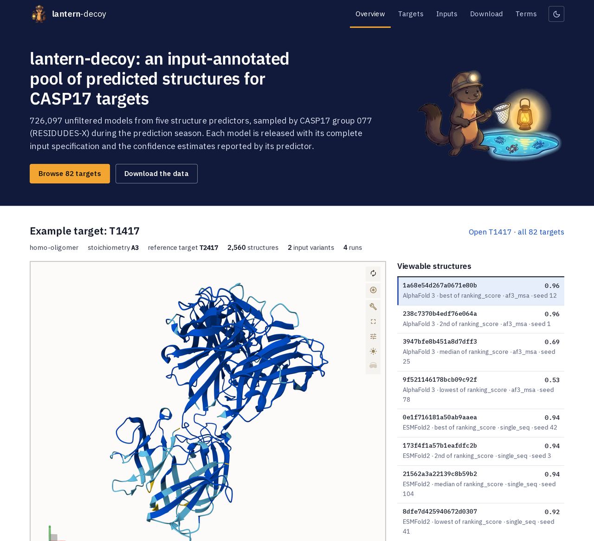
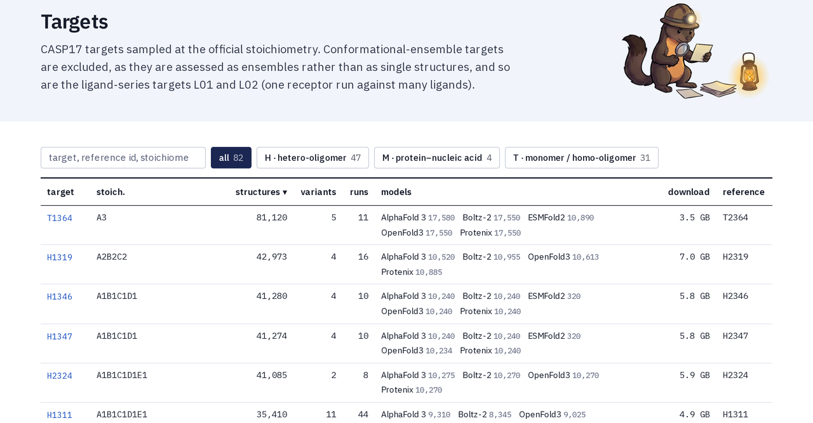
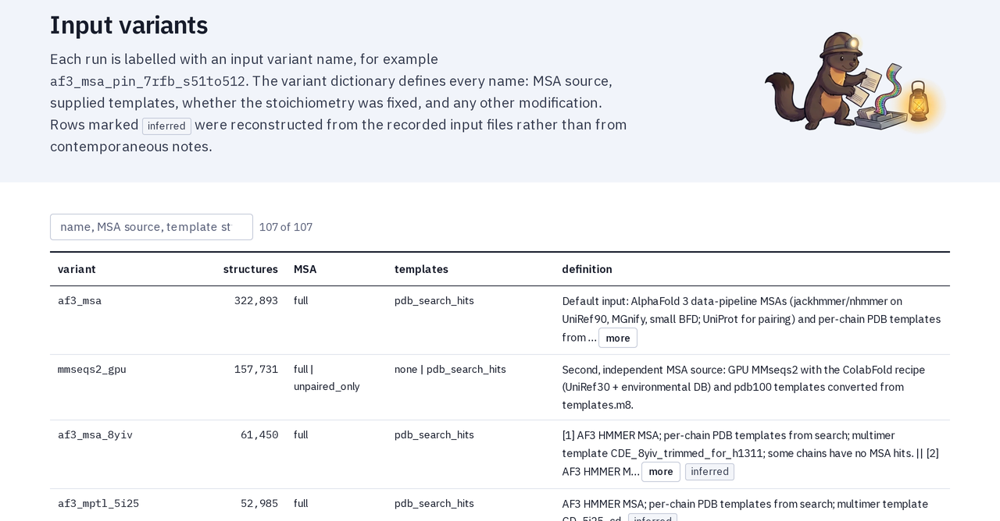

# residudes-decoy: the CASP17 sampling pool, with the input of every model

**[lantern-decoy.deepfold.org](https://lantern-decoy.deepfold.org)** · bucket `https://s3.deepfold.org/lantern-decoy/`

The site and the bucket still carry the earlier name `lantern-decoy`; the dataset, the layout and the
terms below are the same.

726,097 predicted structures for 82 CASP17 targets, from five predictors, released unfiltered: the models
this team submitted and the ones it threw away, each with the input specification that produced it and the
confidence its predictor reported. It is the raw pool of CASP17 group 077 (*RESIDUDES-X*), not a curated set
of good models.

That is the point of it. A set of best models shows what a pipeline chose; a pool shows what it chose
*from*, which is what a study of ranking, selection or decoy discrimination needs. Every claim this
repository makes about selection — the [`+0.088 DockQ over ranking the whole pool by
confidence`](../residudes/docs/casp17_cases.md), residudes-qa's interface scorer, the gates in
[`residudes/docs/gates.md`](../residudes/docs/gates.md) — was measured on pools of this shape, and 82 of those
targets are now public.

[](https://lantern-decoy.deepfold.org)

## What is in it

| | |
|---|---|
| Targets | **82** — 47 `H` assemblies, 31 `T` monomers, 4 `M` protein–nucleic-acid, each at the official stoichiometry |
| Structures | **726,097**, unrelaxed, unfiltered, no clash repair |
| Inference runs | **860** |
| Input variants | **107** named recipes (MSA source, templates, pairing, stoichiometry, ligands, constraints) |
| Predictors | **5** (below) |
| Released answers | 13 targets have an experimental structure in `manifest/natives.csv` |
| Download size | **114.9 GB** in 312 zstd shards (530 GB uncompressed: 457.9 GB mmCIF + 71.8 GB metadata) |

Sampling depth is the team's, not a design: T1364 has 81,120 structures and T1397 has 75, because the
campaign worked some targets harder than others and added variants in reaction to what it saw. The counts
carry that prior and nothing else.

CASP17 ensemble targets (`E*`) are not included — they are assessed as ensembles rather than as single
structures — and neither are the ligand-series targets `L01`/`L02`, which are one receptor against many
ligands.

[](https://lantern-decoy.deepfold.org/targets)

*The targets page: every target with its stoichiometry, how many structures and input variants it has, which
predictors produced them, and what the download costs. T1364 alone is 81,120 structures and 3.5 GB.*

## Predictors, and the terms each shard keeps

Shards are split by predictor, so the terms that apply are identified by the file name and by the
`model_family` column of the index.

| shard | predictor | structures | share | terms |
|---|---|---|---|---|
| `af3.tar.zst` | AlphaFold 3 (Google DeepMind) | 194,183 | 26.7 % | **AF3 Output Terms — non-commercial, not for training** |
| `of3.tar.zst` | OpenFold3 (OpenFold Consortium) | 174,811 | 24.1 % | Apache-2.0 |
| `pt2.tar.zst` | Protenix (ByteDance) | 163,968 | 22.6 % | Apache-2.0 |
| `bt2.tar.zst` | Boltz-2 | 156,160 | 21.5 % | MIT |
| `ef2.tar.zst` | ESMFold2 (Biohub, ESMC-6B backbone) | 36,975 | 5.1 % | MIT · built with ESM |

**The AlphaFold 3 subset cannot be used to train a scoring or ranking model** — the Output Terms forbid
using the output to train or create machine-learning models for biomolecular structure prediction,
including by distillation, and restrict use to non-commercial research. The other four shards, **531,914
structures over the same 82 targets with the same index and metadata**, carry no such restriction, which is
why the split is by predictor and not by target. The full text ships with the data
(`licenses/LEGALLY_BINDING_TERMS_OF_USE.txt`) and the site's
[terms page](https://lantern-decoy.deepfold.org/terms) summarises it.

## Getting it

No credentials, no API: the bucket is public and serves `Access-Control-Allow-Origin: *`.

```sh
# the index first: it is small, and it says what is worth downloading
curl -O https://s3.deepfold.org/lantern-decoy/index/structures.csv.gz

# one target, one predictor
curl -O https://s3.deepfold.org/lantern-decoy/structures/T1416/af3.tar.zst
tar --use-compress-program=unzstd -xf af3.tar.zst

# everything, with any S3 client
aws s3 --no-sign-request --endpoint-url https://s3.deepfold.org \
    sync s3://lantern-decoy/ ./lantern-decoy/

# everything except the non-commercial, no-training AlphaFold 3 shards
aws s3 --no-sign-request --endpoint-url https://s3.deepfold.org \
    sync s3://lantern-decoy/ ./lantern-decoy/ --exclude "structures/*/af3.tar.zst"
```

`SHA256SUMS` carries a checksum for every object (`sha256sum -c`), and every structure also carries its own
`content_sha256` in the index and in its metadata record, so one mmCIF can be verified without its shard.

## The layout, and how a record joins up

```
README.md  TERMS.md  licenses/  SHA256SUMS
manifest/targets.csv            one row per target: class, stoichiometry, counts, sizes
manifest/variants.csv           the 107 input variants and what each name means
manifest/variant_instances.csv  variant x target instances
manifest/runs.csv               one row per inference run
manifest/viewable.csv           the 1,248 structures the web viewer serves uncompressed
manifest/natives.csv            released experimental structures (PDB id, method, resolution)
index/structures.csv.gz         one row per structure, all 726,097
index/<TARGET>.csv.gz           the same table, per target
structures/<TARGET>/<model>.tar.zst   mmCIF, one shard per predictor
metadata/<TARGET>.jsonl.zst     one JSON record per structure
inputs/<TARGET>.json.zst        input specifications, deduplicated, keyed by sha256
site/<TARGET>.json              the per-target summary the browser reads
view/<TARGET>/<id>.cif          single structures, uncompressed, for the viewer
```

`structure_id` is the one key: the file name inside the shard, the first column of the index, and the
`structure_id` of the metadata record. Inputs are deduplicated and referenced by hash:

```sh
zstdcat metadata/T1416.jsonl.zst | jq -r '[.structure_id, .input.sha256] | @tsv'
zstdcat inputs/T1416.json.zst   | jq '."<that sha256>".specification'
```

Index columns: `structure_id`, `target_id`, `truth_target`, `truth_stoichiometry`, `model_family`,
`input_variant`, `run_id`, `seed`, `sample_index`, `n_tokens`, `n_atoms`, `plddt`, `ptm`, `iptm`,
`ranking_score`, `gpde`, `has_clash`, `fraction_disordered`, `cif_bytes`, `content_sha256`,
`source_relative_path`.

[](https://lantern-decoy.deepfold.org/variants)

*The variant dictionary: what each input name means, where that meaning came from, and how much of the pool it
covers. The rows without a written meaning are the ones described below.*

## What it does not claim

- **The confidences are not comparable across predictors**, and inside one predictor a templated run is not
  comparable with a template-free one. They are what each predictor reported for that sample, nothing more.
  (This repository's own measurement of that is in [`residudes/docs/metrics.md`](../residudes/docs/metrics.md).)
- **The sampling is not an experimental design.** Depth per target and the choice of variants both follow
  what the team was worried about at the time.
- **The models are as predicted**: no relaxation, no filtering, no clash repair, and the pool deliberately
  keeps bad models — a decoy set with the decoys removed is not a decoy set.
- **A third of the variant names were never documented.** Of the 107 variants, 47 carry a written meaning
  with a pointer to where it was written down, 13 were reconstructed from the recorded input files and are
  marked `inferred`, and 47 — covering 227,841 structures — have only an `auto_description` generated from
  the input JSON itself. The input specification of those runs is complete and in the data; what is missing
  is a sentence from the time saying why. `manifest/variants.csv` marks which is which rather than
  resolving it silently. The habit that fixes this for later campaigns is in
  [`residudes/AGENTS.md`](../residudes/AGENTS.md): record findings as fields, not as sentences.
- Nothing here was experimentally validated. These are blind predictions of varying quality.

## What it has to do with this repository

- [`residudes`](../residudes/) reads a pool in exactly this shape (`residudes pool`, then gates, QA and a slate),
  and its selection rules were set on pools from this campaign.
- [`residudes-qa`](../residudes-qa/) scores interfaces and clusters pools; its interface model was fitted and
  tested on pools of these runs.
- [`residudes-engine`](../residudes-engine/) is what produced the structures — four of the five predictors run
  from one input file.
- The per-target cases behind the selection claims are in
  [`residudes/docs/casp17_cases.md`](../residudes/docs/casp17_cases.md).

The browser at [lantern-decoy.deepfold.org](https://lantern-decoy.deepfold.org) is a separate repository
([DeepFoldProtein/lantern-decoy-web](https://github.com/DeepFoldProtein/lantern-decoy-web)): a static front
end with no API that fetches the manifests, the per-target summaries and the mmCIF files straight from the
bucket.

## Citation

Please cite the CASP17 abstract of group 077 and the predictor whose structures you use (per-predictor
citations are in `TERMS.md`; the AlphaFold 3 subset requires the AlphaFold 3 paper). Target sequences and
the experimental structures are from the [Protein Structure Prediction
Center](https://predictioncenter.org/casp17/) and carry CASP's own conditions.

```bibtex
@misc{residudes_casp17,
  title  = {Protein Complex Structure Prediction with RESIDUDES in CASP17},
  author = {Bae, Hanjin and Park, Gunwoong and Jo, Gyeonpil and Kim, Kunwoo and Kim, Minsoo and
            Yoo, Jaemin and Kim, Beomseok and Shin, Jaeoh and Kim, Hosung and Kim, Iljung and
            Noh, Yung-Kyun and Yoo, Jejoong and Joo, Keehyoung},
  year   = {2026},
  note   = {CASP17 abstract}
}
```

## Licence, separately from this repository

This repository is [MIT](../LICENSE). **That licence does not cover this dataset**, and nothing here grants
rights over it.

- **The structures** keep the terms of the predictor that produced them, as the table above says: the AlphaFold 3
  shard is non-commercial and may not be used to train structure-prediction, scoring or ranking models; the other
  four are Apache-2.0 or MIT.
- **Our own work in the release** — the index, the per-structure metadata, the input specifications, the variant
  dictionary and the manifests — is covered by the `README.md` and `TERMS.md` distributed with the data, which is
  where that licence is stated.
- **The target sequences and the experimental structures** are the Protein Structure Prediction Center's and carry
  CASP's conditions.
