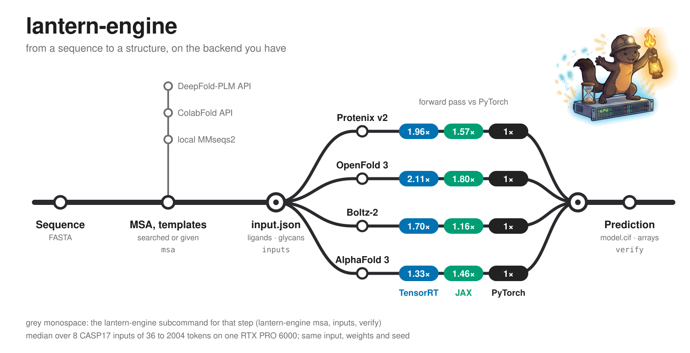
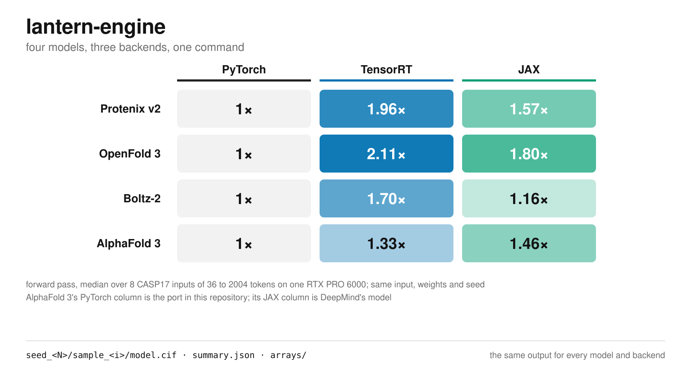
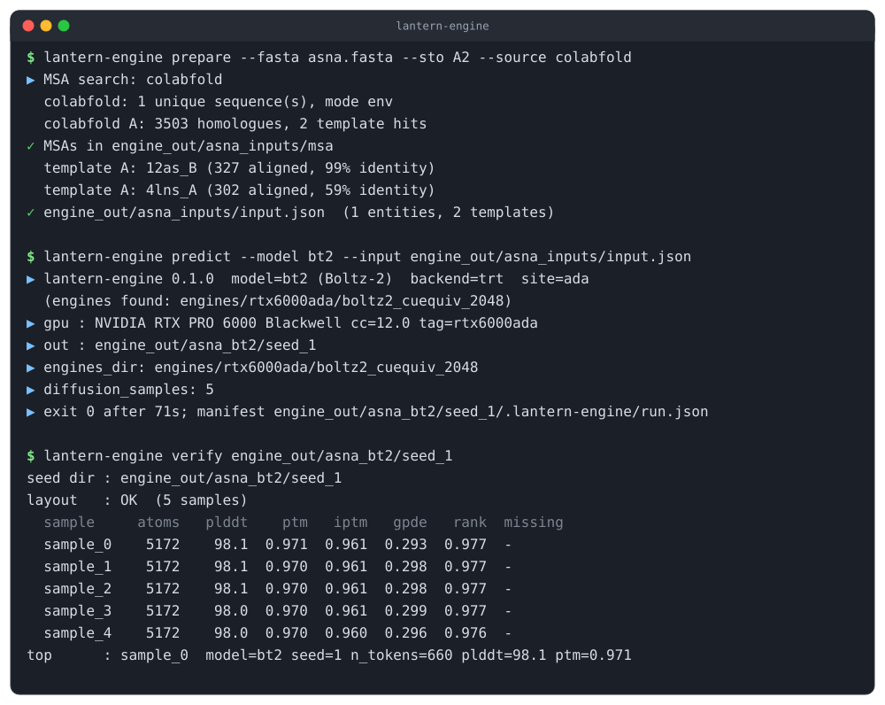

# lantern-engine

lantern-engine runs Protenix v2, OpenFold 3, Boltz-2 and AlphaFold 3 from one input
file and writes the same output layout for each of them. It also builds that input:
MSA search through the DeepFold-PLM and ColabFold APIs or a local MMseqs2,
templates, ligands, glycans and constraints. Each model runs on plain PyTorch,
or faster on the TensorRT and JAX backends included here, with the published
weights and the same results. AlphaFold 3 is DeepMind's JAX model plus a
PyTorch port and TensorRT engines built from it ([`docs/alphafold3.md`](docs/alphafold3.md)).

It is the prediction engine of [lantern](../lantern/), the campaign agent, next to
[lantern-qa](../lantern-qa/). It used to be called foldmux. Outputs written under that name
(`.foldmux/run.json`) are still read, and `FOLDMUX_*` environment variables are still honoured.

The repository is self-contained. Model code, backends, the CLI and the
recipes that build the runtime are all in this tree; nothing is fetched at
run time except model weights, which `lantern-engine setup checkpoints` downloads
from each publisher (AlphaFold 3's are licensed per user by Google DeepMind
and are placed by hand).



**Figure 1. One input file, four models, three backends.** A sequence becomes MSAs and templates, then one
`input.json` that every model reads; each model runs on PyTorch, TensorRT or JAX and writes the same output
layout. The ratios on the tracks are forward-pass speed-ups over that model's own PyTorch path (Figure 2).

## Speed



**Figure 2. Forward-pass speed-up over PyTorch.** Same input, weights and
seed; one run per model, backend and input, so run-to-run variation is not
measured ([benchmark.md](docs/benchmark.md)). Median over eight CASP17 inputs
of 36 to 2004 tokens on one RTX PRO 6000. The gain grows with input size (up to 2.7× at 2000 tokens),
every backend runs 2004-token inputs on one card, and the backends predict
the same structures. Per-input numbers, the size curves and the comparison
with published work: [`docs/benchmark.md`](docs/benchmark.md).

## Setup

Linux x86_64, an NVIDIA GPU of the Ada, Hopper or Blackwell generation with
a driver for CUDA 12.8 or newer, Python 3.11 or newer on `PATH`, and
[uv](https://docs.astral.sh/uv/). Disk: 13 GB for the runtime, 6.4 GB for the
weights, 2 to 8 GB per GPU class for optional TensorRT engines.

```sh
git clone https://github.com/DeepFoldProtein/RESIDUDES.git
cd RESIDUDES/lantern-engine
export PATH="$PWD/bin:$PATH"     # or: pip install -e .

lantern-engine setup site --checkpoints /data/weights --engines /data/engines   # where weights and TRT engines go
lantern-engine setup venv          # the runtime, from the lockfile; add --slurm to build on a compute node
lantern-engine setup checkpoints   # model weights from each publisher, sizes and checksums verified
lantern-engine doctor              # paths, GPU, libstdc++, venv imports, TensorRT plugin
```

`setup all` runs the last three steps in one go. `bin/lantern-engine` is a
launcher without dependencies: it runs the CLI with any Python 3.11 and
starts the model from the runtime venv it built. Put `bin` on your `PATH`,
or run `pip install -e .` once for a `lantern-engine` console script. On a Slurm
cluster add `--scheduler slurm --partition <name>` to `setup site`.

## Predict

```sh
lantern-engine predict --model pt2 --input input.json                 # → engine_out/<name>_pt2/
lantern-engine predict --model bt2 --input input.json --backend jax --seed 3 --out runs/bt2/seed_3
lantern-engine submit  --model of3 --input input.json --seeds 1-5     # Slurm: one job per seed
lantern-engine verify  engine_out/<name>_pt2 [--ref other/seed_1]    # layout check and confidence table
```



The input is an AlphaFold 3-style `input.json` with MSAs and templates
attached ([`docs/input_schema.md`](docs/input_schema.md)). Model-native
inputs (Protenix JSON, OpenFold 3 query JSON, Boltz YAML) are accepted as
they are.

`--backend auto`, the default, uses TensorRT when engines for this GPU exist
and PyTorch otherwise. `--backend jax` runs the JAX port. Per-model options:
`--num-recycles`, `--diffusion-samples`, `--template-weight`,
`--pairing-mode` (OpenFold 3), `--engines-dir`. Anything after `--` goes to
the model's own command line.

Every run ends up as `seed_<N>/sample_<i>/` with `model.cif`,
`summary.json` (pLDDT, pTM, ipTM, gPDE, per chain) and the PAE, PDE and
contact arrays, plus a `run.json` that records the command, environment,
GPU and commit ([`docs/output_schema.md`](docs/output_schema.md)).

## Build the input

```sh
lantern-engine prepare --fasta target.fasta                                  # MSA from the DeepFold-PLM API, then input.json
lantern-engine prepare --fasta complex.fasta --sto A2B1 --source colabfold   # MMseqs2 through the ColabFold API: MSAs, pairing, PDB templates
lantern-engine inputs  --fasta complex.fasta --sto A1B1 --glycan A29:NAG-NAG-BMA --multimer-template 8yiv:A=A,B=B
```

`prepare` is `msa` followed by `inputs`. The MSA step takes one or more
sources (`plmmsa`, `colabfold`, `mmseqs2`) and merges them. The input step
adds templates from the search hits or from a PDB chain, an earlier
prediction or a multi-chain structure, plus ligands, glycans and contact
constraints, and writes the `input.json` with a `sources.json` next to it
that says where everything came from. The options and what each one did in
CASP17 are in [`docs/inputs.md`](docs/inputs.md).

## TensorRT engines

Engines are built on the machine that will use them, once per GPU class:

```sh
lantern-engine engines list                                   # what exists for this GPU
lantern-engine engines build --model pt2 --max-seqlen 1024    # 15 to 60 minutes on one GPU; --slurm to submit
```

Engines are tuned for the size range they were built for, so a 2048-token
set next to a large one pays off: lantern-engine picks the smallest engine that
covers each input. What the engines buy is in the Speed section above.

## Commands

| command | what it does |
|---|---|
| `setup site` | write `sites/<name>.toml` with this machine's paths |
| `setup venv` | build the runtime venv at `core/.venv` (`--slurm` to build on a compute node) |
| `setup checkpoints` | download model weights, checking size and sha256 |
| `setup all` | venv, checkpoints, doctor |
| `doctor` | check the site, the GPU, libstdc++, the venv imports and the TensorRT plugin |
| `msa` | MSA search: `plmmsa`, `colabfold` or `mmseqs2` |
| `inputs` | assemble `input.json`: stoichiometry, MSAs, templates, ligands, glycans, constraints |
| `prepare` | `msa` then `inputs` |
| `predict` | one prediction on this machine; exit 3 if the model wrote nothing |
| `submit` | the same through Slurm, one job per seed, logs in the seed directory |
| `verify` | check a seed directory against the output layout, compare with a reference |
| `engines list`, `engines build` | TensorRT engines for this GPU |
| `models`, `sites`, `env` | show the registry, the site files, the runtime environment |

Models are `pt2`, `of3`, `bt2`, `af3`; backends `auto`, `trt`, `jax`, `torch`;
GPU classes `rtx4090`, `rtx6000ada`, `b200`, `h100`, `a100`, detected from
the compute capability.

## Documentation

| | |
|---|---|
| [`docs/inputs.md`](docs/inputs.md) | from a sequence to an input: MSA sources, templates, ligands, glycans, constraints |
| [`docs/alphafold3.md`](docs/alphafold3.md) | AlphaFold 3: environment, weights, the PyTorch port, the TensorRT engines |
| [`docs/input_schema.md`](docs/input_schema.md), [`docs/output_schema.md`](docs/output_schema.md) | what goes in, what comes out |
| [`docs/architecture.md`](docs/architecture.md) | what a `predict` call does and where to extend |
| [`docs/sites.md`](docs/sites.md) | describing a machine: every key of a site file, the engines layout |
| [`docs/benchmark.md`](docs/benchmark.md), [`docs/benchmark_details.md`](docs/benchmark_details.md) | speed by backend and size, structural agreement, every run |
| [`docs/verification.md`](docs/verification.md) | what has been checked against reference predictions |
| [`docs/troubleshooting.md`](docs/troubleshooting.md) | when something fails |
| [`docs/development.md`](docs/development.md) | rules, tests, adding a model or a site |

## Layout

```
lantern-engine/
├── bin/lantern-engine          launcher, no installation
├── sites/               machine descriptions (TOML); local.example.toml is the template
├── scripts/             mmseqs2_search.sh; slurm/ job wrappers
├── src/lantern_engine/         the CLI: registry, config, runners, msa, inputs, setup, verify
├── tests/               unit tests, no GPU needed (python3 -m unittest discover -s tests)
├── docs/                this documentation, figures, benchmark results
└── core/                the runtime: model code, TensorRT and JAX backends, adapters, lockfile
```

Outputs go to `./engine_out/` by default. `runs/` is scratch space that git
ignores.

## Limits

- ESMFold2 is not run by lantern-engine.
- `submit` targets Slurm. Other schedulers run `predict` directly.
- Pre-built engines are not distributed; `engines build` is the supported path.
- The optional JAX environment with fused kernels (`venv_jax`) is built separately with `core/scripts/setup_jax_venv.sh`.

## Licence

lantern-engine's own code is [MIT](../LICENSE). The model code vendored under `core/models/` keeps its authors'
terms: AlphaFold 3 is CC BY-NC-SA 4.0 (**non-commercial**), Protenix and OpenFold 3 are Apache-2.0. Weights and
databases are not distributed here and carry their own.

## Citation

Cite the CASP17 abstract of group 077 — the BibTeX entry is in the [repository README](../README.md#citation) and in [`CITATION.cff`](../CITATION.cff).
