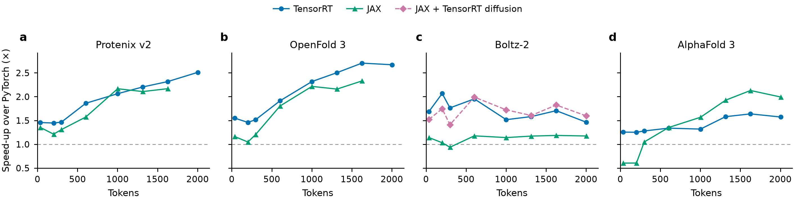
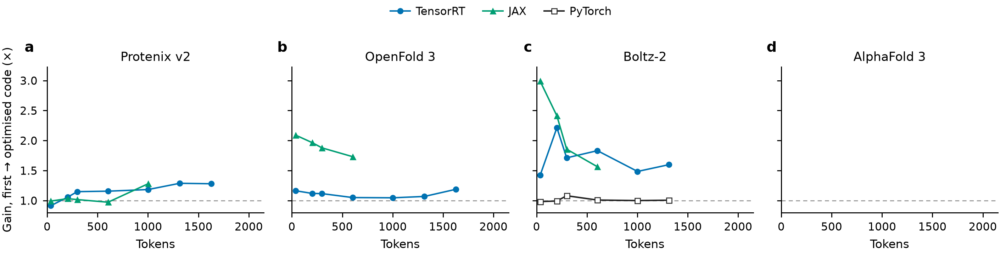
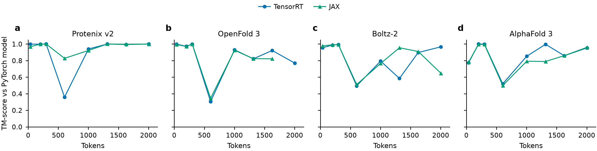

# Benchmark

Protenix v2, OpenFold 3, Boltz-2 and AlphaFold 3 run to 2004 tokens on a single RTX PRO 6000 Blackwell. The TensorRT backend finishes the forward pass 1.3 to 2.1× faster than each model's own PyTorch path (median over 8 inputs from 36 to 2004 tokens; up to 2.7× at 2000 tokens). The JAX backend, a Haiku port of the pairformer and diffusion modules that reuses the same weights (for AlphaFold 3, DeepMind's own JAX model), is 1.2 to 1.8× faster than PyTorch. Same inputs, weights, seed and settings on every backend; 182 completed runs.

| | Protenix v2 | OpenFold 3 | Boltz-2 | AlphaFold 3 |
|---|---:|---:|---:|---:|
| TensorRT vs PyTorch, median (max) | 1.96× (2.51×) | 2.11× (2.70×) | 1.70× (2.07×) | 1.33× (1.64×) |
| JAX vs PyTorch, median (max) | 1.57× (2.17×) | 1.80× (2.33×) | 1.16× (1.18×) | 1.46× (2.13×) |
| JAX trunk + TensorRT diffusion, median (max) | – | – | 1.66× (1.99×) | – |
| Largest input completed, PyTorch / TensorRT / JAX | 2004 / 2004 / 1627 | 2004 / 2004 / 1627 | 2004 / 2004 / 2004 | 2004 / 2004 / 2004 |
| Gain of this release over the first measurement, TensorRT / JAX | 1.16× / 1.02× | 1.12× / 1.92× | 1.65× / 2.13× | – / – |
| Top model vs PyTorch top model, median TM-score, TensorRT / JAX | 1.00 / 1.00 | 0.93 / 0.92 | 0.93 / 0.93 | 0.91 / 0.83 |

Settings are the CASP17 production defaults (1 seed, 5 diffusion samples, 10 recycles); inputs are CASP17 targets with MSAs and templates. Forward pass = the model writer's `timing.json`; JAX numbers are with a hot compile cache (the first run at a new shape adds compilation, see the details).

**How to read these numbers.** The measurements are in [`benchmark/results.csv`](benchmark/results.csv): 210 attempted runs collected 2026-11-21, of which 182 completed and 28 ran out of memory, which is the ceiling the table's last rows report on one NVIDIA RTX PRO 6000 Blackwell Max-Q. Each row is a single run of one model, backend, input and engine build: **no configuration was repeated, so run-to-run variation is not measured here**, and differences of a few percent should not be read as real. The quoted ratios are medians over the eight inputs, which is why they are given with the maximum rather than an interval. The two series in the table, `v1` and `v2`, are the first measurement and this release; comparing them is what Figure 2 shows.



**Figure 1. Forward-pass speed-up over the PyTorch backend.** Same input, weights and seed; dashed line = parity. TensorRT grows with input size as the O(N²) pairformer takes over; Boltz-2's TensorRT gain is flatter because its PyTorch path already uses fused cuEquivariance triangle kernels. The dashed diamonds are the Boltz-2 hybrid that keeps the JAX pairformers and runs the diffusion token transformer on its TensorRT engine. AlphaFold 3's PyTorch baseline is the port in this repository and its JAX column is DeepMind's own implementation, which the TensorRT path approaches from 1000 tokens up.



**Figure 2. What this release changed.** Forward time of the first measurement divided by the current one, same input and backend. The JAX gains come from keeping activations in bf16 so the triangle attention runs on cuDNN flash attention instead of XLA's materialised N³ softmax, and from compiling the pairformer as one scanned body; Boltz-2's TensorRT gain is the diffusion token transformer engine, which the first release left in PyTorch; the TensorRT gains at 1000+ tokens come from choosing the best-fitting engine of a size ladder.



**Figure 3. The backends predict the same structures.** TM-score of each backend's top-ranked model against the PyTorch top model, complex-level (chains concatenated). Low points are the same targets on every backend: T1430 (36 tokens), T1358 (604 tokens), H1424 (1002 tokens), T1404 (1315 tokens), H1335 (1627 tokens), E2375 (2004 tokens). These are a low-confidence target (top pLDDT about 50) and multi-chain assemblies whose chain placement is ambiguous, where any change in numerics, even a re-run of PyTorch itself, moves the top-ranked sample. Per-chain folds and pLDDT/pTM agree throughout. AlphaFold 3 draws a different random 1024-row MSA subset at every recycle, so two of its runs differ more than two runs of the other models even on one backend; with the subset fixed, the port and DeepMind's model agree to bf16 rounding (alphafold3.md).

## Size ceiling

| model | PyTorch | TensorRT | JAX |
|---|---:|---:|---:|
| Protenix v2 | 2004 | 2004 | 1627 |
| OpenFold 3 | 2004 | 2004 | 1627 |
| Boltz-2 | 2004 | 2004 | 2004 |
| AlphaFold 3 | 2004 | 2004 | 2004 |

Tokens of the largest input that completed on the 96 GB card with the shipped defaults. JAX reaches Protenix v2 2004 tokens when the XLA memory cap is raised from 0.65 to 0.85 of the card (`XLA_PYTHON_CLIENT_MEM_FRACTION=0.85`).

## Compared with the literature

OpenFold-TRT (Didi et al., bioRxiv 10.64898/2026.03.11.711233, March 2026) compiles OpenFold, an AlphaFold 2-class model, with TensorRT and reports a 2.51× forward-pass speed-up over PyTorch on the same GPU class, with 949 residues as the largest input that fits (an 80 GB H100 ran out of memory there), and TM-scores against CASP14 targets as the accuracy check.

lantern-engine reaches 1.3 to 2.1× median and up to 2.7× on AlphaFold 3-class models, whose pairformer and diffusion stacks are heavier than the Evoformer, and runs 2004 tokens for every model on TensorRT and PyTorch, twice the preprint's ceiling. The JAX path adds a second, independently implemented fast backend with the same weights; where TensorRT engines are missing (a new GPU, no build yet) it still beats PyTorch. pLDDT, pTM and TM-score between backends are published for every run (`benchmark/agreement.csv`), including the inputs where the top-ranked sample moves, and the matrix, figures and tables are regenerated by three commands from this repository.

## Reproduce

```sh
bench/run.py --suffix v2                      # submit the matrix (Slurm, one job per model × backend × input)
bench/run.py --backends jax --suffix v2-warm  # second JAX pass once the compile cache is hot
bench/collect.py                             # rebuild this page, the details page and the figures
```

Every run, variant and reading note: [`benchmark_details.md`](benchmark_details.md). What changed between the two series, and why: the list at the end of that page.
