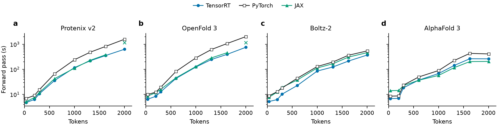
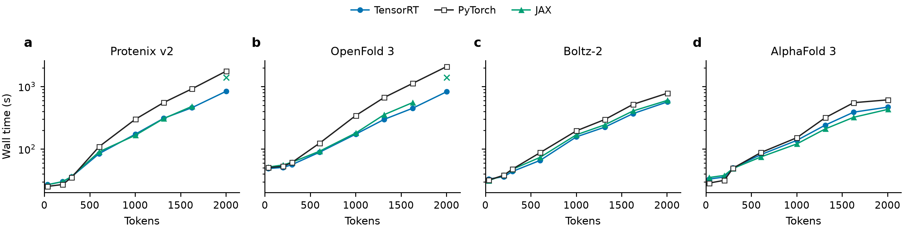
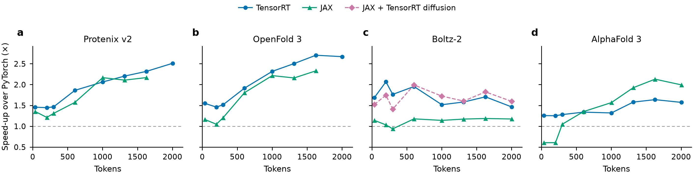
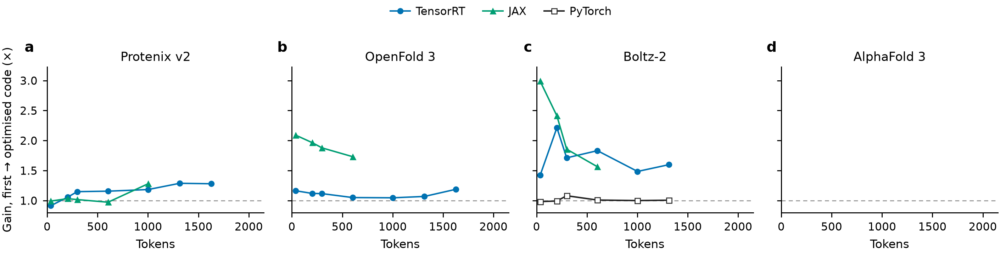
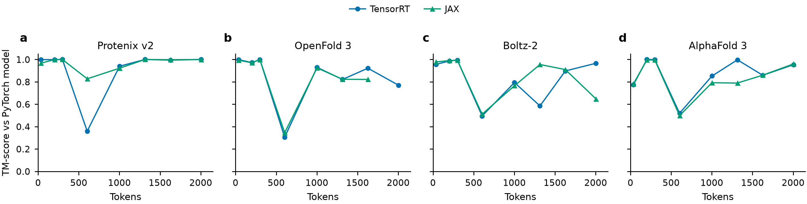
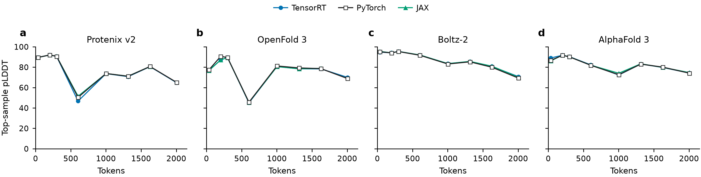

# Benchmark details

Measured with `bench/run.py` on **NVIDIA RTX PRO 6000 Blackwell Max-Q Workstation Edition** (one GPU per job, Slurm, site `ada`), 2026-11-06. Each run is one seed, 5 diffusion samples, 10 recycles, the CASP17 production settings, on prepared AF3-dialect inputs (MSAs + templates). 182/210 runs completed; pending or failed runs are listed, not dropped. The summary is [`benchmark.md`](benchmark.md).

Backends: **trt** = TensorRT engines (pairformer, confidence pairformer and, for Boltz-2 in v2, the diffusion token transformer, BF16; `cuequiv` RTX PRO 6000 engines; for AlphaFold 3 the trunk pairformer and the diffusion token transformer, `vanilla` engines, with the rest of the network in the PyTorch port), **torch** = the model's own PyTorch (for AlphaFold 3, the port in `core/alphafold3/af3torch`), **jax** = the JAX hot-swap of the same modules (for AlphaFold 3, DeepMind's published JAX model). Forward time is the writer's `timing.json` (`runtime_s`, model forward only). Wall time is the whole process as lantern-engine measured it, so it includes model and engine loading and, for jax, XLA compilation (cached per shape after the first run).

Two series are listed: **v1** is the first full matrix (2026-11-02, the code as first published) and **v2** the same matrix after the optimisations listed under *What changed* below: Boltz-2's diffusion token transformer on its TensorRT engine, per-template chunking on every backend, JAX activations kept in bf16 (cuDNN flash attention instead of XLA's materialised softmax), layer-stack scan for the JAX pairformers, equal recycle counts, and best-fit engine selection from an engine ladder (a 2048-token engine beside the 3072–5120 ones). Figures show the current state (v2 where it exists).

**Figure D1.** Forward-pass time by backend (log scale). × = run out of memory (colour = backend).

**Figure D2.** End-to-end wall time: model load, engine load or XLA compile, featurisation, inference, writing.

**Figure D3.** Forward-pass speed-up over the PyTorch backend; dashed diamonds = Boltz-2 JAX trunk + TensorRT diffusion.

**Figure D4.** Forward time of the first matrix (v1) divided by the optimised code (v2), same input and backend.

**Figure D5.** TM-score of each backend's top-ranked model against the PyTorch top model (complex level).

**Figure D6.** Top-sample pLDDT by backend: same input, weights and seed.

## Summary tables

| model | median trt speed-up | median jax speed-up (warm where available) | inputs compared |
|---|---:|---:|---:|
| Protenix v2 | 1.96× | 1.57× | 8 |
| OpenFold 3 | 2.11× | 1.80× | 8 |
| Boltz-2 | 1.70× | 1.16× | 8 |
| AlphaFold 3 | 1.33× | 1.46× | 8 |

Forward-time gain of the optimised code (v2) over the first matrix (v1), same input and backend:

| model | backend | median v1 → v2 | range | inputs |
|---|---|---:|---|---:|
| Protenix v2 | trt | 1.16× | 0.91–1.29× | 7 |
| Protenix v2 | jax | 1.02× | 0.97–1.28× | 5 |
| OpenFold 3 | trt | 1.12× | 1.05–1.19× | 7 |
| OpenFold 3 | jax | 1.92× | 1.73–2.09× | 4 |
| Boltz-2 | trt | 1.65× | 1.42–2.21× | 6 |
| Boltz-2 | torch | 1.00× | 0.98–1.08× | 6 |
| Boltz-2 | jax | 2.13× | 1.56–2.99× | 4 |

Largest input completed and first failure, per model × backend (current code and site defaults; `mem85` = JAX with `mem_fraction = 0.85` instead of the default 0.65):

| model | backend | largest completed | first failure | pending |
|---|---|---:|---|---:|
| Protenix v2 | trt | 2004 | - |  |
| Protenix v2 | torch | 2004 | - |  |
| Protenix v2 | jax | 1627 | 2004 (E2375, OOM) |  |
| Protenix v2 | jax (mem85, v2) | 2004 | - |  |
| OpenFold 3 | trt | 2004 | - |  |
| OpenFold 3 | torch | 2004 | - |  |
| OpenFold 3 | jax | 1627 | 2004 (E2375, OOM) |  |
| OpenFold 3 | jax (mem85, v2) | - | 2004 (E2375, OOM) |  |
| Boltz-2 | trt | 2004 | - |  |
| Boltz-2 | torch | 2004 | - |  |
| Boltz-2 | jax | 2004 | - |  |
| Boltz-2 | jax (mem85, v1) | 1002 | 1315 (T1404, OOM) |  |
| AlphaFold 3 | trt | 2004 | - |  |
| AlphaFold 3 | torch | 2004 | - |  |
| AlphaFold 3 | jax | 2004 | - |  |

Boltz-2 hybrid (`LANTERN_ENGINE_JAX_TRT_DIFFUSION=1`: JAX pairformers + TensorRT diffusion token transformer):

| tokens | hybrid s | PyTorch s | TensorRT s | JAX s | speed-up vs PyTorch |
|---:|---:|---:|---:|---:|---:|
| 36 | 5.7 | 8.7 | 5.2 | 7.6 | 1.52× |
| 202 | 7.3 | 12.8 | 6.2 | 12.4 | 1.74× |
| 299 | 12.7 | 18.0 | 10.2 | 19.2 | 1.41× |
| 604 | 22.2 | 44.1 | 22.6 | 37.5 | 1.99× |
| 1002 | 75.0 | 129.1 | 85.2 | 113.3 | 1.72× |
| 1315 | 121.8 | 195.3 | 123.5 | 166.8 | 1.60× |
| 1627 | 199.6 | 364.0 | 213.5 | 307.3 | 1.82× |
| 2004 | 341.0 | 543.6 | 372.0 | 463.4 | 1.59× |
| median | | | | | 1.66× |

## All runs

| target | tokens | model | run | forward s | wall s | top pLDDT | pTM | status |
|---|---:|---|---|---:|---:|---:|---:|---|
| T1430 A1 | 36 | pt2 | trt | 4.3 | 28 | 89.5 | 0.766 | ok |
| T1430 A1 | 36 | pt2 | trt-v2 | 4.7 | 27 | 89.5 | 0.766 | ok |
| T1430 A1 | 36 | pt2 | torch | 6.8 | 25 | 89.5 | 0.766 | ok |
| T1430 A1 | 36 | pt2 | jax | 35.4 | 57 | 89.5 | 0.767 | ok |
| T1430 A1 | 36 | pt2 | jax-warm | 5.0 | 26 | 89.5 | 0.767 | ok |
| T1430 A1 | 36 | pt2 | jax-v2 | 16.9 | 41 | 89.5 | 0.766 | ok |
| T1430 A1 | 36 | pt2 | jax-v2-warm | 5.1 | 27 | 89.5 | 0.767 | ok |
| T1430 A1 | 36 | of3 | trt | 7.4 | 50 | 76.8 | 0.410 | ok |
| T1430 A1 | 36 | of3 | trt-v2 | 6.4 | 49 | 76.8 | 0.409 | ok |
| T1430 A1 | 36 | of3 | torch | 9.9 | 50 | 77.4 | 0.413 | ok |
| T1430 A1 | 36 | of3 | jax | 17.8 | 63 | 77.4 | 0.414 | ok |
| T1430 A1 | 36 | of3 | jax-warm | 17.8 | 60 | 77.4 | 0.414 | ok |
| T1430 A1 | 36 | of3 | jax-v2 | 8.4 | 51 | 76.9 | 0.409 | ok |
| T1430 A1 | 36 | of3 | jax-v2-warm | 8.5 | 52 | 76.7 | 0.409 | ok |
| T1430 A1 | 36 | bt2 | trt | 7.4 | 42 | 95.0 | 0.814 | ok |
| T1430 A1 | 36 | bt2 | trt-v2 | 5.2 | 33 | 94.7 | 0.824 | ok |
| T1430 A1 | 36 | bt2 | torch | 8.6 | 32 | 95.0 | 0.816 | ok |
| T1430 A1 | 36 | bt2 | torch-v2 | 8.7 | 32 | 95.0 | 0.809 | ok |
| T1430 A1 | 36 | bt2 | jax | 23.2 | 48 | 95.0 | 0.822 | ok |
| T1430 A1 | 36 | bt2 | jax-warm | 22.8 | 48 | 95.0 | 0.822 | ok |
| T1430 A1 | 36 | bt2 | jax-v2 | 7.6 | 32 | 95.4 | 0.820 | ok |
| T1430 A1 | 36 | bt2 | jax-v2-warm | 7.6 | 31 | 95.4 | 0.820 | ok |
| T1430 A1 | 36 | bt2 | jax-v2-hybrid | 5.7 | 33 | 95.4 | 0.821 | ok |
| T1430 A1 | 36 | af3 | trt-v2 | 6.7 | 33 | 89.0 | 0.554 | ok |
| T1430 A1 | 36 | af3 | torch-v2 | 8.5 | 29 | 86.7 | 0.545 | ok |
| T1430 A1 | 36 | af3 | jax-v2 | 14.1 | 35 | 86.1 | 0.534 | ok |
| T1430 A1 | 36 | af3 | jax-v2-warm | 14.0 | 35 | 86.1 | 0.534 | ok |
| T1372 A1 | 202 | pt2 | trt | 6.6 | 36 | 92.0 | 0.940 | ok |
| T1372 A1 | 202 | pt2 | trt-v2 | 6.3 | 30 | 91.9 | 0.940 | ok |
| T1372 A1 | 202 | pt2 | torch | 9.1 | 27 | 92.0 | 0.941 | ok |
| T1372 A1 | 202 | pt2 | jax | 47.5 | 70 | 92.0 | 0.941 | ok |
| T1372 A1 | 202 | pt2 | jax-warm | 7.7 | 31 | 92.0 | 0.941 | ok |
| T1372 A1 | 202 | pt2 | jax-v2 | 14.0 | 38 | 92.0 | 0.941 | ok |
| T1372 A1 | 202 | pt2 | jax-v2-warm | 7.5 | 30 | 92.0 | 0.941 | ok |
| T1372 A1 | 202 | of3 | trt | 9.4 | 54 | 87.0 | 0.864 | ok |
| T1372 A1 | 202 | of3 | trt-v2 | 8.4 | 51 | 87.0 | 0.864 | ok |
| T1372 A1 | 202 | of3 | torch | 12.2 | 53 | 90.5 | 0.897 | ok |
| T1372 A1 | 202 | of3 | jax | 92.9 | 139 | 90.7 | 0.899 | ok |
| T1372 A1 | 202 | of3 | jax-warm | 22.9 | 66 | 90.7 | 0.899 | ok |
| T1372 A1 | 202 | of3 | jax-v2 | 40.3 | 84 | 87.1 | 0.864 | ok |
| T1372 A1 | 202 | of3 | jax-v2-warm | 11.7 | 56 | 87.1 | 0.865 | ok |
| T1372 A1 | 202 | bt2 | trt | 13.7 | 44 | 94.0 | 0.930 | ok |
| T1372 A1 | 202 | bt2 | trt-v2 | 6.2 | 36 | 94.1 | 0.932 | ok |
| T1372 A1 | 202 | bt2 | torch | 12.7 | 38 | 94.0 | 0.927 | ok |
| T1372 A1 | 202 | bt2 | torch-v2 | 12.8 | 38 | 94.0 | 0.931 | ok |
| T1372 A1 | 202 | bt2 | jax | 105.7 | 132 | 93.5 | 0.926 | ok |
| T1372 A1 | 202 | bt2 | jax-warm | 29.9 | 57 | 93.5 | 0.926 | ok |
| T1372 A1 | 202 | bt2 | jax-v2 | 56.5 | 82 | 94.0 | 0.932 | ok |
| T1372 A1 | 202 | bt2 | jax-v2-warm | 12.4 | 38 | 94.0 | 0.932 | ok |
| T1372 A1 | 202 | bt2 | jax-v2-hybrid | 7.3 | 37 | 94.1 | 0.931 | ok |
| T1372 A1 | 202 | af3 | trt-v2 | 6.9 | 36 | 91.6 | 0.895 | ok |
| T1372 A1 | 202 | af3 | torch-v2 | 8.6 | 32 | 91.6 | 0.894 | ok |
| T1372 A1 | 202 | af3 | jax-v2 | 14.2 | 38 | 91.8 | 0.897 | ok |
| T1372 A1 | 202 | af3 | jax-v2-warm | 14.3 | 38 | 91.8 | 0.897 | ok |
| T2455 A1 | 299 | pt2 | trt | 12.0 | 38 | 90.6 | 0.941 | ok |
| T2455 A1 | 299 | pt2 | trt-v2 | 10.5 | 36 | 90.6 | 0.941 | ok |
| T2455 A1 | 299 | pt2 | torch | 15.4 | 35 | 90.6 | 0.941 | ok |
| T2455 A1 | 299 | pt2 | jax | 53.8 | 79 | 90.6 | 0.941 | ok |
| T2455 A1 | 299 | pt2 | jax-warm | 11.9 | 36 | 90.6 | 0.941 | ok |
| T2455 A1 | 299 | pt2 | jax-v2 | 17.3 | 42 | 90.6 | 0.941 | ok |
| T2455 A1 | 299 | pt2 | jax-v2-warm | 11.7 | 36 | 90.6 | 0.941 | ok |
| T2455 A1 | 299 | of3 | trt | 14.1 | 59 | 89.5 | 0.920 | ok |
| T2455 A1 | 299 | of3 | trt-v2 | 12.6 | 56 | 89.5 | 0.920 | ok |
| T2455 A1 | 299 | of3 | torch | 19.1 | 61 | 89.5 | 0.920 | ok |
| T2455 A1 | 299 | of3 | jax | 106.1 | 156 | 89.5 | 0.920 | ok |
| T2455 A1 | 299 | of3 | jax-warm | 29.8 | 75 | 89.5 | 0.920 | ok |
| T2455 A1 | 299 | of3 | jax-v2 | 48.4 | 94 | 89.4 | 0.919 | ok |
| T2455 A1 | 299 | of3 | jax-v2-warm | 15.9 | 62 | 89.4 | 0.919 | ok |
| T2455 A1 | 299 | bt2 | trt | 17.4 | 53 | 95.5 | 0.936 | ok |
| T2455 A1 | 299 | bt2 | trt-v2 | 10.2 | 44 | 95.4 | 0.936 | ok |
| T2455 A1 | 299 | bt2 | torch | 19.4 | 49 | 95.3 | 0.938 | ok |
| T2455 A1 | 299 | bt2 | torch-v2 | 18.0 | 48 | 95.3 | 0.937 | ok |
| T2455 A1 | 299 | bt2 | jax | 125.9 | 156 | 95.4 | 0.938 | ok |
| T2455 A1 | 299 | bt2 | jax-warm | 35.6 | 64 | 95.4 | 0.938 | ok |
| T2455 A1 | 299 | bt2 | jax-v2 | 80.8 | 109 | 95.4 | 0.937 | ok |
| T2455 A1 | 299 | bt2 | jax-v2-warm | 19.2 | 48 | 95.4 | 0.937 | ok |
| T2455 A1 | 299 | bt2 | jax-v2-hybrid | 12.7 | 44 | 95.4 | 0.937 | ok |
| T2455 A1 | 299 | af3 | trt-v2 | 18.3 | 50 | 90.3 | 0.914 | ok |
| T2455 A1 | 299 | af3 | torch-v2 | 23.4 | 50 | 90.1 | 0.914 | ok |
| T2455 A1 | 299 | af3 | jax-v2 | 52.5 | 79 | 90.2 | 0.914 | ok |
| T2455 A1 | 299 | af3 | jax-v2-warm | 22.4 | 49 | 90.2 | 0.914 | ok |
| T1358 A4 | 604 | pt2 | trt | 41.2 | 95 | 46.6 | 0.235 | ok |
| T1358 A4 | 604 | pt2 | trt-v2 | 35.7 | 85 | 46.7 | 0.235 | ok |
| T1358 A4 | 604 | pt2 | torch | 66.4 | 110 | 50.4 | 0.249 | ok |
| T1358 A4 | 604 | pt2 | jax | 82.6 | 132 | 51.4 | 0.247 | ok |
| T1358 A4 | 604 | pt2 | jax-warm | 41.1 | 89 | 51.4 | 0.247 | ok |
| T1358 A4 | 604 | pt2 | jax-v2 | 42.2 | 91 | 51.4 | 0.247 | ok |
| T1358 A4 | 604 | of3 | trt | 45.1 | 91 | 45.4 | 0.201 | ok |
| T1358 A4 | 604 | of3 | trt-v2 | 42.9 | 89 | 45.0 | 0.206 | ok |
| T1358 A4 | 604 | of3 | torch | 82.1 | 125 | 45.6 | 0.205 | ok |
| T1358 A4 | 604 | of3 | jax | 152.8 | 199 | 45.9 | 0.196 | ok |
| T1358 A4 | 604 | of3 | jax-warm | 78.8 | 125 | 46.0 | 0.197 | ok |
| T1358 A4 | 604 | of3 | jax-v2 | 45.9 | 96 | 46.1 | 0.197 | ok |
| T1358 A4 | 604 | of3 | jax-v2-warm | 45.5 | 93 | 45.4 | 0.196 | ok |
| T1358 A4 | 604 | bt2 | trt | 41.4 | 88 | 91.7 | 0.650 | ok |
| T1358 A4 | 604 | bt2 | trt-v2 | 22.6 | 66 | 91.8 | 0.668 | ok |
| T1358 A4 | 604 | bt2 | torch | 44.5 | 82 | 92.2 | 0.631 | ok |
| T1358 A4 | 604 | bt2 | torch-v2 | 44.1 | 88 | 91.7 | 0.637 | ok |
| T1358 A4 | 604 | bt2 | jax | 143.5 | 184 | 92.0 | 0.564 | ok |
| T1358 A4 | 604 | bt2 | jax-warm | 58.7 | 96 | 92.0 | 0.564 | ok |
| T1358 A4 | 604 | bt2 | jax-v2 | 36.5 | 74 | 91.9 | 0.670 | ok |
| T1358 A4 | 604 | bt2 | jax-v2-warm | 37.5 | 74 | 91.9 | 0.670 | ok |
| T1358 A4 | 604 | bt2 | jax-v2-hybrid | 22.2 | 61 | 91.9 | 0.698 | ok |
| T1358 A4 | 604 | af3 | trt-v2 | 36.9 | 81 | 82.2 | 0.444 | ok |
| T1358 A4 | 604 | af3 | torch-v2 | 49.4 | 88 | 81.8 | 0.443 | ok |
| T1358 A4 | 604 | af3 | jax-v2 | 67.2 | 106 | 81.9 | 0.440 | ok |
| T1358 A4 | 604 | af3 | jax-v2-warm | 36.5 | 75 | 81.9 | 0.440 | ok |
| H1424 C1E1 | 1002 | pt2 | trt | 138.3 | 209 | 73.4 | 0.592 | ok |
| H1424 C1E1 | 1002 | pt2 | trt-v2 | 116.9 | 173 | 73.6 | 0.596 | ok |
| H1424 C1E1 | 1002 | pt2 | torch | 241.0 | 300 | 73.8 | 0.594 | ok |
| H1424 C1E1 | 1002 | pt2 | jax | 188.8 | 259 | 73.8 | 0.591 | ok |
| H1424 C1E1 | 1002 | pt2 | jax-warm | 142.4 | 197 | 73.9 | 0.595 | ok |
| H1424 C1E1 | 1002 | pt2 | jax-v2 | 111.3 | 166 | 73.7 | 0.595 | ok |
| H1424 C1E1 | 1002 | of3 | trt | 128.8 | 181 | 80.8 | 0.657 | ok |
| H1424 C1E1 | 1002 | of3 | trt-v2 | 123.2 | 174 | 80.6 | 0.654 | ok |
| H1424 C1E1 | 1002 | of3 | torch | 285.5 | 345 | 81.2 | 0.660 | ok |
| H1424 C1E1 | 1002 | of3 | jax | - | 140 | - | - | failed (OOM) |
| H1424 C1E1 | 1002 | of3 | jax-mem85 | 242.0 | 295 | 81.1 | 0.661 | ok |
| H1424 C1E1 | 1002 | of3 | jax-v2 | 177.3 | 235 | 80.8 | 0.654 | ok |
| H1424 C1E1 | 1002 | of3 | jax-v2-warm | 128.9 | 181 | 80.5 | 0.649 | ok |
| H1424 C1E1 | 1002 | bt2 | trt | 126.4 | 210 | 83.4 | 0.648 | ok |
| H1424 C1E1 | 1002 | bt2 | trt-v2 | 85.2 | 157 | 83.5 | 0.644 | ok |
| H1424 C1E1 | 1002 | bt2 | torch | 129.1 | 197 | 84.2 | 0.659 | ok |
| H1424 C1E1 | 1002 | bt2 | torch-v2 | 129.1 | 196 | 83.1 | 0.640 | ok |
| H1424 C1E1 | 1002 | bt2 | jax | - | 65 | - | - | failed (OOM) |
| H1424 C1E1 | 1002 | bt2 | jax-mem85 | 198.4 | 255 | 83.2 | 0.628 | ok |
| H1424 C1E1 | 1002 | bt2 | jax-v2 | 164.2 | 220 | 83.4 | 0.655 | ok |
| H1424 C1E1 | 1002 | bt2 | jax-v2-warm | 113.3 | 169 | 83.4 | 0.655 | ok |
| H1424 C1E1 | 1002 | bt2 | jax-v2-hybrid | 75.0 | 134 | 84.5 | 0.641 | ok |
| H1424 C1E1 | 1002 | af3 | trt-v2 | 67.8 | 138 | 72.3 | 0.510 | ok |
| H1424 C1E1 | 1002 | af3 | torch-v2 | 89.4 | 152 | 72.6 | 0.513 | ok |
| H1424 C1E1 | 1002 | af3 | jax-v2 | 89.0 | 153 | 74.0 | 0.565 | ok |
| H1424 C1E1 | 1002 | af3 | jax-v2-warm | 57.1 | 121 | 74.0 | 0.565 | ok |
| T1404 A5 | 1315 | pt2 | trt | 280.6 | 376 | 71.0 | 0.709 | ok |
| T1404 A5 | 1315 | pt2 | trt-v2 | 218.0 | 311 | 70.7 | 0.705 | ok |
| T1404 A5 | 1315 | pt2 | torch | 480.2 | 555 | 71.0 | 0.711 | ok |
| T1404 A5 | 1315 | pt2 | jax | - | 69 | - | - | failed (OOM) |
| T1404 A5 | 1315 | pt2 | jax-mem85 | 351.3 | 432 | 71.2 | 0.711 | ok |
| T1404 A5 | 1315 | pt2 | jax-v2 | 228.0 | 308 | 71.1 | 0.711 | ok |
| T1404 A5 | 1315 | of3 | trt | 263.8 | 317 | 78.3 | 0.478 | ok |
| T1404 A5 | 1315 | of3 | trt-v2 | 247.0 | 299 | 78.4 | 0.478 | ok |
| T1404 A5 | 1315 | of3 | torch | 618.4 | 670 | 79.2 | 0.534 | ok |
| T1404 A5 | 1315 | of3 | jax | - | 129 | - | - | failed (OOM) |
| T1404 A5 | 1315 | of3 | jax-mem85 | - | 116 | - | - | failed (OOM) |
| T1404 A5 | 1315 | of3 | jax-v2 | 286.5 | 356 | 78.4 | 0.479 | ok |
| T1404 A5 | 1315 | bt2 | trt | 197.4 | 313 | 84.8 | 0.748 | ok |
| T1404 A5 | 1315 | bt2 | trt-v2 | 123.5 | 224 | 85.4 | 0.730 | ok |
| T1404 A5 | 1315 | bt2 | torch | 196.4 | 308 | 85.7 | 0.734 | ok |
| T1404 A5 | 1315 | bt2 | torch-v2 | 195.3 | 297 | 85.2 | 0.739 | ok |
| T1404 A5 | 1315 | bt2 | jax | - | 61 | - | - | failed (OOM) |
| T1404 A5 | 1315 | bt2 | jax-mem85 | - | 47 | - | - | failed (OOM) |
| T1404 A5 | 1315 | bt2 | jax-v2 | 189.9 | 268 | 85.6 | 0.751 | ok |
| T1404 A5 | 1315 | bt2 | jax-v2-warm | 166.8 | 244 | 85.6 | 0.751 | ok |
| T1404 A5 | 1315 | bt2 | jax-v2-hybrid | 121.8 | 202 | 85.6 | 0.753 | ok |
| T1404 A5 | 1315 | af3 | trt-v2 | 142.4 | 242 | 83.1 | 0.800 | ok |
| T1404 A5 | 1315 | af3 | torch-v2 | 224.9 | 318 | 83.0 | 0.797 | ok |
| T1404 A5 | 1315 | af3 | jax-v2 | 147.1 | 241 | 83.2 | 0.798 | ok |
| T1404 A5 | 1315 | af3 | jax-v2-warm | 116.8 | 210 | 83.2 | 0.798 | ok |
| H1335 A1B1C2 | 1627 | pt2 | trt | 455.1 | 569 | 80.5 | 0.709 | ok |
| H1335 A1B1C2 | 1627 | pt2 | trt-v2 | 355.7 | 460 | 80.5 | 0.709 | ok |
| H1335 A1B1C2 | 1627 | pt2 | torch | 823.8 | 921 | 80.7 | 0.710 | ok |
| H1335 A1B1C2 | 1627 | pt2 | jax | - | 85 | - | - | failed (OOM) |
| H1335 A1B1C2 | 1627 | pt2 | jax-mem85 | - | 44 | - | - | failed (OOM) |
| H1335 A1B1C2 | 1627 | pt2 | jax-v2 | 380.1 | 483 | 80.6 | 0.709 | ok |
| H1335 A1B1C2 | 1627 | of3 | trt | 469.5 | 547 | 78.3 | 0.693 | ok |
| H1335 A1B1C2 | 1627 | of3 | trt-v2 | 395.4 | 450 | 78.3 | 0.693 | ok |
| H1335 A1B1C2 | 1627 | of3 | torch | 1069.3 | 1123 | 78.5 | 0.695 | ok |
| H1335 A1B1C2 | 1627 | of3 | jax | - | 132 | - | - | failed (OOM) |
| H1335 A1B1C2 | 1627 | of3 | jax-mem85 | - | 123 | - | - | failed (OOM) |
| H1335 A1B1C2 | 1627 | of3 | jax-v2 | 459.0 | 554 | 78.8 | 0.696 | ok |
| H1335 A1B1C2 | 1627 | bt2 | trt | - | 39 | - | - | failed (OOM) |
| H1335 A1B1C2 | 1627 | bt2 | trt-v2 | 213.5 | 370 | 80.7 | 0.558 | ok |
| H1335 A1B1C2 | 1627 | bt2 | torch | - | 34 | - | - | failed (OOM) |
| H1335 A1B1C2 | 1627 | bt2 | torch-v2 | 364.0 | 520 | 79.9 | 0.565 | ok |
| H1335 A1B1C2 | 1627 | bt2 | jax | - | 61 | - | - | failed (OOM) |
| H1335 A1B1C2 | 1627 | bt2 | jax-mem85 | - | 58 | - | - | failed (OOM) |
| H1335 A1B1C2 | 1627 | bt2 | jax-v2 | 371.4 | 472 | 80.9 | 0.567 | ok |
| H1335 A1B1C2 | 1627 | bt2 | jax-v2-warm | 307.3 | 408 | 80.9 | 0.567 | ok |
| H1335 A1B1C2 | 1627 | bt2 | jax-v2-hybrid | 199.6 | 302 | 81.0 | 0.562 | ok |
| H1335 A1B1C2 | 1627 | af3 | trt-v2 | 264.3 | 389 | 79.7 | 0.693 | ok |
| H1335 A1B1C2 | 1627 | af3 | torch-v2 | 432.7 | 552 | 80.0 | 0.694 | ok |
| H1335 A1B1C2 | 1627 | af3 | jax-v2 | 233.9 | 356 | 79.7 | 0.694 | ok |
| H1335 A1B1C2 | 1627 | af3 | jax-v2-warm | 203.3 | 322 | 79.7 | 0.694 | ok |
| E2375 A3B3 | 2004 | pt2 | trt | - | 71 | - | - | failed (OOM (TRT runtime)) |
| E2375 A3B3 | 2004 | pt2 | trt-v2 | 632.1 | 843 | 64.8 | 0.686 | ok |
| E2375 A3B3 | 2004 | pt2 | torch | 1587.3 | 1770 | 65.1 | 0.689 | ok |
| E2375 A3B3 | 2004 | pt2 | jax | - | 104 | - | - | failed (OOM) |
| E2375 A3B3 | 2004 | pt2 | jax-mem85 | - | 82 | - | - | failed (OOM) |
| E2375 A3B3 | 2004 | pt2 | jax-v2 | - | 80 | - | - | failed (OOM) |
| E2375 A3B3 | 2004 | pt2 | jax-v2-mem85 | 601.7 | 792 | 65.0 | 0.688 | ok |
| E2375 A3B3 | 2004 | of3 | trt | - | 115 | - | - | failed (OOM (TRT runtime)) |
| E2375 A3B3 | 2004 | of3 | trt-v2 | 759.2 | 829 | 70.0 | 0.641 | ok |
| E2375 A3B3 | 2004 | of3 | torch | 2026.9 | 2096 | 68.8 | 0.612 | ok |
| E2375 A3B3 | 2004 | of3 | jax | - | 162 | - | - | failed (OOM) |
| E2375 A3B3 | 2004 | of3 | jax-mem85 | - | 161 | - | - | failed (OOM) |
| E2375 A3B3 | 2004 | of3 | jax-v2 | - | 140 | - | - | failed (OOM) |
| E2375 A3B3 | 2004 | of3 | jax-v2-mem85 | - | 141 | - | - | failed (OOM) |
| E2375 A3B3 | 2004 | bt2 | trt | - | 46 | - | - | failed (OOM) |
| E2375 A3B3 | 2004 | bt2 | trt-v2 | 372.0 | 568 | 70.7 | 0.901 | ok |
| E2375 A3B3 | 2004 | bt2 | torch | - | 43 | - | - | failed (OOM) |
| E2375 A3B3 | 2004 | bt2 | torch-v2 | 543.6 | 783 | 69.3 | 0.883 | ok |
| E2375 A3B3 | 2004 | bt2 | jax | - | 54 | - | - | failed (OOM) |
| E2375 A3B3 | 2004 | bt2 | jax-mem85 | - | 62 | - | - | failed (OOM) |
| E2375 A3B3 | 2004 | bt2 | jax-v2 | 536.9 | 687 | 70.2 | 0.855 | ok |
| E2375 A3B3 | 2004 | bt2 | jax-v2-warm | 463.4 | 601 | 70.2 | 0.855 | ok |
| E2375 A3B3 | 2004 | bt2 | jax-v2-hybrid | 341.0 | 475 | 70.0 | 0.857 | ok |
| E2375 A3B3 | 2004 | af3 | trt-v2 | 261.5 | 469 | 74.2 | 0.803 | ok |
| E2375 A3B3 | 2004 | af3 | torch-v2 | 411.0 | 613 | 74.1 | 0.802 | ok |
| E2375 A3B3 | 2004 | af3 | jax-v2 | 206.7 | 425 | 74.7 | 0.812 | ok |
| E2375 A3B3 | 2004 | af3 | jax-v2-warm | 206.3 | 432 | 74.7 | 0.812 | ok |

## What changed between v1 and v2

- Boltz-2 diffusion: the token transformer runs on its own TensorRT engine (v1 left it in PyTorch).
- Templates are processed one at a time on every backend; Boltz-2 at 1627 tokens no longer runs out of memory.
- JAX activations stay in bf16 and masks are cast to the compute dtype, so triangle attention runs on cuDNN flash attention instead of XLA's materialised N³ softmax. This is the largest JAX gain.
- The JAX pairformers compile as one scanned layer body instead of 48 unrolled blocks: shorter compiles, smaller executables, same numerics.
- Recycle counts are the same on every backend (10); the first matrix had not guaranteed that.
- An engine ladder: a 2048-token TensorRT engine built next to the large one, and `predict` picks the smallest engine that covers the input.
- The Boltz-2 hybrid: JAX pairformers with the diffusion token transformer on TensorRT (`LANTERN_ENGINE_JAX_TRT_DIFFUSION=1`).
- Tried and not adopted: `torch.compile` on the Boltz-2 diffusion module, and a separate JAX environment with tokamax fused attention and cuEquivariance-JAX kernels (`core/jaxenv`, kept as an option).

## Reading the numbers

- Forward time is what the backend changes; wall time adds model/engine loading and I/O, which are the same order as the forward pass below ~300 tokens, so end-to-end differences are smaller than forward-pass differences.
- pLDDT/pTM across backends for the same input differ only by BF16 / kernel-order effects (compare rows with the same target and model). `bench/agreement.py` adds TM-score / RMSD of each run's top model against the PyTorch one (`benchmark/agreement.csv`).
- `jax` rows are the first run at each shape: XLA compiles inside the forward pass, so both forward and wall time include compilation. `-warm` rows are a second pass with the compile cache hot; the figures use the warm run where it exists.
- `-mem85` rows rerun a JAX job that OOM'd with the site default `mem_fraction = 0.65` (a 62 GB cap for XLA on this 96 GB card) with the cap raised to 0.85. The default stays at 0.65 because the same site file also serves 24 GB cards; raise it per run with `XLA_PYTHON_CLIENT_MEM_FRACTION=0.85`, or set `mem_fraction` in the site file.
- `OOM` on both `trt` and `torch` for the same input is the model's own PyTorch side running out of memory; the pairformer backend is not involved. In v1 this was Boltz-2's template stack at 1627 tokens; v2 chunks it per template.
- `-hybrid` rows (Boltz-2 only) keep the JAX pairformers and run the diffusion token transformer on its TensorRT engine; they are the fastest Boltz-2 configuration from ~600 tokens up.
- TensorRT rows in v2 use the best-fitting engine of a ladder (`boltz2_cuequiv_{2048,5120}`, `openfold3_p2_cuequiv_{2048,3072}`, `protenix_v2_cuequiv_{2048,4096}`); the 2048-token engines were built with `lantern-engine engines build --max-seqlen 2048 --kernel cuequiv` (6–20 min each).
- AlphaFold 3 joined the matrix after the first series, so it has v2 rows only and no v1 → v2 gain; its PyTorch baseline is the port, its JAX rows are DeepMind's model (`--backend jax`), and its TensorRT rows use `alphafold3_vanilla_2048`.
- Inputs are CASP17 targets on the team's shared filesystem (`bench/targets.json`); re-run with `bench/run.py [--suffix v2]` and rebuild with `bench/collect.py`.

Raw data: [`benchmark/results.csv`](benchmark/results.csv), [`benchmark/agreement.csv`](benchmark/agreement.csv). Figures: `uv run bench/plot.py` (matplotlib; PNG and PDF).
