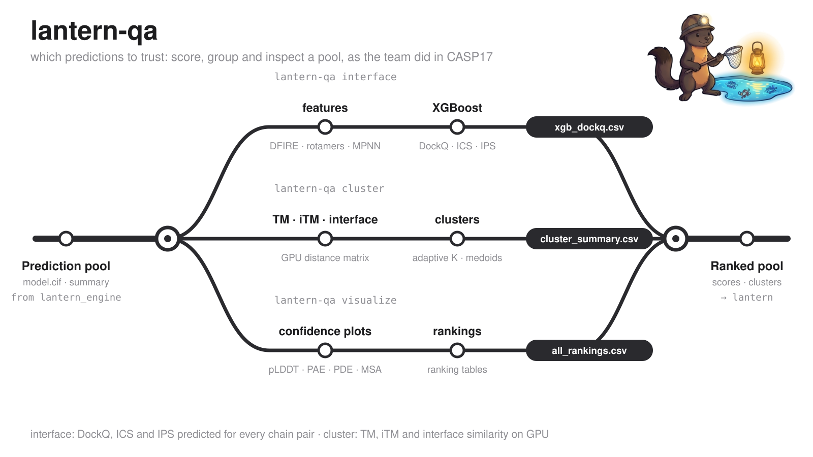

# lantern-qa

lantern-qa scores and inspects a pool of predicted structures: per-interface quality
predictions, clustering, and the standard confidence plots. It is the QA stack the
DeepFold team used in CASP17, collected from the team's analysis tree into one package
with no hard-coded paths, pinned dependencies and checksummed data. The CASP17 command
lines still work.



**Figure 1. From a prediction pool to a ranked pool.** Three lanes over the same models: predicted interface
quality (DockQ, ICS, IPS from XGBoost on interface features), clustering on GPU distance matrices, and the
confidence plots. Each writes one table, and the three are joined on the model name.

| Module | Was (CASP17, `casp17/analysis/` and `casp17/visualization/`) | What it does |
|---|---|---|
| `lantern_qa.interface` | `XGBDimerScorer_tool/xgbdimer` | **Interface scorer.** Extracts features for every chain-pair interface and predicts DockQ, ICS and IPS with XGBoost. PPI models v6; antibody–antigen models v9 and v10.1. It is not limited to dimers, hence the new name. |
| `lantern_qa.cluster` | `MassiveClustering_tool/massiveclustering`, `run_clustering.py` | GPU TM / iTM / dRMSD / interface clustering, adaptive K, medoids, consensus, Leiden networks, join with interface scores |
| `lantern_qa.ema` | `EMA/scorers` (the ones the features use) | DFIRE v2, aADARS v3, Dunbrack bbdep and NDRD rotamer terms, H-bond network, ProteinMPNN likelihood |
| `lantern_qa.mpnn` | `MassiveClustering_tool/proteinmpnn/run` (code only) | vendored ProteinMPNN; weights live in the data root |
| `lantern_qa.visualize` | `visualization/` (af3-viz container) | pLDDT, PAE, PDE, distogram, contact-probability, Ramachandran and MSA images; `all_rankings.csv`, `summary.csv`, `per_seed_summary.csv` |

Within RESIDUDES:
- `lantern-engine` builds inputs and runs the predictors.
- `lantern-qa` assesses what they produced.
- `lantern`, the campaign agent, drives both.

The CASP17 pools these scorers were fitted and tested on are public, unfiltered and with the input of every
model: [lantern-decoy](https://lantern-decoy.deepfold.org), 726,097 structures over 82 targets
([`docs/lantern-decoy.md`](../docs/lantern-decoy.md)). The AlphaFold 3 quarter of that pool may **not** be used
to train scoring or ranking models; the other 531,914 structures carry no such restriction.

## Install (uv)

```sh
cd RESIDUDES/lantern-qa
uv sync --extra cu130          # the exact CASP17 build: torch 2.11.0 from PyPI with its CUDA 13.0 libraries (driver >= 580: RTX 4090 / RTX 6000 Ada, B200)
uv sync --extra cu124          # torch 2.6.0+cu124 for nodes whose driver stops at CUDA 12.4
uv run lantern-qa data fetch   # 60 files, 281 MB, into data/files, each checked against its sha256 (--link to symlink)
uv run lantern-qa doctor       # python, pinned versions, torch/GPU, data, optional tools
```

Python is pinned to 3.12.12 (`.python-version`); uv downloads it if needed.

Dependencies match the CASP17 production venv (`analysis/.venv`), listed in full in
`envs/casp17-analysis-venv.freeze.txt` and locked in `uv.lock`. There is one exception:
- That venv carried networkx 2.2, which conflicts with its own torch 2.11 (torch needs ≥ 2.5.1).
- networkx is only used by the Louvain fallback, which runs only when leidenalg is missing.
- So it is 3.4.2 here, with no effect on default results.

`bin/lantern-qa` runs the CLI from `.venv` without installing.

## Data

`data/manifest.toml` lists every data file with its path, size, sha256, licence and
sources. The data root is `$LANTERN_QA_DATA`, otherwise `data/files` (git-ignored).

| Group | Files | Origin | Note |
|---|---|---|---|
| `xgb_models/` | 46 (25 MB) | trained by the team | defaults: PPI `xgb_ppi_v6_*`; antibody `xgb_v9_full` (DockQ) and `xgb_agab_v10_1_*` (ICS/IPS); older versions kept as fallbacks |
| `ema/dfire/` | 1 | team re-implementation of DFIRE2 | |
| `ema/dunbrack/` | 3 | Dunbrack bbdep2010 and NDRD | **academic licence: not redistributed**; fetched from the team copy only |
| `ema/potentials/` | 1 | team-trained aADARS v3 | |
| `proteinmpnn/model_weights/` | 12 (71 MB) | ProteinMPNN (MIT) | 11 files match the upstream repository byte for byte, so `--source url` works off-cluster |

`lantern-qa data list|fetch|verify`:
- Fetches from the team copy (`local`) first, then from the public URL.
- Refuses any file whose sha256 differs from the manifest.

Importing the package fills the environment variables the original scorers read,
pointing them at the data root. Values set beforehand win. The variables are:
- `EMA_DFIRE_V2_TABLE`, `EMA_BBDEP_LIB`, `EMA_NDRD_PATH`, `EMA_AADARS_V3_POT`
- `EMA_PROTEINMPNN_DIR`, `EMA_PROTEINMPNN_WEIGHTS`
- `LANTERN_QA_XGB_MODELS`

## Use

Arguments pass through unchanged. Only the command in front changes:

| CASP17 | lantern-qa |
|---|---|
| `xgbdimer <sub> …` / `XGBDimerScorer_tool/run_scoring.py <sub> …` | `lantern-qa interface <sub> …` |
| `XGBDimerScorer_tool/run_scoring.sh <sub> …` (Slurm fan-out, sharding, self-heal) | `scripts/interface/run_scoring.sh <sub> …` |
| `XGBDimerScorer_tool/shard_ppi.sh …` | `scripts/interface/shard_ppi.sh …` |
| `MassiveClustering_tool/run_clustering.py <target> …` | `lantern-qa cluster <target> …` |
| `MassiveClustering_tool/run_clustering.sh <target> …` (Slurm) | `scripts/cluster/run_clustering.sh <target> …` |
| `massivecluster <sub> …` | `lantern-qa massivecluster <sub> …` |
| `visualization/analyze_target.sh <target>` | `lantern-qa visualize <target>` (or `scripts/visualize/analyze_target.sh`) |
| `visualization/analyze_msa_target.sh <target>` | `lantern-qa visualize-msa <target>` |

```sh
# interface scores (DockQ + ICS + IPS) for one target
lantern-qa interface run-ppi-v4 --target-dir targets/T1417 --sto A3 --targets dockq,ics,ips -o out/T1417_iface
# the same on Slurm (GPU, automatic sharding)
scripts/interface/run_scoring.sh run-all --target-dir targets/T1417 --sto A3 --mode ppi -o out/T1417_iface
# cluster the pool (GPU TM matrix, adaptive K, medoids)
lantern-qa cluster targets/T1417 --sto A3 --method tm --gpu 0
# confidence plots and ranking CSVs into targets/T1417/visualization/
lantern-qa visualize targets/T1417 --no-msa
```

Output file and column names are kept from CASP17, because the clustering join, foldmine
and the ground-truth analyses read them. They are `xgb_pred`, `xgb_ics`, `xgb_ips`,
`master_with_xgb.parquet` and `xgb_scores.parquet`, and model files such as
`xgb_ppi_v6_full.json`.

Tool manuals: `docs/interface/`, `docs/cluster/`, `docs/ema/`, `docs/visualize/`.

## Optional parts

- **Antibody CDR masking and aADARS** need ANARCI with HMMER.
  - CASP17 used a separate venv: `analysis/.venv-cdr`, Python 3.10, anarci 2026.2.13.2.
  - Point `LANTERN_QA_CDR_BIN` at its `bin/`.
- **TCR docking angles** (`--method tcr-angle`) need the external Pierce binary (built against GSL) and `tcr3d_pierce.py`.
  - Set `LANTERN_QA_TCR_TOOLS` and `LANTERN_QA_TCR_RENUMBER`. They default to the team paths.

## Provenance and licences

- `PROVENANCE.md`: where each part came from and what was changed.
- lantern-qa's own code: [MIT](../LICENSE), with the rest of this repository.

- ProteinMPNN: MIT (Dauparas et al., Science 2022).
- MassiveClustering carries its original MIT licence (`licenses/`).
- Dunbrack rotamer libraries: academic licence, not included.

## Citation

Cite the CASP17 abstract of group 077 — the BibTeX entry is in the [repository README](../README.md#citation) and in [`CITATION.cff`](../CITATION.cff). Work that uses structures from the pool should also cite the predictor that produced them.
