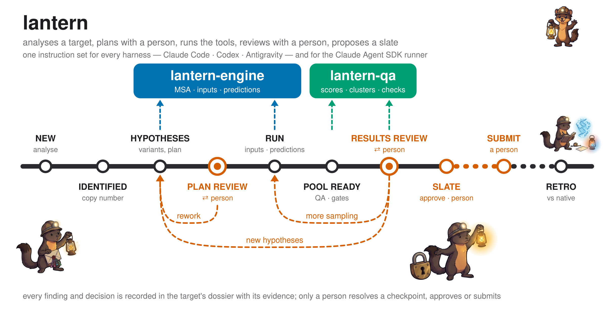

# lantern


lantern is the DeepFold team's structure-prediction campaign agent. It keeps one dossier per target and takes each
target from its sequence to a slate of five models.

- **It analyses the target first.** That means the construct and its identity, the literature, public structures
  (exact-sequence and foldseek sweeps), MSA depth and its gaps, templates, and the stoichiometry evidence. Every
  finding is recorded as evidence.
- **It reads the literature on the target and on each partner, and that reading is what it acts on.** Where a partner
  binds, how many copies there are, which chemistry the sequence does not carry, which published structure is the
  right template and which state it is: all of it comes from the papers, and each claim is recorded with its source.
  On H2319 the antibody's epitope (from escape selection in its own paper) became a structural gate and the antigen's
  recent crystals — missing from the default template database — became the template: model 1 scored DockQ 0.93,
  against 0.67 for the pool's most confident model. See [what the literature gives a target](docs/literature.md).
- **Every decision rests on those priors.** Stoichiometry, input variants, sampling and the slate each name the
  evidence they rely on and the alternatives they rejected. `lantern report` shows which prior reached which
  decision.
- **It works it out with a person at two checkpoints.** The prediction plan is discussed after the analysis, and the
  first results are reviewed before the slate. Unusual results lead to another round only if the person decides so.
- **It builds better inputs when the defaults fall short.**
  - **An empty MSA gets a family crawl.** `lantern msa T --crawl --family PF…` (the family comes from the analysis)
    collects the Pfam/InterPro family members, runs hmmsearch over
    UniRef90 and MGnify, and aligns every sequence to the query with OTalign. In the T1331 replay the agent's own crawl
    took the default MSA of 0 sequences to 28,968 (27,319 covering at least half the query). The CASP17 MSA of that
    family took AF3's median lDDT from 0.33 to 0.70. A shallow MSA with no family gets plmMSA (`--plm`; T1357
    0.59 → 0.88, T2371 0.37 → 0.87).
  - **A public assembly becomes an AF3 multimer template built on the target's own sequences** (`lantern-modeller`,
    MODELLER). A homolog's 24-mer took T2461o from DockQ 0.46 to 0.88. The released H2422 complex, with its missing
    residues built, took H2422 from 0.35 to 0.94.
  - **Chemistry the FASTA leaves out goes into the input.** H2388's description said "phosphopeptide"; the 14-3-3
    motif picked the serine, and af3's median DockQ went from 0.24 to 0.82.
- **It selects by what it knows, then by confidence.** The analysis's sites (an epitope from escape mutants, a pocket
  from the literature, a reference for a rigid part) become structural gates and a site census (`lantern gate`). Among
  the models that pass, af3's most confident leads and the predictors alternate after it. In CASP17, choosing by
  gates first and confidence second gave model 1 a mean DockQ of 0.651 over 37 complexes, against 0.564 for the
  highest ranking_score across predictors (paired difference +0.088, Wilcoxon p = 0.001; against af3's confidence
  alone, +0.059). See
  [what CASP17 taught lantern](docs/casp17_cases.md), case by case, [the gate reference](docs/gates.md), and
  [what the metrics are](docs/metrics.md).
- **It runs the tools.** [lantern-engine](../lantern-engine/) makes the predictions and [lantern-qa](../lantern-qa/) assesses the
  pool, both through sbatch or pueue.
- **A person approves and submits.** The agent never does. After approval, `lantern package` checks the slate's
  geometry and writes the CASP files through the team's casp17-utils. Anything it flags waits for a person.

[](docs/figures/overview.svg)

**Figure 1. The stage line.** Thirteen stages from a sequence to a packaged slate. The two ringed stations
are the checkpoints, where the agent writes a brief and stops until a person resolves it; orange marks every
move reserved for a person. The dashed curves are the three loops back, and the bands above show which stretch
drives lantern-engine and which drives lantern-qa. Under the title is where it runs: **Claude Code, Codex and
Antigravity all read the same `AGENTS.md` and skills**, and so does the Claude Agent SDK runner that `lantern
agent step` and `lantern daemon` use. The three marks say which harnesses read those files, not which have been
exercised:
what each was actually tried in is
[below](#built-for-claude-code-codex-and-antigravity-run-in-claude-code).

In a real dossier every decision cites the priors the analysis found, and `lantern report` prints that map:
on T1416, a live replay, twelve priors reached ten decisions, two of them through the person's checkpoint.

The same command writes the analysis as a document, and it leads with the target rather than with the record:
what it is (organism, family and fold with their Pfam or InterPro ids, the construct and its numbering offset),
the sequence counted chain by chain, how deep the MSAs are per chain and per database, the structures the searches
returned with the identity and coverage they reported, and the slate with lantern-qa's predicted DockQ beside each
predictor's own confidence. It draws a map of each chain carrying the residues a gate would use, and links the
coverage plot. [`examples/H1388`](examples/H1388/) is a run from the first command to the plan checkpoint, and its
[`analysis.md`](examples/H1388/analysis.md) is what the document looks like.

## Built for Claude Code, Codex and Antigravity; run in Claude Code

One instruction file, [`AGENTS.md`](AGENTS.md), and one skill set, [`skills/`](skills/), laid out so that each
harness finds them where it looks. That much is tested. Whether the other two harnesses behave as this table says
is not: lantern has been run in Claude Code and in the Agent SDK, and Codex and Antigravity are covered only by
tests against their documented layouts, because neither is installed on this cluster. The claim in this section is
therefore about the layout, not about observed behaviour, until someone runs
[`docs/harness_check.md`](docs/harness_check.md) in them.

| harness | instructions | skills | how it is kept an agent |
|---|---|---|---|
| **Claude Code** | `CLAUDE.md` → `@AGENTS.md` | `.claude/skills` | `.claude/settings.json`: `LANTERN_ACTOR=agent`, read-only commands allowed, `approve`/`resolve` denied |
| **Codex** | `AGENTS.md` | `.agents/skills` | `lantern approve`/`resolve` refuse `LANTERN_ACTOR=agent`; the stage machine refuses an agent's move past a checkpoint |
| **Antigravity** | `AGENTS.md` | `.agents/skills` (and `.agent/skills` for older builds) | as for Codex |
| **`lantern agent step` / `daemon`** (Claude Agent SDK) | `AGENTS.md` appended to the system prompt | `.claude/skills` | plus a PreToolUse guard and writes confined to the dossier directory |

`lantern setup` links the skills into a project for all three harnesses. With `--copy-skills` it installs copies
instead of symlinks: Codex documents that it follows symlinks, and Antigravity's docs do not say (see
[`docs/harness_check.md`](docs/harness_check.md)). [`tests/test_compat.py`](tests/test_compat.py)
checks each harness's documented layout:
- skill discovery paths;
- frontmatter: `name` equals the folder, a `description` of at most 1,024 characters;
- `AGENTS.md` without frontmatter and under Antigravity's 24,000-byte limit;
- the `CLAUDE.md` import;
- the Claude Code settings;
- the SDK prompt.

Live checks so far:
- **Claude Code** (headless `claude -p` in this folder):
  - It loaded `CLAUDE.md` → `AGENTS.md`, listed all seven skills, explained both checkpoints, and named `lantern gate`
    (with `--init` and `--show`) for gating a pool (2026-11-22, $0.19).
  - Given a stage to do, it wrote and submitted the structural gates for a 14-3-3–phosphopeptide pool from the
    dossier's evidence ($1.43; $0.75 on the second attempt, after the fixes it prompted).
  - Earlier: a reviewer brief that flagged the unchecked gates, with the `approve` attempt blocked ($0.33); the
    read-only CLI with `--allowedTools` ($0.12).
- **The Agent SDK runner** took five CASP17 replays through the stages. Two reached a proposed slate and three wait at
  a checkpoint; [`examples/H1388`](examples/H1388/) is the one that ships (below).
- **Codex and Antigravity** are not installed on the cluster. They are covered by the spec tests above until someone
  runs [`docs/harness_check.md`](docs/harness_check.md) in them: the same question and expected answer, for every
  harness.

## Start

```sh
cd RESIDUDES/lantern
uv sync                          # claude-agent-sdk (the agent runner) and gemmi (gates); the rest is stdlib
bin/lantern setup                # first run, with you: resources, databases, config, skills
bin/lantern doctor               # re-check any time
```

**Where dossiers live.** On this cluster `setup` suggests `/store/deepfold/lantern`, which is the team's shared dossier
folder. Use your own folder for experiments, or pass `--config` with another `lantern.toml`. `lantern daemon` takes paid
agent steps, so it asks you to name its targets (`--target T1234`), or to pass `--all` for every dossier there.

**Somewhere else.** The paths in this repository are the DeepFold cluster's, and they are defaults, not
requirements: [`catalog.toml`](catalog.toml) lists that cluster's databases, weights and tools, and the site paths
in the source (MSA databases and binaries, the OpenStructure image, the plmMSA client, PyMOL) are each overridden
by `lantern.toml` — `[msa]` for databases, `[tools]` for programs — with a binary on `PATH` preferred over a
default that is not there. `lantern setup` writes that file and `lantern doctor` says which components are
missing. Two things named in it are the team's own and not public: `casp17-utils`, without which `lantern
package` stops after its geometry checks rather than writing CASP files, and `target_notes`, which is where the
team keeps per-target reading and is only ever a place to look for papers.

**Words used below.**

| word | meaning |
|---|---|
| **dossier** | a target's folder, `<work_root>/targets/<T>/`, around `dossier.json`: evidence, decisions, stage, log |
| **stage** | where the target is (NEW, IDENTIFIED, …, SLATE_PROPOSED, APPROVED, …); each stage has a next step |
| **sto** | a stoichiometry such as `A3` or `A2B1C1` (`--stoich` at `target add`, `--sto` after; it defaults to the given one) |
| **pool** | every prediction of the target, read from a lantern-engine layout into `pool.csv` |
| **runner** | the predictor: af3 = AlphaFold 3, pt2 = Protenix v2, of3 = OpenFold 3, bt2 = Boltz-2, ef2 = ESMFold2 (`_jax`: their JAX ports) |
| **variant** | the input a run used (`af3_msa`: AF3's MSA; `mmseqs2_gpu`; a template or ligand variant) |
| **gate** / **census** | a structural test a model must pass / a per-model label of which named site a partner touches |
| **slate** | the five models proposed for submission; a person approves it |
| **checkpoint** | a conversation with a person at PLAN_REVIEW or RESULTS_REVIEW; only a person resolves it |

`lantern setup` goes through six parts:
1. **Resources.** This machine, its GPUs, the Slurm partitions and queue, storage and quota, and the tools; then recommendations.
2. **Databases.** The databases, weights and tools in `catalog.toml`: present or missing, and how old.
3. **Components.** lantern-engine's and lantern-qa's own `doctor`.
4. **Config.** `lantern.toml`: where dossiers live, budgets, model.
5. **Skills.** Links into your project's `.claude/skills`, `.agents/skills` and `.agent/skills`.
6. **Tour.** The commands below.

Nothing is downloaded or overwritten without a yes.

## A target

```
NEW → IDENTIFIED → HYPOTHESES → PLAN_REVIEW ⇄ person → INPUTS_READY → RUNNING → POOL_READY
    → RESULTS_REVIEW ⇄ person → SLATE_PROPOSED → [person: lantern approve] → APPROVED
    → [lantern package] → PACKAGED → [person submits, then `lantern stage T SUBMITTED`] → SUBMITTED → RETROSPECTIVE
  loops: PLAN_REVIEW → HYPOTHESES (rework the plan) · POOL_READY → RUNNING · RESULTS_REVIEW → RUNNING (more sampling)
         or HYPOTHESES (new hypotheses) · SUBMITTED → HYPOTHESES (a stage-2 reissue)
```

The same thing, one picture per stage ([`mascot/`](../mascot/), which also has them with a transparent background
for slides):

| | | | |
|:--:|:--:|:--:|:--:|
| <br>**NEW**<br>the sequence and one line | <br>**IDENTIFIED**<br>construct, identity, the papers | <br>**HYPOTHESES**<br>the input variants | <br>**PLAN_REVIEW**<br>*a person holds the pen* |
| <br>**INPUTS_READY**<br>MSAs and templates built | <br>**RUNNING**<br>seeds through sbatch | <br>**POOL_READY**<br>every model imported | <br>**RESULTS_REVIEW**<br>*a person decides the loop* |
| <br>**SLATE_PROPOSED**<br>gates first, then confidence | <br>**APPROVED**<br>*the stamp is theirs* | <br>**PACKAGED**<br>geometry checks, CASP files | <br>**SUBMITTED**<br>*a person submits* |
| <br>**RETROSPECTIVE**<br>scored against the native | <br>**a loop**<br>more sampling, or new hypotheses | <br>**a refusal**<br>the target is parked, not retried | <br>**a person's move**<br>approve, resolve, submit |

The four with a human hand in them are the rule, not decoration: lantern proposes, a person decides.

```sh
bin/lantern target add T1234 --fasta T1234.fasta [--stoich A3]   # dossier: <work_root>/targets/T1234/dossier.json
bin/lantern next T1234                                            # the next step and the skill that covers it
bin/lantern agent step T1234                                      # the agent does that step, then stops
bin/lantern daemon --target T1234                                 # or: step the named targets whenever they can move
bin/lantern target show T1234                                     # the dossier (or `lantern report T1234`: the analysis)
```

- An agent step does the work of the current stage, records findings (`evidence`) and choices (`decide`, with the
  evidence keys and the rejected alternatives), moves the stage when the goal is met, and stops.
- The next step starts from the dossier alone, so steps can be repeated, interrupted, or done by a person.

### The analysis document, and the figures it draws

`lantern report T` reads the dossier and writes `analysis.md`; `lantern slides T` puts the same material in a deck
(`report/report.pdf`). Both lead with the target rather than with the record: what it is, the sequence counted per
chain, what the literature says, the sites, the motifs, MSA depth, the structures that exist, and the pool once
there is one. The whole raw record follows, so nothing is only summarised.

Each kind of evidence gets **its own figure**, drawn from that evidence alone (`lantern/src/lantern/figures.py`,
stdlib SVG, no job to run) — one picture that mixes four questions answers none of them:

| figure | drawn from | what it shows |
|---|---|---|
| `chain_map` | the FASTA, `identity`, `construct`, the site keys | each chain to scale, its domains, and the residues a gate would use |
| `literature` | `literature` | every claim with its source, which priors and decisions share an identifier with it, and what the reading says is **not** known |
| `sites` | `binding_site`, `epitope`, `motif`, … and `chemistry` | each site in its own sequence, residue by residue, with what the record says it does and where that came from |
| `motif` | any motif written anywhere in the evidence | every place the pattern fits the sequence, which match carries the recorded residue, and the consensus patterns that fit nowhere |
| `clusters` | `lantern qa T --what cluster`, `pool.csv`, the interface scores | the same models four ways — by cluster, by predicted DockQ, by the predictor's own confidence, and one small panel per predictor showing where its models sit — then the clusters ranked by mean predicted DockQ with what is in each, and what that says in sentences |

Two rules hold for all of them: everything drawn comes from a number that was recorded or computed here, and
anything the parser could not place is named on the figure instead of being dropped. A figure with nothing to draw
is not drawn, and an older one is deleted rather than left to be linked.

Beside them the deck renders **the medoid of each cluster** with PyMOL — one view for all of them, superposed, with
any chain short enough to vanish (a peptide, a ligand-sized subunit) drawn as spheres — because a cluster is a
claim that these models are the same shape, and the medoid is what that shape looks like. And both documents open
with **one page of findings**: what the target is, the chemistry the FASTA does not carry, MSA depth, the
structures that exist, what the pool does, what nobody knows, and what is waiting on a person — each line read out
of the dossier, with its numbers, and left out when there is no evidence for it.

### The two checkpoints

- **Plan review (PLAN_REVIEW).** After the analysis the agent writes a brief and opens a checkpoint. The brief covers:
  - what it found, and which priors each decision rests on;
  - the prediction plan: stoichiometries, variants, seeds, GPU hours;
  - its questions, each with options and a recommendation;
  - the figures above, redrawn as the checkpoint opens and linked from the brief, so the person decides from the
    picture of the sites and the motifs rather than from a sentence about them;
  - what the analysis never recorded (no organism, no family, no MSA measurement, no public-structure search, no
    write-up, a site with no residues field) — each may be right for the target, so it is a list, not a block.

  The person and the agent talk it through (`lantern reply`). When the person writes, the daemon gives the agent a
  step to answer. Nothing is submitted until the person runs `lantern resolve T C1 --outcome proceed`.
- **Results review (RESULTS_REVIEW).** `lantern review T` checks the first round:
  - low confidence;
  - a split or flat n-sweep;
  - low pLDDT;
  - clashes;
  - missing models;
  - predictors in different architectures;
  - weak interfaces;
  - runs that lost a chain, and models whose file is empty;
  - the most confident models at different sites (from a gate census);
  - a site in the evidence that no gate uses, or one whose source is not recorded.

  The agent adds what it sees itself. Any trigger opens a results checkpoint, and the person decides: proceed to the
  slate, `loop:RUNNING` or `loop:HYPOTHESES`.

```sh
bin/lantern consult T --kind plan --brief brief.md --ask "Copy number: (a) A3 [rec.], (b) A1, (c) A4"   # the agent
bin/lantern checkpoints T C1                       # read the conversation
bin/lantern reply T C1 "why not A6? the family has hexamers"                                        # either side
bin/lantern resolve T C1 --outcome proceed         # people only (also loop:RUNNING / loop:HYPOTHESES)
bin/lantern review T [--add "name: why"]           # first-results checks -> triggers
```

### Pool, QA, slate, retrospective

**Before `lantern pool`.** It reads `<dir>/results/<sto>/<variant>/<runner>/seed_<N>/sample_<M>/` (`summary.json`
and `model.cif`). Per-chain runs go under `<dir>/<chain>/results/...`. A pool of this campaign is public if you
want one to try these commands on: [lantern-decoy](https://lantern-decoy.deepfold.org), 726,097 CASP17 models
with the input of each ([`docs/lantern-decoy.md`](../docs/lantern-decoy.md)).
- `<dir>` is `--dir`, or `<targets_root>/<T>` from `lantern.toml`.
- The folder names become the names everything else uses: `--sto A3`, and models like `A3__af3_msa__af3__s97_3`.
- lantern-engine writes the seed part, so point it there:
  - `lantern-engine predict --seed 1 --out <dir>/results/A3/af3_msa/pt2/seed_1`, or
  - `lantern-engine submit --seeds 1-20 --out <dir>/results/A3/af3_msa/pt2`.

```sh
bin/lantern pool T1234                       # read the pool -> pool.csv, per-runner confidence (--dir, --threads)
bin/lantern qa T1234 --what interface        # lantern-qa through sbatch (interface | cluster); antibody: --mode ab
bin/lantern jobs T1234                       # refresh the recorded jobs (wait for COMPLETED)
bin/lantern evidence T1234 epitope "A:611,615 (escape mutants, J Virol 2024)"   # a site and its source
bin/lantern gate T1234 --init                # draft -> <work_root>/targets/T1234/gates/draft_<sto>.json (a new file each run)
bin/lantern gate T1234 --spec <work_root>/targets/T1234/gates/draft_A3.json   # evaluate it (sbatch; --local up to 100)
bin/lantern gate T1234 --show                # after the job: pass counts per gate and predictor -> evidence gates
bin/lantern slate T1234                      # propose 5 from the models that pass: af3's best leads, runners alternate,
                                             # one per cluster/seed in slots 1-3 (--site S; antibodies: --no-interface)
bin/lantern slate T1234 --sto A2:3,A1:2      # a hedge across stoichiometries, slots in that order
bin/lantern slate T1234 --models M1,...,M5   # the five chosen after review
bin/lantern approve T1234 --what "slate v2"  # people only: moves it to APPROVED; names models that fail its gates
bin/lantern package T1234 --server           # geometry checks, polymer-only TS files via casp17-utils `prepare`
bin/lantern stage T1234 SUBMITTED            # people only, after submitting the files yourself
bin/lantern retro T1234 --native native.pdb  # once the native is out: score the slate models (sbatch, OpenStructure)
bin/lantern retro T1234 --scores scored.csv  # with pool models scored against the native (lddt/dockq_wave columns):
                                             # every slate version, the baselines, and whether the gates kept the good models
bin/lantern export T1234 examples/T1234      # dossier, analysis.md, checkpoints, step costs, logs, slates, QA and gate summaries
```

`--sto` defaults to the stoichiometry given at `target add --stoich`.

## Example

[`examples/H1388`](examples/H1388/) is one live run on a CASP17 target: human 14-3-3 gamma with an 11-residue LARP1
peptide, declared A1B1, from `target add` to the question a person has to answer. Four agent steps, $2.15, NEW →
IDENTIFIED → HYPOTHESES → PLAN_REVIEW, where it stops, because only a person resolves a checkpoint.

It identifies both chains (14-3-3 gamma P61981, Pfam PF00244; LARP1 542–552, Q6PKG0), picks the phosphosite out of
two serines by motif and annotation, measures MSA depth per chain, finds 23 exact-sequence PDB entries, writes a
375-line target note and asks four questions — then measures the reference structure and corrects its own gate
recommendation in the open checkpoint thread.

The folder holds:
- the analysis (`analysis.md`: priors, decisions and the prior → decision map);
- the write-up the agent wrote from the dossier, with the figures it cites (`notes/target.md`, `report/figs/`);
- the plan checkpoint, open, with that correction posted in its thread (`checkpoints/C1_plan.md`);
- every step's transcript and cost (`agent_logs/`, `steps.json`).

It does not ship the campaign files those rest on — the MSAs, the template mmCIFs and the pool's models run to
gigabytes — so a note that says "counted here" over `msas/af3/uniref90.a3m` can be read and traced, but not
recomputed from this repository alone. The write-up gives the absolute path of every file it read, so the counts are
checkable wherever the campaign lives.

The cost is the agent's own, summed from [`steps.json`](examples/H1388/steps.json), which records the USD and turns
of every step. It is a replay: the predictions existed, and new runs were not allowed. The team's own submission and
every native structure were barred until RETROSPECTIVE, so what is written down is what the agent found from the
target files and the literature. The retrospectives against the CASP17 assessment natives are kept with the
dossiers until the natives are public.

**The reading.** The run records five sourced claims under `literature` — the mode I and II 14-3-3 consensus motifs
and the groove that holds them (Yaffe 1997, PMID 9428519), the conserved basic phosphate pocket carried from 14-3-3
zeta into this construct's own numbering, UniProt's annotation of LARP1 S548 — beside a `not_known` field saying
that no paper or structure on the 14-3-3:LARP1 complex itself was found, after 50 Europe PMC hits. That is what the
source requirement in [docs/literature.md](docs/literature.md) asks for; the earlier replays (T1416, T1331)
recorded no `literature` key at all and their site priors carry no source field, which, with the H2319 case, is why
it was written down.

## Skills

Each skill in `skills/` is a SKILL.md playbook written from what the team learned in CASP17.

| Skill | Stage | Core of it |
|---|---|---|
| `lantern-setup` | first run | resources, stale databases, config, with the user |
| `lantern-intake` | NEW, HYPOTHESES | construct, the literature on the target and each partner (with sources; [`docs/literature.md`](docs/literature.md)), public structures first (47 CASP17 targets had one), sites that become gates, chemistry the FASTA leaves out (H2388), MSA depth and how to deepen it (crawl, plmMSA, ef2 test, RNA homologs) |
| `lantern-stoichiometry` | IDENTIFIED | evidence, not defaults: absence of precedent is not a monomer; under-prediction is the costly error |
| `lantern-consult` | PLAN_REVIEW, RESULTS_REVIEW | the brief, questions with options and a recommendation, results triggers, loops; never resolve yourself |
| `lantern-modeller` | HYPOTHESES, RESULTS_REVIEW | a homolog's assembly, or a released complex with gaps, rebuilt on the target's sequences (MODELLER) as an AF3 multimer template; T2461o DockQ 0.46 → 0.88, H2422 0.35 → 0.94 |
| `lantern-selection` | POOL_READY, RESULTS_REVIEW, APPROVED | `lantern gate`: structural gates and a site census first (M2415 ligand 51.8 → 8.8 Å; H2321 is the case where the record is missing), then confidence within a predictor; lantern-qa; slate hedging; packaging checks |
| `lantern-ops-safety` | INPUTS_READY, RUNNING | sbatch / pueue, one watcher, unique tags, silent AF3 deaths, storage |

## What this does not show

The evidence for lantern is one campaign's worth, and it is worth knowing where it is thin before relying on it.

- **The selection result rests on 56 targets, 37 of them complexes, from CASP17 alone**, scored against natives as
  they were released rather than on a held-out benchmark. The margin over ranking the whole pool by confidence is
  solid (+0.088 DockQ, Wilcoxon *p* = 0.001); the margin over af3's own confidence, which is what a
  single-predictor pipeline would use, is +0.059, and 9 to 11 of those targets came out worse
  ([`docs/casp17_cases.md`](docs/casp17_cases.md)).
- **The gates were set per target by a person who could see the pool.** No part of this is an automatic rule
  measured on data it had not seen, and on H2321 the submitted model failed one of its own gates while being the
  best model in the pool: the choice that produced it was never written down. That case is the argument for the
  dossier, not for the rubric.
- **The per-target cases are selected.** Each is there because an intervention measurably changed the outcome;
  nobody counted the times it changed nothing.
- **The interface scorer is validated on a benchmark, not on single-target pools**, and CASP17 produced a target
  where it ranked the pool backwards (ρ = −0.28). lantern leaves it out of the slate by default for that reason.
- **Two of the three harnesses have never been run**, only laid out and tested against their documented rules.
- **Five replays, no live campaign.** The agent has taken CASP17 targets from a dossier to a proposed slate; no
  target has gone from a fresh sequence to a submission under it, and no slate has been approved.

## Safety

- **Shell guard.** No recursive deletes, broad scans of shared storage, mass job cancellation, pueue wipes, force
  pushes, fast polling loops, CASP submission, `approve`/`resolve`, or changes to `LANTERN_ACTOR`. It is a seatbelt,
  not a sandbox: the agent runs as the same Unix user.
- **Writes** by the file tools go only under the target's dossier directory, and never to `dossier.json` itself.
- **Budgets.** Per-step USD and turn limits; a GPU-hour budget per target.
- **People's moves.** Only a person resolves a checkpoint, loops back, approves a slate or submits. The stage machine
  refuses the agent, and an approval from an earlier round does not count again.

## Layout

```
lantern/
  AGENTS.md              the instructions every harness reads (CLAUDE.md imports it)
  bin/lantern            launcher (uv venv if present, else any Python >= 3.11)
  catalog.toml           databases / weights / tools with paths and freshness rules
  skills/<name>/SKILL.md playbooks (.claude/skills, .agents/skills and .agent/skills link here)
  src/lantern/           config, resources, catalog, setup, dossier (stages, checkpoints), guard, agent, cli,
                         pool, slate, ops (qa/jobs), consult (checkpoints, review), report, retro, export, daemon
  .claude/settings.json  Claude Code in this folder acts as the agent
  examples/H1388/        one live run, from `target add` to the plan checkpoint
  docs/figures/          overview figure (make_figures.py, drawn from an example dossier)
  tests/                 core, pool/slate/retro, and harness compatibility
```

## Citation

Cite the CASP17 abstract of group 077 — the BibTeX entry is in the [repository README](../README.md#citation) and in [`CITATION.cff`](../CITATION.cff).
