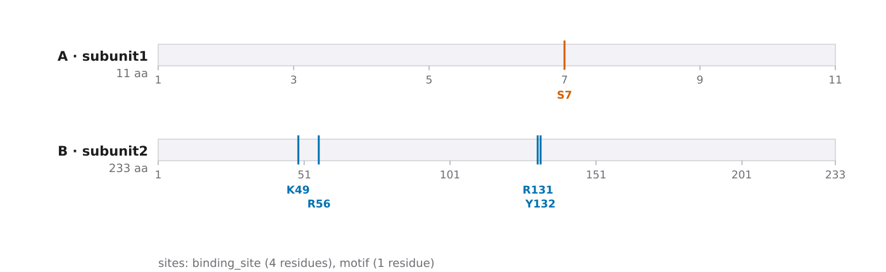
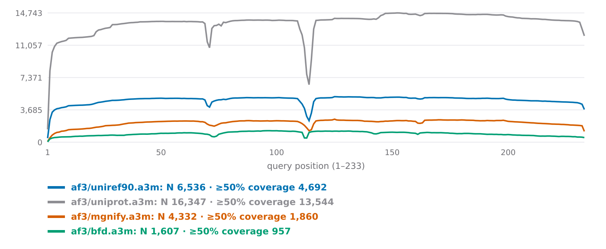
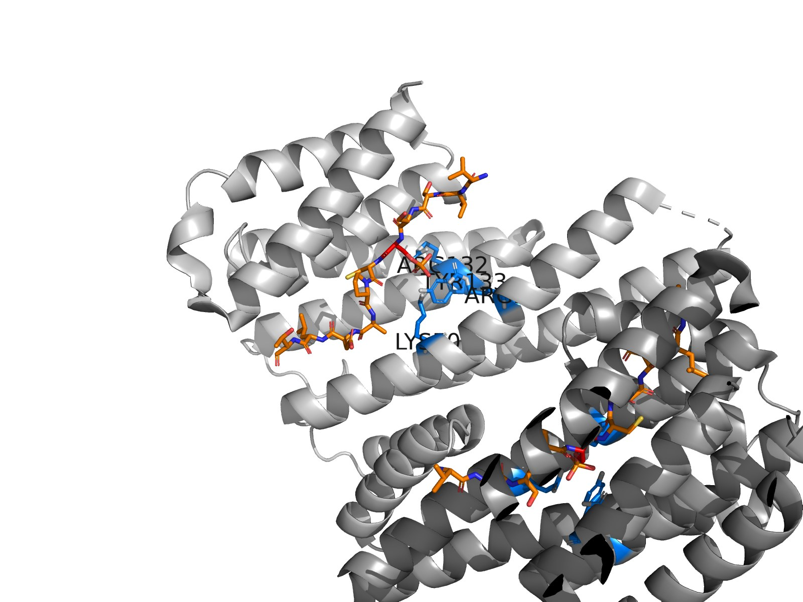
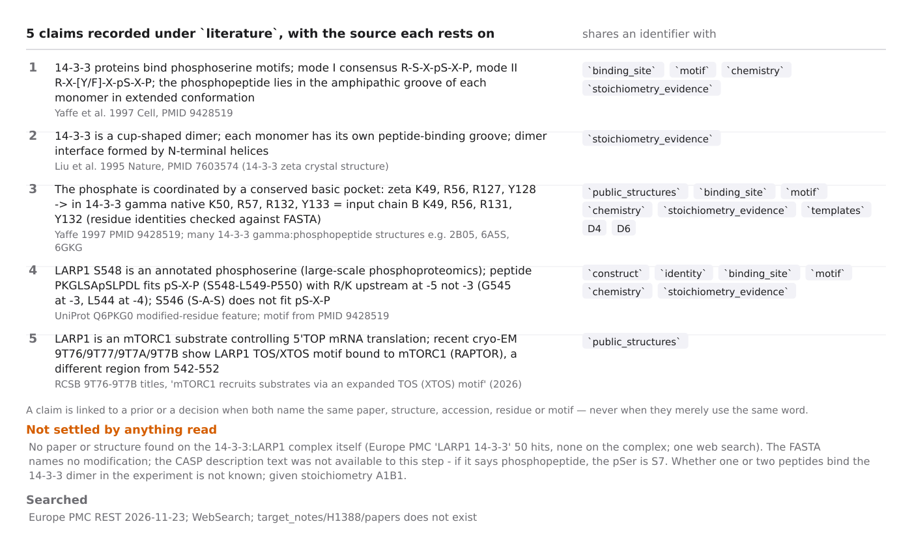
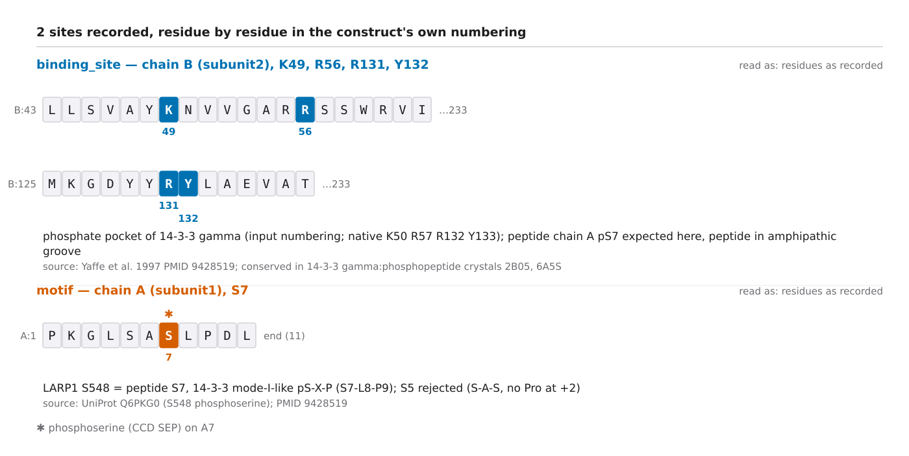
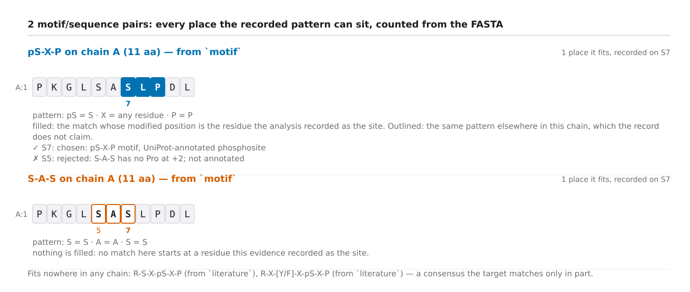
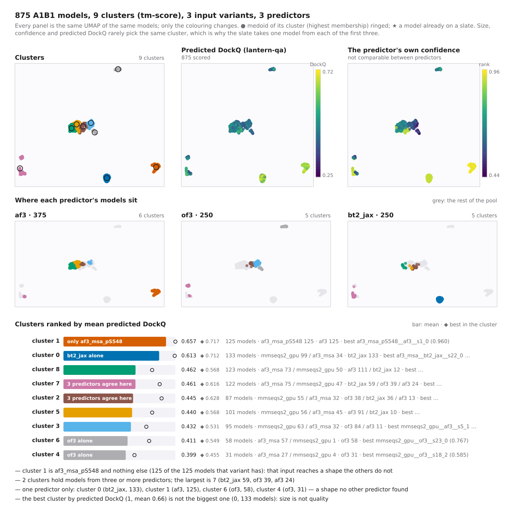

# H1388: target analysis

Stage **PLAN_REVIEW**. 13 kinds of evidence and 6 decisions, recorded by agent, deepfold.

Sequence: 244 residues in 2 chains (11, 233). Given stoichiometry: A1B1.

## In one page

- **What it is.** **A** (11 aa) subunit1 — Q6PKG0; La-related protein 1 (LARP1), Homo sapiens, residues 542-552 · **B** (233 aa) subunit2 — P61981; 14-3-3 protein gamma (YWHAG), Homo sapiens; 14-3-3 protein family; Pfam PF00244; InterPro IPR000308, IPR023409, IPR023410, IPR036815. Given stoichiometry **A1B1**.
- **The chemistry the FASTA does not carry.** **A7** phosphoserine (CCD SEP) — S7 chosen; S5 rejected
- **MSA depth.** deepest `af3/uniprot.a3m` **16,347** sequences, thinnest `af3/bfd.a3m` 1,607, over 4 measured alignments
- **Structures that exist.** **33** PDB entries named in the record: `11hg`, `11jj`, `2b05`, `2br9`, `3iqu`, `3uzd`, `4e2e`, `4j6s` …
- **The pool.** **875** models in **9** clusters. cluster 1 is af3_msa_pS548 and nothing else (125 of the 125 models that variant has): that input reaches a shape the others do not
  - 2 clusters hold models from three or more predictors; the largest is 7 (bt2_jax 59, of3 39, af3 24)
  - one predictor only: cluster 0 (bt2_jax, 133), cluster 1 (af3, 125), cluster 6 (of3, 58), cluster 4 (of3, 31) — a shape no other predictor found
- **What nobody knows.** No paper or structure found on the 14-3-3:LARP1 complex itself (Europe PMC 'LARP1 14-3-3' 50 hits, none on the complex; one web search). The FASTA names no modification; the CASP description text was not available to this step - if it says phosphopeptide, the pSer is S7. Whether one or two peptides bind the 14-3-3 dimer in the experiment is not known; given stoichiometry A1B1.
- **Open, and waiting on a person (C1).** (1) Phosphorylation; (2) Stoichiometry; (3) GPU; (4) Selection gate

## The target, written up

<!-- target.md -->

Written 2026-11-23 at stage PLAN_REVIEW, from the dossier (`dossier.json`) and
the files under `/gpfs/deepfold/casp/casp17/targets/H1388/`. Not read: `submit/` and any native structure.

How to check a sentence: a number in square brackets is a reference in §8. A name in backticks such as
`binding_site` is a dossier evidence key, and D1–D6 are dossier decisions. "Measured here" or "counted here" means I
recomputed the value from the cited file while writing this note.

**Numbering.** Every residue is given in **input** numbering first, meaning its position in its chain in the CASP FASTA
[1]. It was converted from the **native** numbering of each protein's canonical UniProt sequence:
- chain A: input *j* = LARP1 (Q6PKG0) *j* + 541;
- chain B: input *i* = 14-3-3 gamma (P61981) *i* + 1 for *i* ≥ 2. Input 1 has no native counterpart.

I checked one residue of each chain against the FASTA (§2). PDB 6A5S numbers its 14-3-3 chains the native way: auth
50/57/132/133 are K/R/R/Y in all four chains [4, checked here].

### 1. Identification

| | |
|---|---|
| CASP id | H1388 [1] |
| Organisers' description | Not available. The target folder holds `target.fasta` and the team's run folders only, and the FASTA headers (`H1388,subunit1\|`, `H1388,subunit2\|`) name nothing [1]. The dossier records the text as not seen (`literature.not_known`). The lantern-intake skill quotes a CASP17 target H2388, "14-3-3 gamma bound to LARP1 derived phosphopeptide", with this peptide's sequence [26]. On a replay that line is hindsight and is not used as evidence here (dossier log, 2026-11-23 08:21). |
| Stoichiometry | Given: A1B1 (dossier `stoichiometry.given`). Expected in solution: 2:2, a 14-3-3 homodimer with a peptide on each subunit. UniProt says "Homodimer" [2]. The 6A5S asymmetric unit holds two dimers, each subunit with its own phosphopeptide [4, measured here]. The six gamma–peptide assemblies the dossier checked are all 2:2 (`stoichiometry_evidence`). |
| Chain A (subunit1) | 11 aa, PKGLSASLPDL: human LARP1 (UniProt Q6PKG0), residues 542–552 [1, 3] |
| Chain B (subunit2) | 233 aa: human 14-3-3 gamma (YWHAG, UniProt P61981), residues 3–234, after one serine [1, 2] |
| Experimental method | Not known: there is no description. |
| Dates | No CASP release date or deadline is recorded (the dossier's `deadlines` is empty). The team's copies of the FASTA and the inputs are dated 2026-06-16 (file times) [1, 11]. HHpred ran on 2026-07-13 (hhr header) [10]. The UniProt records are as of their 2026-11-04 annotation update [2, 3]. The PDB and literature searches ran on 2026-11-23 (`public_structures`, `literature`), and the dossier was opened the same day. |

### 2. The chains

#### Chain A: LARP1 542–552, the peptide

- **Mapping.** PKGLSASLPDL is an exact substring of the canonical LARP1 sequence (isoform 1, the one UniProt displays),
  at 542–552 [3, checked here]: `input j = native j + 541`. Checked: input S5 = S546 and S7 = S548. UniProt's isoform 2
  (Q6PKG0-3) differs at 1–77 and 78–144 [3], so it would number this segment differently. Everything here uses
  isoform 1.
- **Construct.** The FASTA carries no tag, no extension and no modification [1].
- **Landmarks.** UniProt lists S548 (input 7) as a modified residue, "Phosphoserine", with evidence code ECO:0007744
  from three large-scale phosphoproteomics studies [3, 18–20]. S546 (input 5) has no modification feature [3]. The
  residues around S548 are K543 (−5), G544 (−4), L545 (−3), S546 (−2), A547 (−1), **S548**, L549 (+1) and P550 (+2)
  [counted here from 1, 3].
  - *Correction to the record:* `literature` gives "G545 at −3, L544 at −4". The sequence puts L545 at −3 and G544 at −4.
- **Where it sits in LARP1.** 542–552 lies inside two UniProt regions: 511–598, "Disordered" (a MobiDB-lite
  prediction), and 77–573, "Required for interaction with PABPC1" [3, citing 21]. It lies outside the La-type HTH domain
  (397–487) and outside 574–1096, "Required for interaction with RPTOR" [3, citing 21].
- **Structures.** No structure has this segment with a 14-3-3 [5, 6]. Seven PDB entities contain the motif GLSASLPD
  (§6, table 6b) [6]. I did not check whether 542–552 is modelled in any of them.
- **MSA.** It holds the query only, as expected for 11 residues (`existing_pool.msa_A`, `msa_depth`).

#### Chain B: 14-3-3 gamma 3–234

- **Mapping.** Input 2–233 is identical to P61981 3–234 [1, 2, checked here]: `input i = native i + 1` for *i* ≥ 2.
  Checked: input K49, R56, R131 and Y132 are native K50, R57, R132 and Y133. Input S1 stands where the native has M1–V2
  (native MVD…, input SD…). Native 235–247 (SDQQDDDGGEGNN) is absent.
  - *Correction to the record:* `construct` says "232 aa", "target residues 2–232 = native 3–233" and a truncated tail
    of "234–247". Counting the FASTA gives 233 aa, 2–233 = 3–234, and a missing tail of 235–247. The same entry's rule,
    `input i = native i + 1`, is right, and the sites below use it.
  - That S1 is a cloning or protease remnant is the dossier's guess (`construct.differences`); no source says what it is.
- **Family.** UniProt: "Belongs to the 14-3-3 family"; Pfam PF00244; InterPro IPR000308, IPR023409, IPR023410 and
  IPR036815; SMART SM00101 [2]. HHpred aligns the whole query (input 1–233 or 2–233) to ten 14-3-3 structures at
  probability 100, and the next hit is at 95.2 % with 9 % identity [10]. So the construct is one 14-3-3 domain from
  end to end, and no other domain is present.
- **Helices.** UniProt's nine helices of 12 or more residues, taken from PDB entries, are native 4–16, 20–31, 39–69,
  77–103, 117–137, 140–164, 170–181, 190–206 and 216–233 [2]. Subtract 1 for input numbering.
- **Landmarks.** Input numbering, with native in brackets:
  - **The phosphate pocket:** K49 (K50), R56 (R57), R131 (R132) and Y132 (Y133). UniProt marks R57 and R132 as
    "Interaction with phosphoserine on interacting protein" [2, citing 17]. In all four 6A5S subunits the
    phosphoserine's phosphate oxygens are 2.4–2.8 Å from K50 NZ, from the NE/NH atoms of R57 and R132, and from Y133 OH
    [4, measured here].
  - **Other UniProt modifications** inside the construct (native numbering) are pS71, pY133 (by similarity), pT145,
    pS215 and pT234 [2]. pY133 is a pocket residue. Nothing in the record says the experiment's protein carried any of
    them.
- **The dimer.** UniProt says "Homodimer" [2, citing 17]. In 6A5S, subunits A–B and D–G pair through their N-terminal
  residues: 48 and 46 Cα pairs lie within 8 Å, and 11–12 of those are between residues numbered below 60
  [4, measured here]. The construct keeps the N-terminus from native 3 onward.
- **The C-terminus in structures.** No 6A5S chain is modelled past native 235 [4]. UniProt takes a short helix at
  237–240 from 6BYL [2]. Either way, the construct ends at 234.
- **Structures.** There are 23 exact-sequence PDB entries (§6, table 6a) [5, 7]. UniProt cross-references 22 of them,
  all except 8XI3 [2].
- **MSA.** Deep, with no thin region (`msa_depth`; MSA files [12]):

  | MSA | sequences | ≥ 50 % coverage | median coverage | min coverage |
  |---|---|---|---|---|
  | uniref90 | 6,536 | 4,692 | 4,982 | 456 |
  | uniprot | 16,347 | 13,544 | 13,908 | 1,454 |
  | mgnify | 4,332 | 1,860 | 2,374 | 74 |
  | bfd | 1,607 | 957 | 993 | 34 |

  In uniref90, coverage is lowest at input 1 (456, the serine with no native counterpart) and at input 113–115 (2,451
  at 114) [counted here from 12]. Input 113–115 is native 114–116, which lies between UniProt's helices 104–108 and
  117–137 [2].

### 3. The biology that bears on the structure

UniProt describes 14-3-3 gamma as an adapter that "binds to a large number of partners, usually by recognition of a
phosphoserine or phosphothreonine motif", and as a homodimer [2]. In the gamma crystal structures the dossier lists,
each subunit of the dimer carries its own phosphopeptide. 6A5S has four 14-3-3 chains and four TFEB pS211 peptides
(LVGVTSS(pS)CPADLTQ), and each phosphate is held by K50, R57, R132 and Y133 of its own subunit [4, measured here].
2B05, 6FEL, 7A6R, 6GKG and 6BYL are 2:2 assemblies (`stoichiometry_evidence`). The dossier also states two consensus
motifs, mode I R-S-X-pS-X-P and mode II R-X-[Y/F]-X-pS-X-P, and attributes them to Yaffe et al. 1997 [15], a paper that
was not read. I use them only where the LARP1 sequence shows the pattern directly: S548 is followed by X-Pro
(L549-P550), and S546 is not (A547-S548).

UniProt describes LARP1 as an RNA-binding protein that regulates translation downstream of mTORC1. It is "phosphorylated
on multiple Ser and Thr residues in response to active mTORC1", and phosphorylation promotes its dissociation from
mRNAs that carry a 5′TOP motif [3, PTM comment citing 22]. UniProt lists IntAct binary interactions between LARP1 and
three 14-3-3 genes: SFN (4 experiments), YWHAE (6) and YWHAZ (4). YWHAG is not among them [3, INTERACTION]. No source
found says which LARP1 residues a 14-3-3 binds: the Europe PMC search "LARP1 14-3-3" returned 50 hits, none of them
on the complex (`literature.not_known`) [24]. The strongest pointer to 542–552 as the binding segment is that the
organisers cut it out, and that is an inference, not a source.

So the state to model rests on two facts and one inference. S548 is phosphorylated in cells [3, 18–20], and 14-3-3
binds phosphorylated motifs [2]. The inference is that the peptide is pS548, with its phosphate in the pocket of one
subunit (`chemistry`, `motif`, D1). The FASTA does not say so [1], and the description that might is not on disk
[25]. CASP scores one subunit and one peptide (A1B1). In solution that subunit would be half of a dimer, probably with
a second peptide on the other half (D2, from [2] and [4]).

### 4. Sites and chemistry, in input numbering

**Chain ids.** In A1B1 the peptide is chain A and the 14-3-3 is chain B. In the A2B2 inputs the peptides are A and B
and the 14-3-3 copies are C and D [11]. A site written on chain B has to be mapped to C and D for A2B2 models.

| site | input | native | source | becomes |
|---|---|---|---|---|
| phosphate pocket | B: K49, R56, R131, Y132 | P61981 K50, R57, R132, Y133 | UniProt sites at 57 and 132 [2, 17]; in 6A5S, 2.4–2.8 Å from the phosphate oxygens in all four subunits [4, measured here]; `binding_site` | **gate**: `lantern gate --init` reads `binding_site`. C1 question 4 proposes a cut-off of A7 within 4 Å of these side chains; see below. |
| phosphosite | A: S7 | LARP1 S548 | UniProt phosphoserine [3, 18–20]; followed by L-P [1]; `motif` | the peptide end of the pocket **gate** (`motif`), and the residue of the variant below |
| phosphoserine | A: S7 → SEP | pS548 | `chemistry`; D1 | **variant**: the `af3_msa_pS548` inputs (A1B1 and A2B2) put `{"ptmType": "SEP", "ptmPosition": 7}` on the peptide and are otherwise the same as `af3_msa` [11]; af3 only |
| rejected | A: S5 | LARP1 S546 | no Pro at +2 (A547, S548 follow it) [1]; no UniProt modification [3] | nothing |
| ligands, metals | — | — | D5: none | nothing |

**Which atom the 4 Å gate is measured from matters.** In 6A5S I measured the nearest side-chain atom of each pocket
residue: K CD/CE/NZ, R CD/NE/CZ/NH1/NH2 and Y CZ/OH [4, measured here]. The distances depend on the peptide atom:
- from the phosphate oxygens: 2.4–2.8 Å;
- from the phosphorus: 3.6–3.9 Å;
- from the serine OG: 4.2–5.1 Å.

So the reference structure passes a 4 Å cut-off only when it is measured from the phosphate oxygens or the phosphorus.
Measured from OG, which is the only option for the unmodified runs, the reference itself would fail. The gate spec
should either name the atom or use about 5.5 Å for OG.

**Not recorded as residues:** the rest of the peptide-binding surface beyond the four pocket residues. A census of the
B residues the peptide touches would need that list.

### 5. What is uncertain

1. **Is the experiment's peptide phosphorylated at S548?**
   - For: UniProt's pS548 [3]; the X-Pro after S548 [1]; 14-3-3 binds phosphorylated motifs [2].
   - Against: the FASTA carries no modification [1], and the description is not on disk [25].
   - *What answers it:* D1 runs the SEP input next to the unmodified one, and C1 question 1 asks the person which
     leads.
2. **Which way does the 11-mer lie on the subunit, and in which register?**
   - No structure of this peptide bound to a 14-3-3 exists [5, 6]. The four pocket residues define the phosphate
     position [4].
   - The paper behind 6A5S is titled as describing a "noncanonical mode" of TFEB binding [4; the paper, 14, not read].
     So 6A5S's peptide backbone is not a safe reference for LARP1's register.
   - *What answers it:* the gate checks only the phosphate against the pocket, not the backbone (C1 question 4). D4
     keeps a custom 6A5S/2B05 template as a fallback if the pool splits on register. The brief also suggests checking
     models against the 6A5S/2B05 peptide backbone; that should wait until someone reads [14].
3. **Do the af3 runs see a gamma template?**
   - In the AF3 default inputs (`af3_msa`, `af3_msa_pS548`), chain B's four templates are 3UAL (epsilon), 8HEW, 7EXE
     (zeta/delta) and 6NYB (zeta), 63–79 % identical to chain B. None is gamma, although all 23 gamma entries are
     among the 1,578 hmmsearch hits at 99.6–100 % identity [7, 11, computed here].
   - D4 rests on "91 of 1578 hits are 14-3-3 gamma, so close templates are present" (`existing_pool.templates_B`).
     That is true of the hit list, not of what the inputs carry. The lantern-intake skill notes that AF3's template
     filter hides near-100 % matches [26]; the files themselves do not say why the gamma entries were dropped.
   - Only the `mmseqs2_gpu` inputs carry gamma templates (6BYJ and 6Y6B, fident 1.000) [9, 11]. The SEP variant exists
     only on `af3_msa`, so the runs the plan would lead with never had a gamma template.
   - *What answers it:* nothing in the plan yet. D4's custom-template fallback is the natural place; the person should
     see this at C1.
4. **One subunit or the dimer?**
   - CASP gives A1B1; the dimer is the solution state [2, 4].
   - *What answers it:* D2 runs both A1B1 and A2B2, and cuts each A2B2 model to one B:A pair.

### 6. The structures that exist

The best peptide-bound gamma structure with a recorded resolution is 6A5S at 2.10 Å [4]. No structure of 14-3-3 with
LARP1 exists [5, 6]. Foldseek was not run: with 23 exact-sequence structures the dossier judged it unnecessary
(`public_structures.foldseek`).

#### 6a. Chain B: the 23 exact-sequence human 14-3-3 gamma entries

**The searches behind this table:**
- **The RCSB sequence search** (chain B, identity ≥ 95 %, E < 1e-10, 2026-11-23) returned these 23 entities. The
  saved result holds identifiers and a relevance score only, with no identity per hit [5].
- **The per-hit numbers** come from two searches run for the team's inputs:
  - the AF3 hmmsearch over PDB seqres [7]. I counted identity and coverage from its alignment, over the 233 query
    columns;
  - the mmseqs2 template search [9]. `fident` and the query range are as its m8 file reports them.
- **Why some `fident` values are below 1.000** while the hmmsearch identity is 100 %: the difference comes mostly from
  gaps where the template lacks residues (6A5S: CIGAR `68M4I160M`).
- **"Absent"** means the entry is not among the 300 mmseqs2 hits; the weakest of those has `fident` 0.630.
- **"State"** is what the dossier recorded (`public_structures.exact_sequence_sweep.note`,
  `stoichiometry_evidence.homolog_assemblies`), unless a reference is given.
- **"Fold"** means the entry is usable as a template for the 14-3-3 fold, and its contents were not recorded.

| PDB | AF3 hmmsearch: identity, coverage [7] | mmseqs2: fident, query [9] | state | use as a template |
|---|---|---|---|---|
| 6A5S | 100 %, 232/233 | 0.982, 2–233 | TFEB pS211 peptide on each of four subunits; X-ray, 2.10 Å; phosphate on K50/R57/R132/Y133 [4] | the reference for the pocket gate; a custom-template candidate (D4); its peptide backbone is not a register reference (§5.2) |
| 2B05 | 100 %, 232/233 | absent | phosphoserine peptide, 2.55 Å; 2:2 C2 assembly | peptide-bound; D4's other custom-template candidate |
| 6FEL | 100 %, 232/233 | 0.982, 2–233 | CaMKK2-motif peptide; 2:2 C2 | peptide-bound |
| 6Y4K | 100 %, 232/233 | 0.926, 2–233 | CaMKK2-motif peptide | peptide-bound |
| 6GKG | 100 %, 232/233 | 0.965, 2–233 | caspase-2 peptide; a dimer with two peptides | peptide-bound |
| 7A6R | 100 %, 232/233 | 0.982, 3–233 | DAPK2 peptide; 2:2 C2 | peptide-bound |
| 6BYL | 100 %, 232/233 | absent | O-GlcNAc-Thr peptide; a dimer with two peptides | its peptide carries a GlcNAc, not a phosphate, so it is not a pocket reference |
| 6BZD | 99.6 %, 232/233; input 56 is E, not R (native R57E) [7, counted here] | 0.995, 2–233 | a pocket mutant | the fold only, not the pocket. RCSB scored it 0.0, against 1.0 for the other 22 [5] |
| 6BYJ | 100 %, 232/233 | 1.000, 2–233 | 14-3-3 gamma; X-ray, 2.90 Å; the template file keeps chain F only [11] | used in the `mmseqs2_gpu` inputs |
| 6Y6B | 100 %, 232/233 | 1.000, 2–233 | 14-3-3 gamma with a glycoside small molecule (entity 3 in the template file); X-ray, 3.08 Å [11] | used in the `mmseqs2_gpu` inputs |
| 3UZD | 100 %, 232/233 | 0.969, 2–233 | not recorded | fold |
| 4E2E | 100 %, 232/233 | absent | not recorded | fold |
| 4J6S | 100 %, 232/233 | absent | not recorded | fold |
| 4O46 | 100 %, 232/233 | absent | not recorded | fold |
| 5D3E | 100 %, 232/233 | 0.965, 2–233 | not recorded | fold |
| 6GKF | 100 %, 232/233 | 0.974, 2–233 | not recorded | fold |
| 6S9K | 100 %, 232/233 | 0.974, 2–233 | not recorded; UniProt takes most of its helix boundaries from it [2] | fold |
| 6SAD | 100 %, 232/233 | absent | not recorded | fold |
| 6ZBT | 100 %, 232/233 | 0.982, 2–233 | not recorded | fold |
| 6ZC9 | 100 %, 232/233 | 0.991, 2–233 | not recorded | fold |
| 7A6Y | 100 %, 232/233 | 0.991, 3–233 | not recorded | fold |
| 8XI3 | 100 %, 232/233 | absent | not recorded; not among UniProt's cross-references [2] | fold |
| 9CI3 | 100 %, 232/233 | absent | not recorded | fold |

#### 6b. Chain A: entries that contain the LARP1 segment

The search was an RCSB sequence-motif search for GLSASLPD (2026-11-23), which reports presence only [6]. AF3's
hmmsearch for chain A also matched three of these entries over LARP1 542–552 [8]. The states in this table are as the
dossier records them (`public_structures.peptide`, `literature`; for 9T76/9T77, see [23]).

| PDB entity | found by | state | use |
|---|---|---|---|
| 9T76_2 | motif | LARP1 with mTORC1; cryo-EM; released 2026-11-18 | no 14-3-3; whether 542–552 is modelled was not checked |
| 9T77_4 | motif | LARP1 with mTORC1; cryo-EM; released 2026-11-18 | as above |
| 8XP2_36 | motif; hmmsearch 8xp2_JD, 542–552 | "large assembly" | as above |
| 8XP3_36 | motif; hmmsearch 8xp3_JD, 542–552 | "large assembly" | as above |
| 9ED0_35 | motif; hmmsearch 9ed0_h, 542–552 | "large assembly" | as above |
| 11HG_81 | motif | "large assembly" | as above |
| 11JJ_82 | motif | "large assembly" | as above |

#### 6c. The templates the inputs actually carry

| input [11] | chain | template | what it is (entity description) | identity, coverage |
|---|---|---|---|---|
| `af3_msa`, `af3_msa_pS548` | B (C, D in A2B2) | 3UAL | 14-3-3 protein epsilon | 65.2 %, 230/233 (computed here from `templates.json` [7]) |
| | | 8HEW | "14-3-3 protein" | 63.0 %, 230/233 |
| | | 7EXE | 14-3-3 protein zeta/delta | 77.2 %, 228/233 |
| | | 6NYB | 14-3-3 protein zeta | 78.5 %, 228/233 |
| | A (A, B in A2B2) | 4PSJ (two alignments) | OR464 | 6 of 11 and 5 of 10 residues identical [8] |
| | | 3AQY, 3AQX | beta-1,3-glucan-binding protein | 7 of 10 identical, each [8] |
| `mmseqs2_gpu` | B (C, D in A2B2) | 7V9B_A | YWHAE/FAM22B fusion protein; X-ray, 1.85 Å | fident 0.643, query 1–233 [9] |
| | | 6BYJ_F, 6Y6B_B, 6BYJ_A | 14-3-3 protein gamma | fident 1.000, query 2–233 [9] |
| | A | none | | |

The peptide's AF3 templates are short segments of unrelated proteins: none of them involves a 14-3-3 [8].

#### 6d. Chain B: other 14-3-3 isoforms (HHpred)

HHpred searched the clustered PDB database `mmcif70/pdb70` [10]. No gamma entry is among the hits;
`public_structures.hhpred_caveat` puts that down to the clustering. The identities are as HHpred reports them [10].

| hit | entry (HHpred's description) | probability | identity | query columns |
|---|---|---|---|---|
| 1 | 4ZQ0_C, 14-3-3 protein | 100 | 57 % | 2–233 |
| 2 | 3IQU_A, 14-3-3 protein sigma | 100 | 67 % | 1–233 |
| 3 | 2NPM_B, 14-3-3 domain containing protein | 100 | 59 % | 2–233 |
| 4 | 7NFW_A, 14-3-3 protein sigma | 100 | 67 % | 1–233 |
| 5 | 8QTF_A, 14-3-3-like protein GF14 omega | 100 | 62 % | 1–233 |
| 6 | 2BR9_A, 14-3-3 protein epsilon | 100 | 65 % | 1–233 |
| 7 | 7V9B_A, YWHAE/FAM22B fusion protein | 100 | 65 % | 1–233 |
| 8 | 8EQ8_B, 14-3-3 protein beta/alpha | 100 | 77 % | 1–233 |
| 9 | 2O8P_A, 14-3-3 domain containing protein | 100 | 23 % | 1–231 |
| 10 | 3EFZ_B, 14-3-3 protein | 100 | 24 % | 1–233 |
| 11 | 7WKK_L, IL4I1 protein | 95.2 | 9 % | 2–170 |

### 7. Figures

**Chain map.** Both chains drawn to scale, in input numbering:
- chain A, 1–11, with S7 (the `motif`) in orange;
- chain B, 1–233, with K49, R56, R131 and Y132 (the `binding_site`) in blue.

lantern drew it from those two evidence entries. It has no domain blocks because no domain was recorded with a
residue range; chain B is one 14-3-3 domain from end to end (§2).

**MSA coverage, chain B.** The number of sequences covering each input position, with one line per AF3 MSA
(uniref90, uniprot, mgnify, bfd). `lantern msa --depth` drew it from `B/msas/af3/*.a3m` [12], and its numbers are the
ones in the table in §2. Chain A has no plot, because its MSAs hold only the query.

**6A5S: the pocket the gate uses.**
- **Grey:** one 14-3-3 gamma dimer from 6A5S, chain A in light grey and chain B in dark grey.
- **Orange sticks:** the TFEB pS211 peptide residues within 5 Å of the dimer. The phosphoserine's carbons are red.
- **Blue sticks:** K50, R57, R132 and Y133. In native numbering these are input chain B residues 49, 56, 131 and 132.
  They are labelled on chain A, and the labels overlap in this view.

It was rendered from `dl/pdb/6A5S.cif` [4] by `report/pml/template_6a5s.pml`, in slurm render jobs 328984 and 328985
(dossier `runs`). The distances in §4 were measured from the same file.

### 8. References

**Read.** These are local files.
1. The CASP17 H1388 sequences: `/gpfs/deepfold/casp/casp17/targets/H1388/target.fasta`.
2. UniProt P61981 (14-3-3 protein gamma, YWHAG, human), REST JSON saved on 2026-11-23:
   `dl/P61981.json` (entry version 207, sequence version 2). Fields used: the
   sequence, Site, Modified residue, Helix, the SUBUNIT, FUNCTION and SIMILARITY comments, and the cross-references.
3. UniProt Q6PKG0 (La-related protein 1, LARP1, human): `dl/Q6PKG0.json` (entry
   version 195, sequence version 2). Fields used: the sequence, Modified residue, Region, Domain, the isoforms, and
   the FUNCTION, PTM and INTERACTION comments.
4. PDB 6A5S, mmCIF: `dl/pdb/6A5S.cif` (928 kB). Used: the title, method,
   resolution, entities, citation and coordinates; the distances and contacts were measured here.
5. The RCSB sequence search for chain B: `dl/pdb_gamma.json` (23 entities), with
   dossier `public_structures.exact_sequence_sweep`.
6. The RCSB sequence-motif search for GLSASLPD: `dl/pdb_pep.json` (7 entities),
   with dossier `public_structures.peptide`.
7. The AF3 template search for chain B: `/gpfs/deepfold/casp/casp17/targets/H1388/B/msas/af3/templates_hmmsearch.a3m`
   (1,578 hits) and `templates.json` (the 4 kept).
8. The AF3 template search for chain A: `/gpfs/deepfold/casp/casp17/targets/H1388/A/msas/af3/templates_hmmsearch.a3m`
   (17 hits) and `templates.json` (the 4 kept).
9. The mmseqs2 template search for chain B:
   `/gpfs/deepfold/casp/casp17/targets/H1388/B/msas/mmseqs2_gpu/templates.m8` (300 hits).
10. HHpred for chain B: `/gpfs/deepfold/casp/casp17/targets/H1388/B/hhpred.hhr` (hhsearch against `mmcif70/pdb70`,
    2026-07-13).
11. The prediction inputs: `/gpfs/deepfold/casp/casp17/targets/H1388/inputs/{A1B1,A2B2}/{af3_msa,af3_msa_pS548,mmseqs2_gpu}/input.json`,
    and the template mmCIFs beside them.
12. The chain B MSAs: `/gpfs/deepfold/casp/casp17/targets/H1388/B/msas/af3/{uniref90,uniprot,mgnify,bfd}.a3m`. Their
    depths are in dossier `msa_depth`.
13. The dossier itself, `dossier.json`: the evidence, decisions D1–D6 and
    checkpoint C1. The C1 brief is `checkpoints/C1_plan.md`.

**Cited but not read.** For each, what it would have told us.
14. Xu Y., Ren J., He X., Chen H., Wei T., Feng W. "YWHA/14-3-3 proteins recognize phosphorylated TFEB by a
    noncanonical mode for controlling TFEB cytoplasmic localization." *Autophagy* 2019. PMID 30653408, DOI
    10.1080/15548627.2019.1569928. The citation comes from [4]. This is the paper behind 6A5S. It would say in what way
    the TFEB peptide binds noncanonically, and so whether 6A5S's peptide backbone can stand in for LARP1's.
15. Yaffe M.B. et al. 1997, *Cell*, PMID 9428519. The dossier cites it (`literature`, `binding_site`, `motif`,
    `chemistry`) for the mode I/II motifs and for the zeta pocket residues K49/R56/R127/Y128. It was not read: the
    NEW-stage log shows only a Europe PMC lookup of the PMID. The pocket residues here rest on [2] and [4] instead, and
    the zeta-to-gamma conversion in `literature` was not re-checked.
16. Liu D. et al. 1995, *Nature*, PMID 7603574. The dossier cites it for the dimer and its N-terminal interface. Not
    read; the dimer here rests on [2] and [4].
17. Yang X. et al. 2006, "Structural basis for protein-protein interactions in the 14-3-3 protein family", *PNAS*.
    PMID 17085597, DOI 10.1073/pnas.0605779103. It is UniProt's source for "Homodimer" and for the Site features at
    57 and 132 [2]. Not read.
18. Olsen J.V. et al. 2010, *Sci. Signal.* PMID 20068231, DOI 10.1126/scisignal.2000475. A large-scale
    phosphoproteomics study; UniProt cites it for LARP1 pS548 [3].
19. Rigbolt K.T. et al. 2011, *Sci. Signal.* PMID 21406692, DOI 10.1126/scisignal.2001570. Same use as [18].
20. Zhou H. et al. 2013, *J. Proteome Res.* PMID 23186163, DOI 10.1021/pr300630k. Same use as [18]. None of [18–20]
    was read. They would say in which cells and conditions S548 was found phosphorylated. Their UniProt scope lines
    say nothing about 14-3-3 [3].
21. Philippe L. et al. 2018, *Nucleic Acids Res.* PMID 29244122, DOI 10.1093/nar/gkx1237. It is UniProt's source for
    LARP1 regions 77–573 (PABPC1) and 574–1096 (RPTOR) [3]. Not read.
22. Hong S. et al. 2017, *eLife.* PMID 28650797, DOI 10.7554/elife.25237. It is UniProt's source for the LARP1 PTM
    comment [3]. Not read.

**Could not get.**
23. The paper behind 9T76–9T7B, "mTORC1 recruits substrates via an expanded TOS (XTOS) motif" (2026). The title comes
    from RCSB and is recorded in `literature`; the paper was not read. It would say which LARP1 residues those
    structures model.
24. Any paper or structure on 14-3-3 with LARP1. The search was Europe PMC "LARP1 14-3-3" (50 hits, none on the
    complex) plus one web search (`literature.not_known`, `literature.searched`). There are no team PDFs:
    `/gpfs/deepfold/casp/casp17/target_notes/H1388/papers` does not exist (`literature.searched`). Such a paper would
    tell us whether S548 is the 14-3-3 site, the phosphorylation state, one or two peptides per dimer, and the peptide's
    register.
25. The organisers' description of H1388. It is not on disk. It would say whether the peptide is phosphorylated, the
    experimental method and perhaps the stoichiometry.

**Other.**
26. The lantern-intake skill, `<RESIDUDES>/lantern/skills/lantern-intake/SKILL.md`. Step 4
    covers AF3's near-identity template filter. Step 6 has the CASP17 H2388 line, which is hindsight on a replay and is
    not used.
27. Found by the NEW-stage web search and not used: PMC9458460, on LARP1's poly(A) RNA recognition. It covers LARP1's
    RNA binding and has nothing on 14-3-3 (NEW-stage log).

## What the target is

| | recorded |
|---|---|
| chains | H1388,subunit1 — 11 aa, H1388,subunit2 — 233 aa |
| stoichiometry given by CASP | A1B1 |
| `identity.B.family` | 14-3-3 protein family; Pfam PF00244; InterPro IPR000308, IPR023409, IPR023410, IPR036815 |
| `identity.B.fold` | all-alpha, 9 antiparallel helices; amphipathic groove binds phospho-Ser/Thr peptides; obligate dimer via helices A-D |
| `identity.B.uniprot` | P61981 |
| `identity.A.uniprot` | Q6PKG0 |
| `identity.B.name` | 14-3-3 protein gamma (YWHAG), Homo sapiens |
| `identity.B.hhpred_top` | 4ZQ0_C 14-3-3 Prob 100, 3IQU 14-3-3 sigma, 2BR9 14-3-3 epsilon ... (B/hhpred.hhr) |
| `identity.A.name` | La-related protein 1 (LARP1), Homo sapiens, residues 542-552 |
| `identity.A.context` | LARP1 is an mTORC1 substrate regulating TOP mRNA translation; S548 annotated phosphoserine in UniProt |
| `construct.chains.A (subunit1, 11 aa).note` | No modification in FASTA. Two serines: S5 = LARP1 S546, S7 = LARP1 S548. UniProt annotates S548 as Phosphoserine (modified-residue feature). |
| `construct.chains.B (subunit2, 232 aa).numbering` | input residue i (i>=2) = native i+1 |
| `construct.chains.A (subunit1, 11 aa).seq` | PKGLSASLPDL |
| `construct.chains.A (subunit1, 11 aa).maps_to` | human LARP1 (UniProt Q6PKG0) residues 542-552, exact match |
| `construct.chains.B (subunit2, 232 aa).maps_to` | human 14-3-3 gamma (YWHAG, UniProt P61981, 247 aa); target residues 2-232 = native 3-233 identical |
| `construct.chains.B (subunit2, 232 aa).differences` | target S1 replaces native M1-V2 (likely cloning/protease scar, e.g. remnant of a tag); native C-terminal tail 234-247 (SDQQDDDGGEGNN, acidic, disordered in 14-3-3 crystals) is truncated |
| `construct.given_stoichiometry` | A1B1 |

## The sequence itself

Counted from the dossier's FASTA, so this is arithmetic and not a prediction. A repetitive window or a long run of one residue is where an MSA and a template are most often thin.

| chain | residues | charged D/E/K/R | hydrophobic A/V/I/L/M/F/W/Y | G/P | S/T | Cys | His | longest run | most repetitive 30-mer |
|---|---|---|---|---|---|---|---|---|---|
| H1388,subunit1 | 11 | 18% | 36% | 27% | 18% | 0 | 0 | 1× S | – |
| H1388,subunit2 | 233 | 30% | 41% | 4% | 12% | 3 | 4 | 3× A | 7/30 identical, from residue 64 |

## What the literature says, claim by claim

Each claim as it was recorded, with its source. The last column is drawn, not asserted: a prior or a decision appears there when it names the same paper, structure, accession, residue or motif as the claim.

| # | claim | source | shares an identifier with |
|---|---|---|---|
| 1 | 14-3-3 proteins bind phosphoserine motifs; mode I consensus R-S-X-pS-X-P, mode II R-X-[Y/F]-X-pS-X-P; the phosphopeptide lies in the amphipathic groove of each monomer in extended conformation | Yaffe et al. 1997 Cell, PMID 9428519 | `binding_site`, `motif`, `chemistry`, `stoichiometry_evidence` |
| 2 | 14-3-3 is a cup-shaped dimer; each monomer has its own peptide-binding groove; dimer interface formed by N-terminal helices | Liu et al. 1995 Nature, PMID 7603574 (14-3-3 zeta crystal structure) | `stoichiometry_evidence` |
| 3 | The phosphate is coordinated by a conserved basic pocket: zeta K49, R56, R127, Y128 -> in 14-3-3 gamma native K50, R57, R132, Y133 = input chain B K49, R56, R131, Y132 (residue identities checked against FASTA) | Yaffe 1997 PMID 9428519; many 14-3-3 gamma:phosphopeptide structures e.g. 2B05, 6A5S, 6GKG | `public_structures`, `binding_site`, `motif`, `chemistry`, `stoichiometry_evidence`, `templates`, D4, D6 |
| 4 | LARP1 S548 is an annotated phosphoserine (large-scale phosphoproteomics); peptide PKGLSApSLPDL fits pS-X-P (S548-L549-P550) with R/K upstream at -5 not -3 (G545 at -3, L544 at -4); S546 (S-A-S) does not fit pS-X-P | UniProt Q6PKG0 modified-residue feature; motif from PMID 9428519 | `construct`, `identity`, `binding_site`, `motif`, `chemistry`, `stoichiometry_evidence` |
| 5 | LARP1 is an mTORC1 substrate controlling 5'TOP mRNA translation; recent cryo-EM 9T76/9T77/9T7A/9T7B show LARP1 TOS/XTOS motif bound to mTORC1 (RAPTOR), a different region from 542-552 | RCSB 9T76-9T7B titles, 'mTORC1 recruits substrates via an expanded TOS (XTOS) motif' (2026) | `public_structures` |

**Not settled by anything read:** No paper or structure found on the 14-3-3:LARP1 complex itself (Europe PMC 'LARP1 14-3-3' 50 hits, none on the complex; one web search). The FASTA names no modification; the CASP description text was not available to this step - if it says phosphopeptide, the pSer is S7. Whether one or two peptides bind the 14-3-3 dimer in the experiment is not known; given stoichiometry A1B1.

**Searched:** Europe PMC REST 2026-11-23; WebSearch; target_notes/H1388/papers does not exist

## The sites the analysis found

The residues are the ones a gate would use: read by the same function as `lantern gate --init`, which prefers the numbering recorded as a field over the prose beside it. The residue letters come from the target FASTA, so a site on the wrong numbering shows up as the wrong residue.

| evidence | chain | residues | read as | what it is | source |
|---|---|---|---|---|---|
| `binding_site` | B | K49, R56, R131, Y132 | residues as recorded | phosphate pocket of 14-3-3 gamma (input numbering; native K50 R57 R132 Y133); peptide chain A pS7 expected here, peptide in amphipathic groove | Yaffe et al. 1997 PMID 9428519; conserved in 14-3-3 gamma:phosphopeptide crystals 2B05, 6A5S |
| `motif` | A | S7 | residues as recorded | LARP1 S548 = peptide S7, 14-3-3 mode-I-like pS-X-P (S7-L8-P9); S5 rejected (S-A-S, no Pro at +2) | UniProt Q6PKG0 (S548 phosphoserine); PMID 9428519 |

Chemistry the FASTA does not carry, placed on a residue: **A7** phosphoserine (CCD SEP).

## The motifs, and every place they can sit

Each pattern the analysis wrote down, matched against the chain it was written about. This is arithmetic on the FASTA, not a claim: it says where the pattern fits, and whether the residue the analysis recorded as the site is one of those places.

| pattern | chain | places it fits | at | recorded site | the record's residue is one of them | from |
|---|---|---|---|---|---|---|
| `pS-X-P` | A | 1 | S7 | S7 | yes | `motif` |
| `S-A-S` | A | 1 | S5 | S7 | no | `motif` |

Candidates the analysis weighed: **S7** chosen: pS-X-P motif, UniProt-annotated phosphosite; **S5** rejected: S-A-S has no Pro at +2; not annotated.

## How much the MSAs cover

| MSA | sequences | ≥50% coverage | columns | median coverage | min coverage | median identity |
|---|---|---|---|---|---|---|
| `af3/uniref90.a3m` | 6,536 | 4,692 | 233 | 4,982 | 456 | 0.627 |
| `af3/uniprot.a3m` | 16,347 | 13,544 | 233 | 13,908 | 1,454 | 0.643 |
| `af3/mgnify.a3m` | 4,332 | 1,860 | 233 | 2,374 | 74 | 0.547 |
| `af3/bfd.a3m` | 1,607 | 957 | 233 | 993 | 34 | 0.305 |

## Templates and public structures

Identity and coverage are quoted as the search reported them, not recomputed; a dash means that search did not give one.

| entry | identity | coverage | search | what it reported |
|---|---|---|---|---|
| `6a5s` | – | – | `templates.B` | 23 exact human 14-3-3 gamma PDB structures (see public_structures); best peptide-bound: 6A5S 2.10 A, 2B05 2.55 A, 6GKG, 6FEL. AF3 default template search (A/B msas/af3/templates_hmmsearch.a3m) - check the B one contains gamma entries; the near-identity filter may hide 100% matches, so a custom template of 6A5S/2B05 with peptide pocket is an option |
| – | – | – | `templates.A` | no template; peptide placement comes from the 14-3-3 groove (binding_site/motif gates) |
| – | – | – | `templates.source` | RCSB search 2026-11-23 |
| `2b05` | – | – | `public_structures.exact_sequence_sweep` | **method**: RCSB sequence search, chain B, identity>=95%, e<1e-10, 2026-11-23; **n_entities**: 23; **ids**: 2B05 3UZD 4E2E 4J6S 4O46 5D3E 6A5S 6BYJ 6BYL 6BZD 6FEL 6GKF 6GKG 6S9K 6SAD 6Y4K 6Y6B 6ZBT 6ZC9 7A6R 7A6Y 8XI3 9CI3; **note**: human 14-3-3 gamma, many as dimer with a bound phosphopeptide in the amphipathic groove: 2B05 (pSer peptide, 2.55 A), 6A5S (TFEB motif, 2.10 A), 6FEL/6Y4K (CaM…; **source**: RCSB search API; entry titles from data.rcsb.org |
| `9t76` | – | – | `public_structures.peptide` | **method**: RCSB seqmotif GLSASLPD + full-text 'LARP1 14-3-3'; **hits**: LARP1 present in 9T76/9T77 (LARP1 bound to mTORC1, cryo-EM, released 2026-11-18) and 11HG/11JJ/8XP2/8XP3/9ED0 (large assemblies); none is a 14-3-3:LARP1 comple…; **source**: RCSB search API 2026-11-23 |
| `4zq0` | – | – | `public_structures.foldseek` | not run: chain B has 23 exact-sequence (100% coverage of 3-233) structures; family fold unambiguous (hhpred top hits 4ZQ0, 3IQU, 2BR9 all Prob 100). |
| – | – | – | `public_structures.hhpred_caveat` | B/hhpred.hhr top hits are 14-3-3 of other isoforms/species; no gamma entries listed (clustered DB), so templates must be added explicitly if wanted. |

## The pool, clustered

lantern-qa clusters the pool by TM-score. One run covers one input variant or several together, and when several are clustered together the variants column says which models landed in each cluster — a cluster that holds one variant and nothing else is that variant changing the structure. The slate takes at most one model per cluster in the first three slots, so these are the alternatives a slate hedges across.

| stoichiometry | cluster | models | variants in it | best confidence | its model | best predicted DockQ |
|---|---|---|---|---|---|---|
| A1B1 | 0 | 133 | mmseqs2_gpu 99, af3_msa 34 | 0.931 | `af3_msa__bt2_jax__s22_0` | 0.712 |
| A1B1 | 1 | 125 | af3_msa_pS548 125 | 0.960 | `af3_msa_pS548__af3__s1_0` | 0.717 |
| A1B1 | 8 | 123 | af3_msa 73, mmseqs2_gpu 50 | 0.918 | `af3_msa__bt2_jax__s8_1` | 0.568 |
| A1B1 | 7 | 122 | af3_msa 75, mmseqs2_gpu 47 | 0.931 | `af3_msa__bt2_jax__s3_0` | 0.616 |
| A1B1 | 5 | 101 | mmseqs2_gpu 56, af3_msa 45 | 0.921 | `af3_msa__bt2_jax__s12_1` | 0.568 |
| A1B1 | 3 | 95 | mmseqs2_gpu 63, af3_msa 32 | 0.730 | `mmseqs2_gpu__af3__s5_1` | 0.531 |
| A1B1 | 2 | 87 | mmseqs2_gpu 55, af3_msa 32 | 0.931 | `af3_msa__bt2_jax__s12_0` | 0.628 |
| A1B1 | 6 | 58 | af3_msa 57, mmseqs2_gpu 1 | 0.767 | `mmseqs2_gpu__of3__s23_0` | 0.549 |
| A1B1 | 4 | 31 | af3_msa 27, mmseqs2_gpu 4 | 0.585 | `mmseqs2_gpu__of3__s18_2` | 0.455 |

What the clustering says, from these numbers alone:

- cluster 1 is af3_msa_pS548 and nothing else (125 of the 125 models that variant has): that input reaches a shape the others do not
- 2 clusters hold models from three or more predictors; the largest is 7 (bt2_jax 59, of3 39, af3 24)
- one predictor only: cluster 0 (bt2_jax, 133), cluster 1 (af3, 125), cluster 6 (of3, 58), cluster 4 (of3, 31) — a shape no other predictor found
- the best cluster by predicted DockQ (1, mean 0.66) is not the biggest one (0, 133 models): size is not quality

## Every prior, as it was recorded

The sections above are read out of these entries. This is the whole record, including the fields they leave out, each at the stage it was found.

### construct
*NEW, by agent*

- **chains**:
  - **A (subunit1, 11 aa)**:
    - **seq**: PKGLSASLPDL
    - **maps to**: human LARP1 (UniProt Q6PKG0) residues 542-552, exact match
    - **note**: No modification in FASTA. Two serines: S5 = LARP1 S546, S7 = LARP1 S548. UniProt annotates S548 as Phosphoserine (modified-residue feature).
    - **source**: UniProt Q6PKG0 REST json, /store/deepfold/lantern/targets/H1388/dl/Q6PKG0.json
  - **B (subunit2, 232 aa)**:
    - **maps to**: human 14-3-3 gamma (YWHAG, UniProt P61981, 247 aa); target residues 2-232 = native 3-233 identical
    - **differences**: target S1 replaces native M1-V2 (likely cloning/protease scar, e.g. remnant of a tag); native C-terminal tail 234-247 (SDQQDDDGGEGNN, acidic, disordered in 14-3-3 crystals) is truncated
    - **numbering**: input residue i (i>=2) = native i+1
    - **source**: UniProt P61981 REST json, /store/deepfold/lantern/targets/H1388/dl/P61981.json
- **given stoichiometry**: A1B1

### identity
*NEW, by agent*

- **B**:
  - **uniprot**: P61981
  - **name**: 14-3-3 protein gamma (YWHAG), Homo sapiens
  - **family**: 14-3-3 protein family; Pfam PF00244; InterPro IPR000308, IPR023409, IPR023410, IPR036815
  - **fold**: all-alpha, 9 antiparallel helices; amphipathic groove binds phospho-Ser/Thr peptides; obligate dimer via helices A-D
  - **hhpred top**: 4ZQ0_C 14-3-3 Prob 100, 3IQU 14-3-3 sigma, 2BR9 14-3-3 epsilon ... (B/hhpred.hhr)
  - **source**: UniProt P61981; /gpfs/deepfold/casp/casp17/targets/H1388/B/hhpred.hhr
- **A**:
  - **uniprot**: Q6PKG0
  - **name**: La-related protein 1 (LARP1), Homo sapiens, residues 542-552
  - **context**: LARP1 is an mTORC1 substrate regulating TOP mRNA translation; S548 annotated phosphoserine in UniProt
  - **source**: UniProt Q6PKG0

### public_structures
*NEW, by agent*

- **exact sequence sweep**:
  - **method**: RCSB sequence search, chain B, identity>=95%, e<1e-10, 2026-11-23
  - **n entities**: 23
  - **ids**: 2B05 3UZD 4E2E 4J6S 4O46 5D3E 6A5S 6BYJ 6BYL 6BZD 6FEL 6GKF 6GKG 6S9K 6SAD 6Y4K 6Y6B 6ZBT 6ZC9 7A6R 7A6Y 8XI3 9CI3
  - **note**: human 14-3-3 gamma, many as dimer with a bound phosphopeptide in the amphipathic groove: 2B05 (pSer peptide, 2.55 A), 6A5S (TFEB motif, 2.10 A), 6FEL/6Y4K (CaMKK2 motifs), 6GKG (caspase-2), 7A6R (DAPK2), 6BYL (O-GlcNAc-Thr peptide)
  - **source**: RCSB search API; entry titles from data.rcsb.org
- **peptide**:
  - **method**: RCSB seqmotif GLSASLPD + full-text 'LARP1 14-3-3'
  - **hits**: LARP1 present in 9T76/9T77 (LARP1 bound to mTORC1, cryo-EM, released 2026-11-18) and 11HG/11JJ/8XP2/8XP3/9ED0 (large assemblies); none is a 14-3-3:LARP1 complex. No public structure of this complex found.
  - **source**: RCSB search API 2026-11-23
- **foldseek**: not run: chain B has 23 exact-sequence (100% coverage of 3-233) structures; family fold unambiguous (hhpred top hits 4ZQ0, 3IQU, 2BR9 all Prob 100).
- **hhpred caveat**: B/hhpred.hhr top hits are 14-3-3 of other isoforms/species; no gamma entries listed (clustered DB), so templates must be added explicitly if wanted.

### literature
*NEW, by agent*

- **claims**:

| claim | source |
|---|---|
| 14-3-3 proteins bind phosphoserine motifs; mode I consensus R-S-X-pS-X-P, mode II R-X-[Y/F]-X-pS-X-P; the phosphopeptide lies in the amphipathic groove of each monomer in extended conformation | Yaffe et al. 1997 Cell, PMID 9428519 |
| 14-3-3 is a cup-shaped dimer; each monomer has its own peptide-binding groove; dimer interface formed by N-terminal helices | Liu et al. 1995 Nature, PMID 7603574 (14-3-3 zeta crystal structure) |
| The phosphate is coordinated by a conserved basic pocket: zeta K49, R56, R127, Y128 -> in 14-3-3 gamma native K50, R57, R132, Y133 = input chain B K49, R56, R131, Y132 (residue identities checked against FASTA) | Yaffe 1997 PMID 9428519; many 14-3-3 gamma:phosphopeptide structures e.g. 2B05, 6A5S, 6GKG |
| LARP1 S548 is an annotated phosphoserine (large-scale phosphoproteomics); peptide PKGLSApSLPDL fits pS-X-P (S548-L549-P550) with R/K upstream at -5 not -3 (G545 at -3, L544 at -4); S546 (S-A-S) does not fit pS-X-P | UniProt Q6PKG0 modified-residue feature; motif from PMID 9428519 |
| LARP1 is an mTORC1 substrate controlling 5'TOP mRNA translation; recent cryo-EM 9T76/9T77/9T7A/9T7B show LARP1 TOS/XTOS motif bound to mTORC1 (RAPTOR), a different region from 542-552 | RCSB 9T76-9T7B titles, 'mTORC1 recruits substrates via an expanded TOS (XTOS) motif' (2026) |

- **not known**: No paper or structure found on the 14-3-3:LARP1 complex itself (Europe PMC 'LARP1 14-3-3' 50 hits, none on the complex; one web search). The FASTA names no modification; the CASP description text was not available to this step - if it says phosphopeptide, the pSer is S7. Whether one or two peptides bind the 14-3-3 dimer in the experiment is not known; given stoichiometry A1B1.
- **searched**: Europe PMC REST 2026-11-23; WebSearch; target_notes/H1388/papers does not exist

### binding_site
*NEW, by agent*

- **chain**: B
- **residues**: 49, 56, 131, 132
- **what**: phosphate pocket of 14-3-3 gamma (input numbering; native K50 R57 R132 Y133); peptide chain A pS7 expected here, peptide in amphipathic groove
- **source**: Yaffe et al. 1997 PMID 9428519; conserved in 14-3-3 gamma:phosphopeptide crystals 2B05, 6A5S

### motif
*NEW, by agent*

- **chain**: A
- **residues**: 7
- **what**: LARP1 S548 = peptide S7, 14-3-3 mode-I-like pS-X-P (S7-L8-P9); S5 rejected (S-A-S, no Pro at +2)
- **source**: UniProt Q6PKG0 (S548 phosphoserine); PMID 9428519

### chemistry
*NEW, by agent*

- **modification**: phosphoserine (CCD SEP) on chain A residue 7 (LARP1 S548)
- **candidates**:
  - **S7**: chosen: pS-X-P motif, UniProt-annotated phosphosite
  - **S5**: rejected: S-A-S has no Pro at +2; not annotated
- **basis**: 14-3-3 binds phosphorylated motifs only (PMID 9428519); FASTA carries no PTM
- **run as**: variant next to unmodified input

### stoichiometry_evidence
*IDENTIFIED, by agent, 2 entries (latest shown)*

- **given**: A1B1 (CASP; chain A = LARP1 peptide 11 aa, chain B = 14-3-3 gamma 3-233)
- **homolog assemblies**:
  - **method**: RCSB assembly 1 + rcsb_struct_symmetry, 2026-11-23
  - **entries**:
    - **2B05**: tetrameric, A2B2 C2 (PISA)
    - **6A5S**: tetrameric, A2B2 C2 (PISA)
    - **6FEL**: tetrameric, A2B2 C2 (PISA)
    - **7A6R**: tetrameric, A2B2 C2 (PISA)
    - **6GKG**: tetrameric, 14-3-3 A2 + 2 peptides
    - **6BYL**: tetrameric, 14-3-3 A2 + 2 peptides
  - **summary**: 6/6 human 14-3-3 gamma:phosphopeptide structures = 14-3-3 homodimer with one peptide per groove (2:2); no 1:1 assembly
- **family prior**: 14-3-3 obligate homodimer via N-terminal helices (Liu 1995 PMID 7603574); one peptide per monomer groove (Yaffe 1997 PMID 9428519); the dimer interface (helices A-D) is in the construct (residues 3-233 keep the N-terminus)
- **seq2symm**: not run: family assembly unambiguous from 6/6 PDB assemblies
- **n sweep**: not run as a scan; the pertinent hypotheses are A1B1 (scored unit) and A2B2 (native context). A 14-3-3 dimer with a single peptide (A1B2) is a third option
- **interpretation**: The CASP A1B1 is the scored unit (one groove + one peptide), almost certainly an ASU or interface chosen from a 2:2 crystal. Modelling A2B2 and extracting one 14-3-3:peptide pair is the biological environment; groove geometry of the monomer is the same either way, so A1B1 and A2B2 should agree on peptide placement. Use A2B2 as a cross-check / source for alternatives, not as the submitted stoichiometry.
- **hindsight caveat**: results for A1B1 and A2B2 already exist on disk from the team run; not read for this decision

### msa_depth
*PLAN_REVIEW, by agent, 3 entries (latest shown)*

- **af3/uniref90.a3m**:
  - **path**: /gpfs/deepfold/casp/casp17/targets/H1388/B/msas/af3/uniref90.a3m
  - **length**: 233
  - **n**: 6536
  - **n cov50**: 4692
  - **coverage min**: 456
  - **coverage median**: 4982
  - **median identity**: 0.627
  - **thin regions**: none
- **af3/uniprot.a3m**:
  - **path**: /gpfs/deepfold/casp/casp17/targets/H1388/B/msas/af3/uniprot.a3m
  - **length**: 233
  - **n**: 16347
  - **n cov50**: 13544
  - **coverage min**: 1454
  - **coverage median**: 13908
  - **median identity**: 0.643
  - **thin regions**: none
- **af3/mgnify.a3m**:
  - **path**: /gpfs/deepfold/casp/casp17/targets/H1388/B/msas/af3/mgnify.a3m
  - **length**: 233
  - **n**: 4332
  - **n cov50**: 1860
  - **coverage min**: 74
  - **coverage median**: 2374
  - **median identity**: 0.547
  - **thin regions**: none
- **af3/bfd.a3m**:
  - **path**: /gpfs/deepfold/casp/casp17/targets/H1388/B/msas/af3/bfd.a3m
  - **length**: 233
  - **n**: 1607
  - **n cov50**: 957
  - **coverage min**: 34
  - **coverage median**: 993
  - **median identity**: 0.305
  - **thin regions**: none

### templates
*NEW, by agent*

- **B**: 23 exact human 14-3-3 gamma PDB structures (see public_structures); best peptide-bound: 6A5S 2.10 A, 2B05 2.55 A, 6GKG, 6FEL. AF3 default template search (A/B msas/af3/templates_hmmsearch.a3m) - check the B one contains gamma entries; the near-identity filter may hide 100% matches, so a custom template of 6A5S/2B05 with peptide pocket is an option
- **A**: no template; peptide placement comes from the 14-3-3 groove (binding_site/motif gates)
- **source**: RCSB search 2026-11-23

### existing_pool
*HYPOTHESES, by agent*

- **root**: /gpfs/deepfold/casp/casp17/targets/H1388/results
- **found**: existing pool (CASP17 run, 2026-06) for A1B1 and A2B2; input variants af3_msa, af3_msa_pS548, mmseqs2_gpu
- **per combo**: af3: 25 seeds x 5 samples per sto/variant (af3_msa, af3_msa_pS548, mmseqs2_gpu); bt2_jax and of3: af3_msa and mmseqs2_gpu (no pS548 variant); pt2: inference.log ends 'done' but no model files (only ERR/log) in every sto/variant
- **templates B**: af3 default hmmsearch: 1578 hits, 91 are 14-3-3 gamma, so close templates are present without a custom template
- **msa A**: peptide (11 aa): uniref90/uniprot/mgnify contain only the query (expected for a peptide); A templates_hmmsearch 34 lines, irrelevant

### report
*PLAN_REVIEW, by agent, 23 entries (latest shown)*

- **pdf**: /store/deepfold/lantern/targets/H1388/report/report.pdf
- **with retro**: False
- **figures**: A1B1_chains.jpg, A1B1_plddt.jpg, A2B2_chains.jpg, A2B2_plddt.jpg, C0_chains.jpg, C0_plddt.jpg, C1_chains.jpg, C1_plddt.jpg, C2_chains.jpg, C2_plddt.jpg, C3_chains.jpg, C3_plddt.jpg, C5_chains.jpg, C5_plddt.jpg, C6_chains.jpg, C6_plddt.jpg, C7_chains.jpg, C7_plddt.jpg, C8_chains.jpg, C8_plddt.jpg, overlay.jpg, template_6a5s.jpg

### pool
*PLAN_REVIEW, by agent*

- **dir**: /gpfs/deepfold/casp/casp17/targets/H1388
- **n models**: 1750
- **csv**: /store/deepfold/lantern/targets/H1388/pool.csv
- **by sto variant runner**:
  - **A1B1/af3 msa/af3**:
    - **n**: 125
    - **ranking score median**: 0.67
    - **ranking score max**: 0.77
    - **iptm median**: 0.58
    - **iptm max**: 0.7
    - **top**: seed 6 sample 0 rs 0.77 ipTM 0.7, seed 3 sample 0 rs 0.76 ipTM 0.68, seed 12 sample 0 rs 0.75 ipTM 0.68
  - **A1B1/af3 msa/bt2 jax**:
    - **n**: 125
    - **ranking score median**: 0.915
    - **ranking score max**: 0.931
    - **iptm median**: 0.865
    - **iptm max**: 0.914
    - **top**: seed 12 sample 0 rs 0.931 ipTM 0.911, seed 22 sample 0 rs 0.931 ipTM 0.912, seed 3 sample 0 rs 0.931 ipTM 0.888
  - **A1B1/af3 msa/of3**:
    - **n**: 125
    - **ranking score median**: 0.501
    - **ranking score max**: 0.707
    - **iptm median**: 0.37
    - **iptm max**: 0.623
    - **top**: seed 5 sample 0 rs 0.707 ipTM 0.623, seed 15 sample 0 rs 0.703 ipTM 0.619, seed 15 sample 1 rs 0.686 ipTM 0.598
  - **A1B1/af3 msa pS548/af3**:
    - **n**: 125
    - **ranking score median**: 0.95
    - **ranking score max**: 0.96
    - **iptm median**: 0.92
    - **iptm max**: 0.94
    - **top**: seed 1 sample 0 rs 0.96 ipTM 0.94, seed 13 sample 0 rs 0.96 ipTM 0.93, seed 14 sample 0 rs 0.96 ipTM 0.94
  - **A1B1/mmseqs2 gpu/af3**:
    - **n**: 125
    - **ranking score median**: 0.68
    - **ranking score max**: 0.77
    - **iptm median**: 0.59
    - **iptm max**: 0.7
    - **top**: seed 24 sample 0 rs 0.77 ipTM 0.7, seed 10 sample 0 rs 0.76 ipTM 0.69, seed 16 sample 0 rs 0.76 ipTM 0.68
  - **A1B1/mmseqs2 gpu/bt2 jax**:
    - **n**: 125
    - **ranking score median**: 0.915
    - **ranking score max**: 0.925
    - **iptm median**: 0.887
    - **iptm max**: 0.914
    - **top**: seed 16 sample 0 rs 0.925 ipTM 0.908, seed 1 sample 0 rs 0.923 ipTM 0.86, seed 18 sample 0 rs 0.923 ipTM 0.852
  - **A1B1/mmseqs2 gpu/of3**:
    - **n**: 125
    - **ranking score median**: 0.576
    - **ranking score max**: 0.793
    - **iptm median**: 0.463
    - **iptm max**: 0.731
    - **top**: seed 7 sample 0 rs 0.793 ipTM 0.731, seed 23 sample 0 rs 0.767 ipTM 0.695, seed 14 sample 0 rs 0.727 ipTM 0.649
  - **A2B2/af3 msa/af3**:
    - **n**: 125
    - **ranking score median**: 0.88
    - **ranking score max**: 0.9
    - **iptm median**: 0.85
    - **iptm max**: 0.88
    - **top**: seed 11 sample 0 rs 0.9 ipTM 0.88, seed 12 sample 0 rs 0.89 ipTM 0.86, seed 13 sample 0 rs 0.89 ipTM 0.86
  - **A2B2/af3 msa/bt2 jax**:
    - **n**: 125
    - **ranking score median**: 0.929
    - **ranking score max**: 0.936
    - **iptm median**: 0.928
    - **iptm max**: 0.936
    - **top**: seed 11 sample 0 rs 0.936 ipTM 0.929, seed 14 sample 0 rs 0.935 ipTM 0.932, seed 5 sample 0 rs 0.935 ipTM 0.933
  - **A2B2/af3 msa/of3**:
    - **n**: 125
    - **ranking score median**: 0.918
    - **ranking score max**: 0.922
    - **iptm median**: 0.891
    - **iptm max**: 0.895
    - **top**: seed 10 sample 0 rs 0.922 ipTM 0.895, seed 18 sample 0 rs 0.922 ipTM 0.895, seed 1 sample 0 rs 0.921 ipTM 0.894
  - **A2B2/af3 msa pS548/af3**:
    - **n**: 125
    - **ranking score median**: 0.94
    - **ranking score max**: 0.95
    - **iptm median**: 0.91
    - **iptm max**: 0.93
    - **top**: seed 1 sample 0 rs 0.95 ipTM 0.92, seed 10 sample 0 rs 0.95 ipTM 0.92, seed 15 sample 0 rs 0.95 ipTM 0.92
  - **A2B2/mmseqs2 gpu/af3**:
    - **n**: 125
    - **ranking score median**: 0.88
    - **ranking score max**: 0.89
    - **iptm median**: 0.85
    - **iptm max**: 0.86
    - **top**: seed 1 sample 0 rs 0.89 ipTM 0.86, seed 1 sample 1 rs 0.89 ipTM 0.86, seed 11 sample 0 rs 0.89 ipTM 0.86
  - **A2B2/mmseqs2 gpu/bt2 jax**:
    - **n**: 125
    - **ranking score median**: 0.931
    - **ranking score max**: 0.938
    - **iptm median**: 0.932
    - **iptm max**: 0.942
    - **top**: seed 7 sample 0 rs 0.938 ipTM 0.937, seed 18 sample 0 rs 0.937 ipTM 0.936, seed 9 sample 0 rs 0.937 ipTM 0.936
  - **A2B2/mmseqs2 gpu/of3**:
    - **n**: 125
    - **ranking score median**: 0.903
    - **ranking score max**: 0.924
    - **iptm median**: 0.875
    - **iptm max**: 0.898
    - **top**: seed 13 sample 0 rs 0.924 ipTM 0.898, seed 13 sample 1 rs 0.923 ipTM 0.897, seed 13 sample 2 rs 0.92 ipTM 0.894
- **empty models**:
  - **n**: 0
  - **first**: none

## Decisions and the priors they rest on

| id | stage | type | chose | rests on | confidence | rejected |
|---|---|---|---|---|---|---|
| D1 | NEW | variant | af3 input with SEP at chain A position 7 (LARP1 pS548), run next to the unmodified input | `construct`, `literature`, `motif`, `chemistry` | medium | no modification only: kept as baseline control, 14-3-3 binding requires the phosphate |
| D2 | IDENTIFIED | stoichiometry | A1B1 submitted (given; one 14-3-3 gamma groove + LARP1 pS548 peptide). Run A1B1 and A2B2 (native 14-3-3 dimer, a peptide in each groove); A2B2 models are cut to | `construct`, `public_structures`, `literature`, `stoichiometry_evidence` | high | A1B2 (dimer, one peptide): rejected as primary, no precedent in 6/6 assemblies; low-value  |
| D3 | HYPOTHESES | variant | MSA: use the existing deep chain-B MSAs (af3_msa: uniref90 N=6536, uniprot N=16347; plus mmseqs2_gpu variant). No crawl/plmMSA. Peptide A runs single-sequence ( | `construct`, `msa_depth`, `existing_pool` | high | family crawl / plmMSA for B (MSA already deep); paired MSA for LARP1 peptide (meaningless for 11 aa) |
| D4 | HYPOTHESES | variant | Templates: AF3 default template search (91 of 1578 hits are 14-3-3 gamma, peptide-bound gamma included); no custom template now. Fallback if peptide register/gr | `public_structures`, `templates`, `existing_pool` | medium | custom 6A5S/2B05 template now; MODELLER assembly (dimer is easy for predictors) |
| D5 | HYPOTHESES | variant | No ligand or metal: 14-3-3 binds the phosphopeptide without cofactors. Only chemistry variant is pS548 SEP (D1) | `literature`, `chemistry` | high | add free phosphate/ions (no evidence) |
| D6 | HYPOTHESES | sampling | No new GPU now: CASP17 pool already holds af3 25 seeds x5 for A1B1 and A2B2 x (af3_msa, af3_msa_pS548, mmseqs2_gpu) plus bt2_jax and of3 (unmodified), ~1.4k mod | `binding_site`, `motif`, `stoichiometry_evidence`, `existing_pool` | medium | fresh 100+ seed sweep (pool already large for an 11-aa peptide on rigid 14-3-3); drop pt2 entirely |

## Prior → decision map

Each column is a decision; ● means the decision cites that prior.

| prior | D1 | D2 | D3 | D4 | D5 | D6 |
|---|---|---|---|---|---|---|
| `construct` | ● | ● | ● |  |  |  |
| `identity` |  |  |  |  |  |  |
| `public_structures` |  | ● |  | ● |  |  |
| `literature` | ● | ● |  |  | ● |  |
| `binding_site` |  |  |  |  |  | ● |
| `motif` | ● |  |  |  |  | ● |
| `chemistry` | ● |  |  |  | ● |  |
| `stoichiometry_evidence` |  | ● |  |  |  | ● |
| `msa_depth` |  |  | ● |  |  |  |
| `templates` |  |  |  | ● |  |  |
| `existing_pool` |  |  | ● | ● |  | ● |
| `report` |  |  |  |  |  |  |
| `pool` |  |  |  |  |  |  |
| a person's note |  |  |  |  |  |  |

Found but not cited by any decision: `identity`, `report`, `pool`.

## Checkpoints: where the agent and a person worked it out

### C1 (plan) at PLAN_REVIEW: open

1. Phosphorylation: (a) A7 = pS548 (SEP), lead with SEP models, unmodified as control [recommended: pS-L-P motif, 14-3-3 needs a phosphate], (b) unmodified only, (c) equal weight
2. Stoichiometry: (a) submit A1B1, run A2B2 as dimer-context hedge cut to one B:A pair [recommended], (b) A1B1 runs only, (c) submit the A2B2 dimer
3. GPU: (a) only <=40 of 400 GPU-h (pt2 rerun, of3/bt2 with SEP) on top of the existing ~1.4k-model pool [recommended], (b) none, (c) +100 GPU-h af3 seeds with a custom 6A5S template
4. Selection gate: (a) A7 phosphate within 4 A of B K49/R56/R131/Y132 first, then confidence [recommended], (b) confidence only

- 09:12 **agent**: Correction to my question 4. Since writing it I measured 6A5S (notes/target.md section 4): nearest side-chain atom of B K49/R56/R131/Y132 to the phosphoserine is 2.4-2.8 A from the phosphate oxygens, 3.6-3.9 A from the phosphorus, and 4.2-5.1 A from the serine OG. So a 4 A cut-off passes the reference only when measured from the phosphate O or P. Measured from OG, the only atom the unmodified runs have, the reference itself fails, and so would every unmodified model. This changes my recommendation: (a) as written should not be used. Revised (a): the gate spec names the atom - SEP models: A7 ph

## Between the agent and a person

- 08:20 **person**: dossier created
- 08:20 **person**: OPERATOR: this run is an example of the pipeline from the start, so do the analysis yourself. The team's own submission for this target is on disk at /gpfs/deepfold/casp/casp17/targets/H1388/submit/ - do not read it, and do not read any native structure, until RETROSPECTIVE. Everything else under targets/H1388 (target.fasta, inputs/, results/, msas/) is yours to use, as is the literature. Record w
- 08:21 **agent**: FYI: replay hindsight - the lantern-intake skill quotes H2388 (14-3-3 gamma + LARP1 phosphopeptide PKGLSASLPDL, SEP at peptide position 7) which looks like the same complex as H1388. Those outcome lines are hindsight; decisions here cite evidence collected in this step.
- 08:31 **agent**: FYI: lantern-consult skill quotes a CASP17 'H2388' phosphopeptide case (pS-X-P picked S7, DockQ 0.24->0.82) that matches this target's motif; if this is a replay, that line is hindsight and is not used to drive D1 - D1 rests on the motif/chemistry/literature evidence. Template 6A5S downloaded to /store/deepfold/lantern/targets/H1388/dl/pdb/6A5S.cif (928 kB) for the plan slide.
- 08:32 **agent**: FYI: msa_depth re-recorded in lantern msa --depth shape (chain B af3 MSAs; same numbers) because the per-chain summary shape broke lantern slides; peptide A is query-only (11 aa), see existing_pool.msa_A.

## What this proposes, and what it is asking

The decisions above in one line each, the two models the pool's two scales each prefer, and the questions a person has to answer before anything runs.

- **variant.** af3 input with SEP at chain A position 7 (LARP1 pS548), run next to the unmodified input; MSA: use the existing deep chain-B MSAs (af3_msa: uniref90 N=6536, uniprot N=16347; plus mmseqs2_gpu variant). No crawl/plmMSA. Peptide A runs single…; Templates: AF3 default template search (91 of 1578 hits are 14-3-3 gamma, peptide-bound gamma included); no custom template now. Fallback if peptide …; No ligand or metal: 14-3-3 binds the phosphopeptide without cofactors. Only chemistry variant is pS548 SEP (D1)
- **stoichiometry.** A1B1 submitted (given; one 14-3-3 gamma groove + LARP1 pS548 peptide). Run A1B1 and A2B2 (native 14-3-3 dimer, a peptide in each groove); A2B2 models…
- **sampling.** No new GPU now: CASP17 pool already holds af3 25 seeds x5 for A1B1 and A2B2 x (af3_msa, af3_msa_pS548, mmseqs2_gpu) plus bt2_jax and of3 (unmodified)…
- **Best model in the pool so far.** by confidence `A1B1__af3_msa_pS548__af3__s9_0` (0.960) · by predicted DockQ `A1B1__af3_msa_pS548__af3__s11_4` (0.717) — not the same model, which is what the slate's two scales are for
- **C1 question 1.** Phosphorylation: (a) A7 = pS548 (SEP), lead with SEP models, unmodified as control [recommended: pS-L-P motif, 14-3-3 needs a phosphate], (b) unmodified only, (c) equal weight
- **C1 question 2.** Stoichiometry: (a) submit A1B1, run A2B2 as dimer-context hedge cut to one B:A pair [recommended], (b) A1B1 runs only, (c) submit the A2B2 dimer
- **C1 question 3.** GPU: (a) only <=40 of 400 GPU-h (pt2 rerun, of3/bt2 with SEP) on top of the existing ~1.4k-model pool [recommended], (b) none, (c) +100 GPU-h af3 seeds with a custom 6A5S template
- **C1 question 4.** Selection gate: (a) A7 phosphate within 4 A of B K49/R56/R131/Y132 first, then confidence [recommended], (b) confidence only
- **C1 thread, the agent.** Correction to my question 4. Since writing it I measured 6A5S (notes/target.md section 4): nearest side-chain atom of B K49/R56/R131/Y132 to the phosphoserine is 2.4-2.8 A from the phosphate oxygens, 3.6-3.9 A from the phosphorus, and 4.2-5.1 A from the serine OG. So a 4 A cut-off passes the reference only when measured from the phosphate O or P. Measured from OG, the only atom the unmodified run…

## References

What the analysis read, and which priors rest on it. A prior whose source is not written down cannot be checked against the paper later, and `lantern retro` cannot score it.

| # | source | supports |
|---|---|---|
| 1 | UniProt Q6PKG0 REST json, /store/deepfold/lantern/targets/H1388/dl/Q6PKG0.json | `construct` |
| 2 | UniProt P61981 REST json, /store/deepfold/lantern/targets/H1388/dl/P61981.json | `construct` |
| 3 | UniProt P61981; /gpfs/deepfold/casp/casp17/targets/H1388/B/hhpred.hhr | `identity` |
| 4 | UniProt Q6PKG0 | `identity` |
| 5 | RCSB sequence search, chain B, identity>=95%, e<1e-10, 2026-11-23 | `public_structures` |
| 6 | RCSB search API; entry titles from data.rcsb.org | `public_structures` |
| 7 | RCSB seqmotif GLSASLPD + full-text 'LARP1 14-3-3' | `public_structures` |
| 8 | RCSB search API 2026-11-23 | `public_structures` |
| 9 | Yaffe et al. 1997 PMID 9428519; conserved in 14-3-3 gamma:phosphopeptide crystals 2B05, 6A5S | `literature`, `binding_site`, `motif`, `chemistry` |
| 10 | 14-3-3 obligate homodimer via N-terminal helices (Liu 1995 PMID 7603574); one peptide per monomer groove (Yaffe 1997 PMID 9428519); the dimer interface (helices A-D) is in the construct (residues 3-233 keep the N-terminus) | `literature`, `stoichiometry_evidence` |
| 11 | RCSB 9T76-9T7B titles, 'mTORC1 recruits substrates via an expanded TOS (XTOS) motif' (2026) | `literature` |
| 12 | RCSB assembly 1 + rcsb_struct_symmetry, 2026-11-23 | `stoichiometry_evidence` |
| 13 | RCSB search 2026-11-23 | `templates` |

**No source recorded**: `existing_pool`. Say where each came from (a paper, a structure, an experiment, or a calculation run here).
