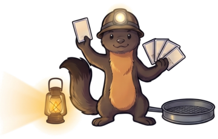

# The residudes mascot, one picture per stage

A miner otter with a helmet lamp and a hand residudes. Sixteen pictures: the thirteen dossier stages, plus three
states that are not stages (a loop back, a safety refusal, and the moves only a person may make).

## What is where

| folder | what | size |
|---|---|---|
| `logo/` | the portrait mascot: `source.png` as drawn, `logo.png` keyed onto transparency, and 1024 / 512 / 256 / 128 px |
| `sheets/` | the four stage images as generated, 2752×1536, four stages each in a 2×2 grid on white |
| `sheets/navy_with_captions/` | the first set, drawn on navy with the stage name painted on; kept on disk, not in git |
| `cells/` | each sheet quartered, exactly as drawn |
| `cutout/` | the background keyed out: transparent, trimmed to the art, about 1000×700 |
| `small/` | `cutout/` at 800 px wide, for slides and posters |
| `thumb/` | at 360 px, for README tables and skill headers (about 50 kB each) |
| `fig/` | at 480 px, embedded in the overview figures, which render at 1.5× |

`python3 split_mascots.py .` rebuilds `cells/` and `cutout/` from `sheets/`, and `python3 make_logo.py .` rebuilds
`logo/` from `logo/source.png` (any python with numpy, scipy and Pillow). `small/`, `thumb/` and `fig/` are
`convert <f> -resize 800x -strip`, `-resize 360x` and `-resize 480x`.

**Where they are used.** The logo heads [the repo README](../README.md) and [residudes's](../residudes/README.md), and
sits in the corner of both overview figures. The stage pictures run as a table under residudes's stage diagram, and
six of them are the stations of the metro map in [`docs/figures/make_figures.py`](../docs/figures/make_figures.py),
embedded as data URIs so each figure stays a single file. `human_only` marks the line about who may resolve,
approve and submit in [residudes's own figure](../residudes/docs/figures/make_figures.py).

## The stages

File names are the dossier's own stage names in lower case, so a deck or a page can look up `<stage>.png` directly.

| file | stage | what the mascot is doing |
|---|---|---|
| `new` | NEW | holding the sealed FASTA envelope, chains hanging from the seal, residudes barely lit |
| `identified` | IDENTIFIED | magnifier over a page, the papers it has read at its feet |
| `hypotheses` | HYPOTHESES | fanning V0–V3 variant cards, three ghosts of itself behind it |
| `plan_review` | PLAN_REVIEW | holding out the brief — the pen is in a person's hand |
| `inputs_ready` | INPUTS_READY | loading input.json cards and an MSA ribbon into a tray |
| `running` | RUNNING | riding the GPU box, hourglass beside it, seeds flying off |
| `pool_ready` | POOL_READY | at the edge of a pool of models, net in hand |
| `results_review` | RESULTS_REVIEW | checklist in hand while a person points at the pool |
| `slate_proposed` | SLATE_PROPOSED | model 1 held high, the other four fanned, the gate sieve behind |
| `approved` | APPROVED | hands down, stepping aside as a person's stamp comes down |
| `packaged` | PACKAGED | boxing the five models, geometry checklist and ruler at its feet |
| `submitted` | SUBMITTED | waving the envelope off, hands empty |
| `retrospective` | RETROSPECTIVE | ledger and measuring tape beside the released structure |
| `loop_back` | — | walking back under a curved arrow: `loop:RUNNING`, `loop:HYPOTHESES`, a stage-2 reissue |
| `safety_refusal` | — | both palms up: a model safeguard refused and the target is parked |
| `human_only` | — | beside a padlock: approve, resolve and submit belong to a person |

The four pictures with a human hand or a lock in them carry residudes's rule: it proposes, a person decides.

## How the background is taken out

The sheets are drawn on flat white, so alpha is how far a pixel is from white. Three things need care.

- **The art is white too.** A page, a clipboard, an envelope, the whites of the eyes are the same 255 as the
  background, so only connectivity separates them. The outlines that should enclose them have hairline gaps that
  the white leaks through: The art mask is closed first to seal those, after which a flood from the border reaches
  the background and nothing else.
- **Compression ringing** in the white is far too faint to see but is not zero, and it stretched the crop box
  hundreds of pixels past the art. Alpha below 14 % is treated as noise rather than glow.
- **A figure can cross the divider** between cells, as a tail does, so each cell is cropped 90 px past its own
  quarter, and what lands in that margin is kept only if it belongs to this cell's figure.

A glow needs no special handling here: drawn on white it fades to white, so the same distance measure gives
it a soft alpha, and the colour is un-premultiplied so it does not wash out on a dark background.

The navy sheets in `sheets/navy_with_captions/` needed much more than this, and the script that handled them is in
the history: the vignette had no single colour, dark fur and dark navy are hard to tell apart near black, and a
glow painted on navy leaves a grey disc when keyed as opaque. If those sheets are ever reworked, start from
`git log -- mascot/split_mascots.py`.

## What is in git

The white sheets and `logo/source.png`, because nothing can regenerate them, and the sizes the docs load:
`thumb/`, `fig/` and the small logos. `cells/`, `cutout/`, `small/`, the full-size logo and the navy
sheets are derived or superseded, so they are ignored (see `.gitignore`) and come back with
`python3 split_mascots.py .` and `python3 make_logo.py .`.
