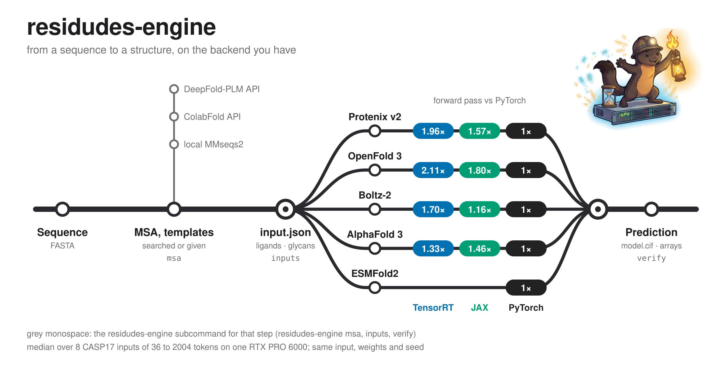
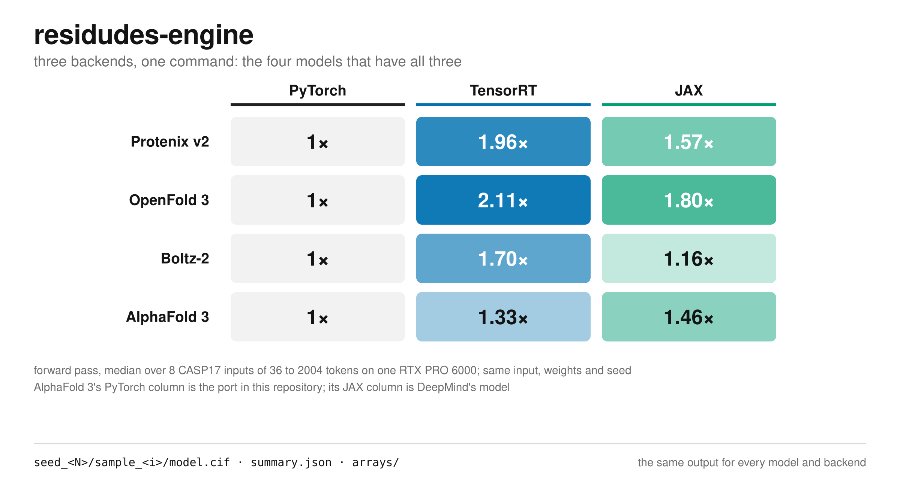

# residudes-engine

residudes-engine runs Protenix v2, OpenFold 3, Boltz-2, AlphaFold 3 and ESMFold2 from
one input file and writes the same output layout for each of them. It also builds that
input: MSA search through the DeepFold-PLM and ColabFold APIs or a local MMseqs2,
templates, ligands, glycans and constraints. The first four run on plain PyTorch,
or faster on the TensorRT and JAX backends included here, with the published
weights and the same results; ESMFold2 is PyTorch only and takes no templates
([`docs/esmfold2.md`](docs/esmfold2.md)). AlphaFold 3 is DeepMind's JAX model plus a
PyTorch port and TensorRT engines built from it ([`docs/alphafold3.md`](docs/alphafold3.md)).

The package serves as the prediction engine for the campaign agent
[residudes](../residudes/) and operates alongside [residudes-qa](../residudes-qa/). It was
formerly named foldmux; outputs written under that name (`.foldmux/run.json`) are still read, and
`FOLDMUX_*` environment variables remain supported.

The package is self-contained: model code, backends, the command-line interface and the recipes
that construct the runtime are all present in this tree. Nothing is retrieved at run time except
model weights, which `residudes-engine setup checkpoints` downloads from the respective
publishers. The AlphaFold 3 parameters are licensed per user by Google DeepMind and must be
installed manually.

[](docs/figures/overview.svg)

**One input file, five models, three backends.** A sequence becomes MSAs and templates, then one
`input.json` that every model reads; each model runs on PyTorch, TensorRT or JAX and writes the same output
layout. The ratios on the tracks are forward-pass speed-ups over that model's own PyTorch path (Figure 2).

## Installation

```sh
cd RESIDUDES/residudes-engine
export PATH="$PWD/bin:$PATH"                                  # or: pip install -e .
residudes-engine setup site --checkpoints <weights> --engines <engines>
residudes-engine setup all                                    # runtime venv, weights, then doctor
residudes-engine prepare --fasta target.fasta                 # MSA search, then input.json
residudes-engine predict --model pt2 --input engine_out/target_inputs/input.json
```

Or take the published image and mount the weights: [`containers/README.md`](../containers/README.md).

## Documentation

| Topic | Document |
|---|---|
| Commands and their options | [`docs/usage.md`](docs/usage.md): setup, prediction, input construction, TensorRT engines |
| Input specification | [`docs/inputs.md`](docs/inputs.md) · [`docs/input_schema.md`](docs/input_schema.md) |
| Output specification | [`docs/output_schema.md`](docs/output_schema.md) |
| Benchmarks | [`docs/benchmark.md`](docs/benchmark.md) · [`docs/benchmark_details.md`](docs/benchmark_details.md) |
| Model-specific notes | [`docs/alphafold3.md`](docs/alphafold3.md) · [`docs/esmfold2.md`](docs/esmfold2.md) |
| Site configuration | [`docs/sites.md`](docs/sites.md) |
| Architecture and development | [`docs/architecture.md`](docs/architecture.md) · [`docs/development.md`](docs/development.md) |
| Troubleshooting and verification | [`docs/troubleshooting.md`](docs/troubleshooting.md) · [`docs/verification.md`](docs/verification.md) |

## Performance

[](docs/figures/speed.svg)

**Forward-pass speed-up over PyTorch.** Same input, weights and
seed; one run per model, backend and input, so run-to-run variation is not
measured ([benchmark.md](docs/benchmark.md)). Median over eight CASP17 inputs
of 36 to 2004 tokens on one RTX PRO 6000. The gain grows with input size (up to 2.7× at 2000 tokens),
every backend runs 2004-token inputs on one card, and the backends predict
the same structures. Per-input numbers, the size curves and the comparison
with published work: [`docs/benchmark.md`](docs/benchmark.md).

## Repository layout

```
residudes-engine/
├── bin/residudes-engine          launcher, no installation
├── sites/               machine descriptions (TOML); local.example.toml is the template
├── scripts/             mmseqs2_search.sh; slurm/ job wrappers
├── src/residudes_engine/         the CLI: registry, config, runners, msa, inputs, setup, verify
├── tests/               unit tests, no GPU needed (python3 -m unittest discover -s tests)
├── docs/                this documentation, figures, benchmark results
└── core/                the runtime: model code, TensorRT and JAX backends, adapters, lockfile
```

Outputs go to `./engine_out/` by default. `runs/` is scratch space that git
ignores.

## Limitations

- ESMFold2 is not run by residudes-engine.
- `submit` targets Slurm. Other schedulers run `predict` directly.
- Pre-built engines are not distributed; `engines build` is the supported path.
- The optional JAX environment with fused kernels (`venv_jax`) is built separately with `core/scripts/setup_jax_venv.sh`.

## Licence

residudes-engine's own code is [MIT](../LICENSE). The model code vendored under `core/models/` keeps its authors'
terms: AlphaFold 3 is CC BY-NC-SA 4.0 (**non-commercial**), Protenix and OpenFold 3 are Apache-2.0. Weights and
databases are not distributed here and carry their own.

## Citation

Cite the CASP17 abstract of group 077 — the BibTeX entry is in the [repository README](../README.md#citation) and in [`CITATION.cff`](../CITATION.cff).
