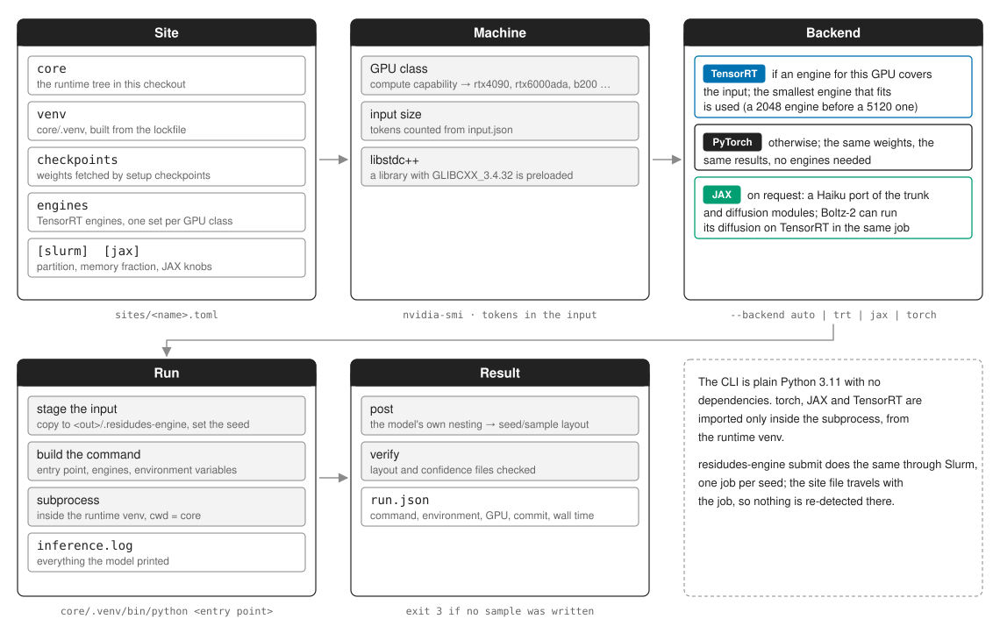

# Architecture

residudes-engine has two halves. `core/` is the runtime: the model code (Protenix,
OpenFold 3, and Boltz-2 through its PyPI package), the TensorRT and JAX
acceleration backends, the AF3-dialect input adapter and the unified output
writers, plus a `pyproject.toml` + `uv.lock` that pin the whole Python
stack. `src/residudes_engine/` is the CLI around it, and it owns four things:

| concern | where | why it is separate |
|---|---|---|
| names | `registry.py` | one tag per model / backend / GPU; engine-dir conventions live here only |
| machine paths | `sites/<site>.toml` + `config.py` | no path in code; one file per machine |
| entry points | `cli.py` + `runners/` | one CLI instead of a shell script per model × backend × cluster |
| output contract | `verify.py` | every result is checked against the same layout |

## A `predict` call, end to end



```
residudes-engine predict --model pt2 --input input.json --seed 1
│
├─ config.load_site()        sites/ada.toml (by --site, $RESIDUDES_ENGINE_SITE, or hostname)
├─ config.detect_gpu()       nvidia-smi compute_cap → "12.0" → tag rtx6000ada
├─ registry.get_model("pt2") family=protenix, checkpoint, engine-dir convention
├─ _resolve_backend("auto")  trt if find_engine_dir(<engines>, rtx6000ada, pt2) else torch
├─ _default_out()            engine_out/<input name>_pt2/seed_1
│
├─ runners.protenix.plan(req)
│    ├─ stage_input()        copy input → <out>/.residudes-engine/input.json, modelSeeds=[1]
│    ├─ resolve_engines()    known dir for this GPU, else the largest locally built <prefix>_<kernel>_<N>
│    ├─ runtime_env()        LD_PRELOAD (GLIBCXX_3.4.32 libstdc++), LD_LIBRARY_PATH (cueq, nvidia, tensorrt_libs),
│    │                       PYTHONPATH (models/protenix : thirdparty : core), caches, RESIDUDES_ENGINE_JAX_* knobs
│    └─ cmd = core/.venv/bin/python core/protenix/inference.py --model_name protenix-v2 …
│
├─ run_plan()                subprocess, cwd=core, stdout → <out>/inference.log
├─ runners.protenix.post()   flatten <out>/<job>/seed_1/* → <out>/, drop native clutter
├─ verify.check_seed_dir()   no sample_<i>/ → exit 3 even if the model exited 0
└─ write_manifest()          <out>/.residudes-engine/run.json  (cmd, env, GPU, commit, wall time, exit code)
```

Every family runner has the same two functions: `plan(req) -> Plan` (pure:
builds command + env, stages input, fails early on a missing checkpoint or
engine) and `post(req, plan)` (moves the model's native nesting into the
unified layout). Nothing in `src/residudes_engine` imports torch, JAX or the model
packages; those are imported only inside the subprocess, from `core/.venv`.

## Layers (dependency direction: top → bottom)

```
cli.py            argparse; setup / doctor / predict / submit / verify / engines / models / sites / env
setup.py          weights download, site-file writer, engine build plan, Slurm wrapper
runners/          per family: protenix.py, openfold3.py, boltz.py  (+ _common.py)
config.py         Site, GPU detection, libstdc++ detection, runtime_env()
registry.py       MODELS, BACKENDS, KERNELS, GPUS, find_engine_dir(), engine_max_seq_len()
verify.py         output-contract checker (standalone)
schema/           stable import path for cif / logits / provenance helpers
core/             the runtime (see core/README.md)
```

`schema/` points into `core/scripts/` today; the helpers move into the
package in a later step without changing the import path.

## Inside `core/`

```
core/
├── protenix/   openfold3/   boltz/     per-family TensorRT compat layers, engine converters, entry points
├── residudes_engine_jax/                        JAX (Haiku) backend: pairformer, token transformer, DLPack bridge to the PyTorch weights
├── scripts/                            af3_input_adapter.py, boltz_inference*.py, cif_normalize.py, logit_codec.py, inputs_meta.py
├── models/protenix, models/openfold-3  model code with the unified-output writers and template-weight hooks
├── thirdparty/                         tensorrt_bionemo (NVIDIA TRT engine pipeline), tensorrt_llm_lite, ipsae
├── pyproject.toml, uv.lock             the runtime's pinned dependency set
└── examples/                           model-native example inputs
```

Entry points inside `core/` locate their siblings by relative path, which is
why the tree is kept intact and why residudes-engine runs them with `cwd=core`.
Several module and environment-variable names in `core/` are historical;
the CLI maps the user-facing `RESIDUDES_ENGINE_JAX_*` knobs onto them.

## Extension points

- **New model version**: add a `ModelSpec` in `registry.py` (checkpoint,
  engine prefix, known engine dirs, weight source). If the family CLI is
  unchanged the existing runner works.
- **New family**: `runners/<family>.py` with `plan()`/`post()`, registered in
  `runners/__init__.py`, plus a `ModelSpec`. Keep the command line identical
  to a known-good invocation; let `post()` do the flattening.
- **New site**: `residudes-engine setup site …` or copy `sites/local.example.toml`.
- **New GPU class**: add the compute capability to `registry.GPUS`; engines
  for it come from `residudes-engine engines build`.
