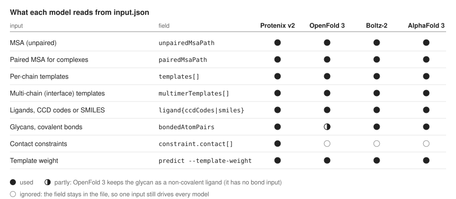

# From a sequence to an input: MSAs, templates, ligands, glycans, constraints

`residudes-engine prepare` turns a FASTA into the AF3-dialect `input.json` that every
model runs from. It is two steps that can also be run separately:

```sh
residudes-engine msa    --fasta q.fasta [--sto A2B1] --source plmmsa|colabfold|mmseqs2   # → <out>/msa/
residudes-engine inputs --fasta q.fasta [--sto A2B1] [templates / ligands / glycans …]    # → <out>/input.json
residudes-engine prepare …                                                                # both
residudes-engine predict --model pt2 --input <out>/input.json
```

`<out>` defaults to `engine_out/<name>_inputs/`. The FASTA holds one record per
distinct chain (A, B, C … in order); `--sto A2B1` gives the copies.

Everything below was used in the CASP17 protocol. Where a feature made a
measurable difference there, the table says so.

## 1. MSA sources

| `--source` | What it is | Gives | Needs | Time |
|---|---|---|---|---|
| `plmmsa` (default) | **DeepFold-PLM MSA API** (`https://plmmsa.deepfold.org`): the query is embedded with a protein language model, neighbours are retrieved from a UniRef50 PLM index and aligned with `otalign` (default), `plmalign` or `plm_blast` | unpaired A3M per chain | network | 3–10 min per chain |
| `colabfold` | **MMseqs2** through the ColabFold MSA server API (public `https://api.colabfold.com`, or a self-hosted server): UniRef30 + environmental DB, species pairing for complexes, PDB70 template hits | unpaired + paired A3M, template hits | network | 1–5 min |
| `mmseqs2` | **MMseqs2 on this machine** (`scripts/mmseqs2_search.sh`, the ColabFold recipe used in CASP17, GPU-capable) | unpaired A3M, PDB100 template hits | `mmseqs` + databases (`--db`, ~500 GB) | 30 s – minutes |

Why two very different sources: HMMER and MMseqs2 find homologues by sequence
similarity, so they go quiet together on shallow families; the PLM search
finds neighbours in representation space and recovers remote homologues
(with more noise). In CASP17, 107 targets used MMseqs2-GPU MSAs and 32 used
plmMSA; the two were run side by side and the better model was picked. Merge
them in one run with `--source plmmsa,colabfold` (A3Ms are concatenated and
de-duplicated, query first).

Options: `--aligner`, `--mode`, `--score-model` (plmmsa; defaults follow the
aligner's reference setup: otalign → ankh_large, plmalign/plm_blast →
prott5); `--no-env`, `--no-filter`, `--no-pair`, `--pairing greedy|complete`
(colabfold); `--db`, `--mmseqs`, `--gpu`, `--threads` (local). Endpoints and
paths can live in the site file:

```toml
[msa]
plmmsa_api    = "https://plmmsa.deepfold.org"   # or RESIDUDES_ENGINE_PLMMSA_API; token: PLMMSA_TOKEN
colabfold_api = "https://api.colabfold.com"     # or RESIDUDES_ENGINE_COLABFOLD_API (self-hosted server)
mmseqs_bin    = "mmseqs"                         # or "apptainer exec --nv mmseqs2-gpu.sif mmseqs"
mmseqs_db     = "/data/mmseqs"                   # uniref30_2302_db, colabfold_envdb_202108_db, pdb100_230517
```

Output: `<out>/msa/unpaired_<X>.a3m`, `paired_<X>.a3m` (when the server
paired), `templates_<X>.m8`, and `msa.json` (depths, source, settings).
Identical chains share one search. When a paired MSA exists, `inputs` writes
`pairing_mode.txt = precomputed` next to `input.json` so OpenFold 3 pairs by
row (the other models read the paired file directly).

## 2. Templates

| flag | does | CASP17 use |
|---|---|---|
| *(default)* | top 4 PDB hits from the search's `.m8` become per-chain templates: the chain is cut from the mmCIF (fetched from RCSB into the cache, or `--mmcif-dir`), aligned to the query, index maps written | every target |
| `--max-template-date 2021-03-01` | drop hits deposited later, for held-out evaluation against a weight set's PDB cutoff | re-runs after CASP |
| `--no-templates` / `--no-search-templates` | MSA-only input, or keep only explicit templates | 38 targets "MSA-only": a control for whether templates hide the true interface |
| `--pin-template D=7mem:E[@0]` | force a PDB chain (id or file, auth chain) into chain D's list at a rank | pinned antigen chains for H targets |
| `--self-template C=<seed_dir>` | a previous prediction's chain becomes the template (stepwise assembly: predict C1D1E1, then use it inside A1B1C1D1E1) | 24 targets, 31 k samples |
| `--multimer-template 8yiv:C=A,D=B,E=C` | **interface template**: several output chains from several chains of one structure; the inter-chain geometry goes into the pair representation (all three models) | 22 targets, 90 k samples, see below |
| `--no-per-chain-template A,B` | clear the per-chain templates of those chains (FASTA letters; templates belong to the sequence, so every copy is affected) when a multimer template already covers them | with the above |
| `--templates-from X=templates.json` | any AF3 templates list you built yourself | custom CIFs |
| `predict --template-weight W` | scale the template embedder's contribution (0 = off, 1 = normal; sweep 2, 4, 8 to force a template) | 7 targets |

Per-chain templates guide each chain's fold only; the multimer template is
what placed chains relative to each other. Measured on AlphaFold 3 top-5
models, no template → template:

| case | pinned | ipTM | RMSD to the template |
|---|---|---|---|
| H2338, Factor XIa 2 chains (5I25) | antigen | 0.62 → 0.74 | 17.0 → 1.8 Å |
| H1400, LujoGP trimer (8P4T) | trimer | 0.38 → 0.53 | 22.7 → 4.4 Å |
| H1354, HA trimer (8VCC) | trimer | 0.62 → 0.76 | 2.0 → 1.9 Å |
| E2368, RBD open | rigid body | 0.83 → 0.86 | 16.2 → 6.4 Å |
| T1331, 7E4M dimer (a wrong hypothesis) | dimer | 0.25 → 0.17 | 23.5 → 22.7 Å |

The last row is the caveat: a template is a hypothesis, and the models follow
it. Keep a no-template run as the control.

Template sequences need not be identical to the query: chains are aligned
globally (BLOSUM62) and only aligned positions are mapped; a multimer
template chain below 30 % identity is rejected as a probable wrong mapping.

## 3. Ligands, glycans, constraints

```sh
--ligand ATP=ccd:ATP            --ligand MG*2=ccd:MG        --ligand lig=smi:'CC(=O)Oc1ccccc1C(=O)O'
--glycan A29:NAG-NAG-BMA        # N-glycan core on Asn29 of every copy of chain A (Asn ND2 → NAG C1, O4 → next C1)
--glycan B150:A2G@OG1           # O-GalNAc on Thr150
--contact A:104=B:166@max=5     # Protenix contact constraint, replicated protomer-wise (copy i ↔ copy i)
```



Who consumes what (through `core/scripts/af3_input_adapter.py`): ligands and
multimer templates go to all three models; glycans (`bondedAtomPairs`) to
Boltz-2 and Protenix as covalent bonds, while OpenFold 3 keeps the sugar as a
non-covalent ligand; contacts to Protenix only. Output chain letters follow assembly order (A2B1 →
A, B, C), ligands and glycans take the next free letters; the glycan of a
homomer is attached to every protomer.

## 4. Provenance

Every `input.json` comes with `sources.json` (FASTA, stoichiometry, MSA
source and settings, every template with its origin, ligands, glycans,
contacts) and the MSA directory keeps `msa.json`. residudes-engine records the input
path in each run's `.residudes-engine/run.json`, so a result can always be traced to
how its input was made.

## 5. Limits

- Nucleic-acid chains are passed as sequences without MSAs (`rna` / `dna`
  entries can be added to the JSON by hand).
- The PLM API does not pair chains; for complexes combine it with
  `colabfold` (`--source plmmsa,colabfold`) to get a paired MSA.
- `mmseqs2` (local) is the CASP17 command chain verbatim; it has been run on
  the team's GPU host only.
- Template dates are taken from the mmCIF's deposition / revision records when
  present; a file without dates is kept.
