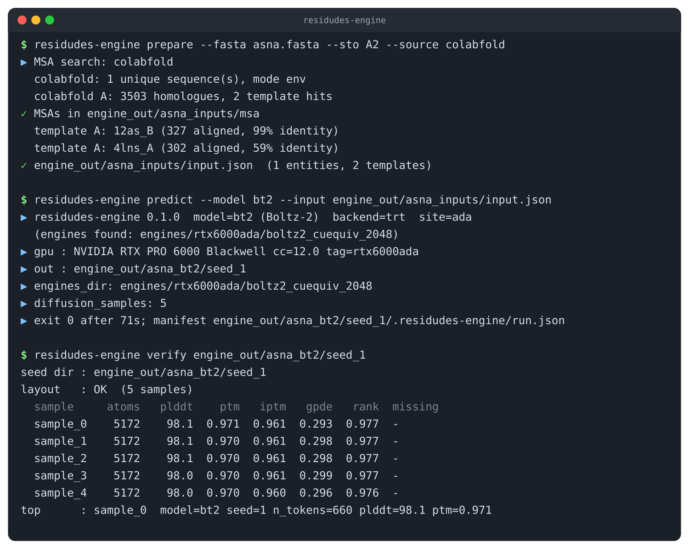

# Running it: setup, predictions, inputs, engines

The README has the three commands; this is each step with its options.

## Setup

Linux x86_64, an NVIDIA GPU of the Ada, Hopper or Blackwell generation with
a driver for CUDA 12.8 or newer, Python 3.11 or newer on `PATH`, and
[uv](https://docs.astral.sh/uv/). Disk: 13 GB for the runtime, 6.4 GB for the
weights, 2 to 8 GB per GPU class for optional TensorRT engines.

```sh
git clone https://github.com/DeepFoldProtein/RESIDUDES.git
cd RESIDUDES/residudes-engine
export PATH="$PWD/bin:$PATH"     # or: pip install -e .

residudes-engine setup site --checkpoints /data/weights --engines /data/engines   # where weights and TRT engines go
residudes-engine setup venv          # the runtime, from the lockfile; add --slurm to build on a compute node
residudes-engine setup checkpoints   # model weights from each publisher, sizes and checksums verified
residudes-engine doctor              # paths, GPU, libstdc++, venv imports, TensorRT plugin
```

### Container alternative

Three of the eight published images provide this package's runtime and make `setup venv`
unnecessary. This includes the AlphaFold 3 C++ extension, which otherwise has to be compiled
locally from five fetched repositories:

| Image | Runtime it provides |
|---|---|
| `residudes-engine-trt` | Protenix v2, OpenFold 3, Boltz-2; PyTorch and TensorRT 10.16 |
| `residudes-engine-jax` | AlphaFold 3 and the JAX backends, extension already built |
| `residudes-ef2` | ESMFold2, which needs its own python 3.12 and a forked transformers |

```sh
apptainer exec --nv -B $PWD:/opt/residudes-engine -B /data/weights:/ckpt \
    images/residudes-engine-trt.sif residudes-engine predict --model pt2 --input input.json
```

`setup site` still determines where weights and engines are stored, and `setup checkpoints` still
downloads them: an image contains the runtime and never the data. TensorRT engines are compiled
for a specific GPU model and are therefore built on the machine that will use them, either inside
or outside the image. [`containers/README.md`](../../containers/README.md) describes all eight
images, and `containers/verify.sh --gpu` exercises each GPU image on the local card.

`setup all` runs the last three steps in one go. `bin/residudes-engine` is a
launcher without dependencies: it runs the CLI with any Python 3.11 and
starts the model from the runtime venv it built. Put `bin` on your `PATH`,
or run `pip install -e .` once for a `residudes-engine` console script. On a Slurm
cluster add `--scheduler slurm --partition <name>` to `setup site`.

## Predict

```sh
residudes-engine predict --model pt2 --input input.json                 # → engine_out/<name>_pt2/
residudes-engine predict --model bt2 --input input.json --backend jax --seed 3 --out runs/bt2/seed_3
residudes-engine submit  --model of3 --input input.json --seeds 1-5     # Slurm: one job per seed
residudes-engine verify  engine_out/<name>_pt2 [--ref other/seed_1]    # layout check and confidence table
```

[](figures/terminal.svg)

The input is an AlphaFold 3-style `input.json` with MSAs and templates
attached ([`docs/input_schema.md`](input_schema.md)). Model-native
inputs (Protenix JSON, OpenFold 3 query JSON, Boltz YAML) are accepted as
they are.

`--backend auto`, the default, uses TensorRT when engines for this GPU exist
and PyTorch otherwise. `--backend jax` runs the JAX port. Per-model options:
`--num-recycles`, `--diffusion-samples`, `--template-weight`,
`--pairing-mode` (OpenFold 3), `--engines-dir`. Anything after `--` goes to
the model's own command line.

Every run ends up as `seed_<N>/sample_<i>/` with `model.cif`,
`summary.json` (pLDDT, pTM, ipTM, gPDE, per chain) and the PAE, PDE and
contact arrays, plus a `run.json` that records the command, environment,
GPU and commit ([`docs/output_schema.md`](output_schema.md)).

## Build the input

```sh
residudes-engine prepare --fasta target.fasta                                  # MSA from the DeepFold-PLM API, then input.json
residudes-engine prepare --fasta complex.fasta --sto A2B1 --source colabfold   # MMseqs2 through the ColabFold API: MSAs, pairing, PDB templates
residudes-engine inputs  --fasta complex.fasta --sto A1B1 --glycan A29:NAG-NAG-BMA --multimer-template 8yiv:A=A,B=B
```

`prepare` is `msa` followed by `inputs`. The MSA step takes one or more
sources (`plmmsa`, `colabfold`, `mmseqs2`) and merges them. The input step
adds templates from the search hits or from a PDB chain, an earlier
prediction or a multi-chain structure, plus ligands, glycans and contact
constraints, and writes the `input.json` with a `sources.json` next to it
that says where everything came from. The options and what each one did in
CASP17 are in [`docs/inputs.md`](inputs.md).

## TensorRT engines

Engines are built on the machine that will use them, once per GPU class:

```sh
residudes-engine engines list                                   # what exists for this GPU
residudes-engine engines build --model pt2 --max-seqlen 1024    # 15 to 60 minutes on one GPU; --slurm to submit
```

Engines are tuned for the size range they were built for, so a 2048-token
set next to a large one pays off: residudes-engine picks the smallest engine that
covers each input. What the engines buy is in the Speed section above.

## Commands

| command | what it does |
|---|---|
| `setup site` | write `sites/<name>.toml` with this machine's paths |
| `setup venv` | build the runtime venv at `core/.venv` (`--slurm` to build on a compute node) |
| `setup checkpoints` | download model weights, checking size and sha256 |
| `setup all` | venv, checkpoints, doctor |
| `doctor` | check the site, the GPU, libstdc++, the venv imports and the TensorRT plugin |
| `msa` | MSA search: `plmmsa`, `colabfold` or `mmseqs2` |
| `inputs` | assemble `input.json`: stoichiometry, MSAs, templates, ligands, glycans, constraints |
| `prepare` | `msa` then `inputs` |
| `predict` | one prediction on this machine; exit 3 if the model wrote nothing |
| `submit` | the same through Slurm, one job per seed, logs in the seed directory |
| `verify` | check a seed directory against the output layout, compare with a reference |
| `engines list`, `engines build` | TensorRT engines for this GPU |
| `models`, `sites`, `env` | show the registry, the site files, the runtime environment |

Models are `pt2`, `of3`, `bt2`, `af3`; backends `auto`, `trt`, `jax`, `torch`;
GPU classes `rtx4090`, `rtx6000ada`, `b200`, `h100`, `a100`, detected from
the compute capability.
