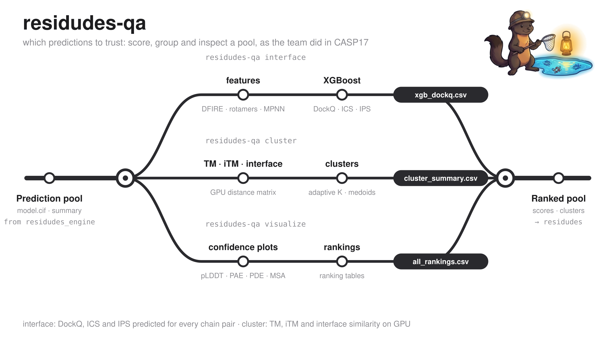

# residudes-qa

residudes-qa scores and inspects pools of predicted structures, providing per-interface quality
predictions, clustering, and standard confidence plots. It is the quality-assessment stack used by
the DeepFold team in CASP17, consolidated from the team's analysis tree into a single package
without hard-coded paths, with pinned dependencies and checksummed data files. The CASP17 command
lines remain valid.

[](docs/figures/overview.svg)

**From a prediction pool to a ranked pool.** Three analyses are applied to the same models: prediction
of interface quality (DockQ, ICS and IPS, from gradient-boosted trees on interface features), clustering on
GPU-computed distance matrices, and confidence plots. Each produces one table, and the three are joined on the
model name.

| Module | CASP17 origin (`casp17/analysis/`, `casp17/visualization/`) | Function |
|---|---|---|
| `residudes_qa.interface` | `XGBDimerScorer_tool/xgbdimer` | **Interface scorer.** Extracts features for every chain-pair interface and predicts DockQ, ICS and IPS with XGBoost. PPI models v6; antibody–antigen models v9 and v10.1. The method is not restricted to dimers, which the renaming reflects. |
| `residudes_qa.cluster` | `MassiveClustering_tool/massiveclustering`, `run_clustering.py` | GPU TM / iTM / dRMSD / interface clustering, adaptive K, medoids, consensus, Leiden networks, join with interface scores |
| `residudes_qa.ema` | `EMA/scorers` (the ones the features use) | DFIRE v2, aADARS v3, Dunbrack bbdep and NDRD rotamer terms, H-bond network, ProteinMPNN likelihood |
| `residudes_qa.mpnn` | `MassiveClustering_tool/proteinmpnn/run` (code only) | vendored ProteinMPNN; weights live in the data root |
| `residudes_qa.visualize` | `visualization/` (af3-viz container) | pLDDT, PAE, PDE, distogram, contact-probability, Ramachandran and MSA images; `all_rankings.csv`, `summary.csv`, `per_seed_summary.csv` |

Position within RESIDUDES:
- `residudes-engine` constructs inputs and runs the predictors;
- `residudes-qa` assesses the resulting models;
- `residudes`, the campaign agent, drives both.

The CASP17 pools on which these scorers were fitted and evaluated are released publicly, unfiltered and with the
input of every model: [residudes-decoy](https://residudes-decoy.deepfold.org), 726,097 structures over 82 targets
([`docs/residudes-decoy.md`](../docs/residudes-decoy.md)). The AlphaFold 3 quarter of that pool may **not** be used
to train scoring or ranking models; the other 531,914 structures carry no such restriction.

## Installation

```sh
cd RESIDUDES/residudes-qa
uv sync --extra cu130                 # or --extra cu124; the CPU set needs no extra
uv run residudes-qa data fetch        # the 60 data files the scorers read
uv run residudes-qa doctor            # python, pins, torch and GPU, data, optional tools
```

Or take the published image: [`containers/README.md`](../containers/README.md) — one for the CPU
and one with the CUDA stack.

## Documentation

| Topic | Document |
|---|---|
| Installation, data files and commands | [`docs/usage.md`](docs/usage.md) |
| Clustering | [`docs/cluster/`](docs/cluster/) |
| EMA scorers | [`docs/ema/`](docs/ema/) |
| Provenance and licence of each component | [`PROVENANCE.md`](PROVENANCE.md) |

## Testing

```sh
cd residudes-qa
.venv/bin/python -m pytest tests          # 92 tests; nothing has to be installed, the conftest adds src/
sbatch tests/cluster/run_tests.sbatch     # the same on a compute node, with a GPU and bounded thread pools
```

The suite covers the clustering core — distance matrices, adaptive K, the dendrogram, the network
and multi-seed grouping, the visualisations and the CLI surface. None of it needs a GPU or torch:
nine pure-python dependencies, all pinned in `pyproject.toml`, which is why CI runs it
(`.github/workflows/tests.yml`). The GPU paths fall back to CPU when there is no card — 10 minutes
on a GPU node, about 1 without.

`tests/parity/` is the other kind of check, and it needs the CASP17 tools beside this one:
`cluster_t1417.py` runs this package and the original MassiveClustering on the same T1417 models on
one node and compares the TM matrix, the structure order and the cluster labels; `interface_t1417.py`
does the same for the interface scorer against XGBDimerScorer, including the scores it wrote during
the campaign. They are how this package was shown to reproduce what CASP17 ran.

## Provenance and licences

- `PROVENANCE.md`: where each part came from and what was changed.
- residudes-qa's own code: [MIT](../LICENSE), with the rest of this repository.

- ProteinMPNN: MIT (Dauparas et al., Science 2022).
- MassiveClustering carries its original MIT licence (`licenses/`).
- Dunbrack rotamer libraries: academic licence, not included.

## Citation

Cite the CASP17 abstract of group 077 — the BibTeX entry is in the [repository README](../README.md#citation) and in [`CITATION.cff`](../CITATION.cff). Work that uses structures from the pool should also cite the predictor that produced them.
