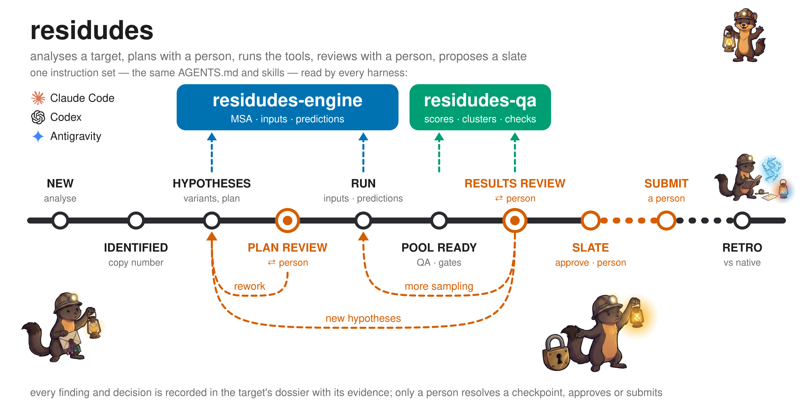
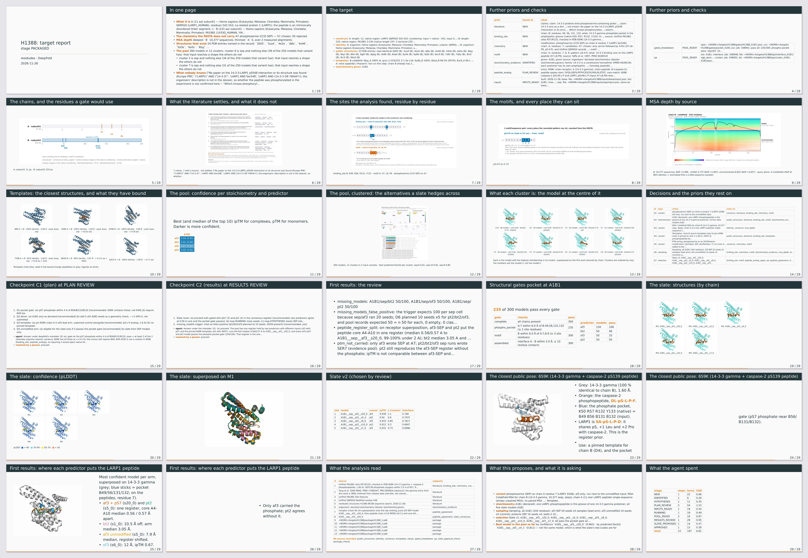

# residudes


The structure-prediction campaign agent used by the DeepFold team. The agent maintains one dossier per target
and carries it from a sequence to a slate of five submitted models, halting at every point that requires a human
decision.

| Property | Description |
|---|---|
| Analysis precedes modelling | construct definition, literature, public structures, MSA depth, functional sites and stoichiometry are established first, each recorded as evidence |
| Decisions are recorded | every decision cites the priors it rests on and the alternatives rejected (`residudes report`) |
| Inputs are constructed deliberately | family crawl for sparse MSAs, MODELLER assemblies used as AlphaFold 3 templates, and chemistry absent from the FASTA |
| Selection uses prior knowledge | functional sites become structural gates; confidence is used only to order the models that pass them |
| Two mandatory checkpoints | the plan, after analysis; the first results, before slate assembly |
| No autonomous approval or submission | both are performed by a human operator |

[](docs/figures/overview.svg)

**Stage sequence.** Thirteen stages lead from a sequence to a packaged slate. The two ringed stages are
the checkpoints, at which the agent writes a brief and halts; orange marks every action reserved for a human
operator. Dashed curves denote the three permitted loops back, and the bands indicate which stages drive
residudes-engine and which drive residudes-qa.

**What a run hands back.** The recorded run in [`examples/H1388`](examples/H1388/) ends with this report, all thirty
pages: the target and what was known about it, the MSAs and templates, the pool and its clusters, the two
checkpoints, the slate, and what the agent spent. molterm draws the decks along the way; the final one is
ray-traced in PyMOL ([PDF](examples/H1388/report/report.pdf)).

[](examples/H1388/report/report.pdf)

## Installation

```sh
cd RESIDUDES/residudes
uv sync                          # claude-agent-sdk (agent runner) and gemmi (gates); otherwise stdlib only
bin/residudes setup                # first run: an agent CLI does it with you (--manual for the questions)
bin/residudes doctor               # re-run at any time to re-check the installation

bin/residudes target add H1388 --fasta examples/H1388/H1388.fasta --stoich A1B1   # the example's own input
bin/residudes chat H1388           # talk to the agent about this target; ctrl-b d leaves it running
bin/residudes                      # what is running, and which target is waiting on a person
```

**Dossier location.** `setup` proposes `work_root/` in the directory it was run from, and lists any shared
dossier directories it finds on the machine so that one can be chosen instead. Another `residudes.toml` can be
supplied with `--config`. Because `residudes daemon` consumes paid agent steps, it requires its targets to be
named explicitly (`--target T1234`), or `--all` for every dossier in the directory.

**Installation on other systems.** The paths in this repository are those of the DeepFold cluster and are
defaults rather than requirements. [`catalog.toml`](catalog.toml) lists that cluster's databases, weights and
tools, and every site path in the source (MSA databases and binaries, the OpenStructure image, the plmMSA client,
PyMOL) can be overridden in `residudes.toml`: `[msa]` for databases and `[tools]` for programs. A binary present on
`PATH` takes precedence over a default path that does not exist. `residudes setup` writes that file and
`residudes doctor` reports which components are missing. Two of the components named there are internal to the team
and not public: `casp17-utils`, in whose absence `residudes package` halts after its geometry checks instead of
writing CASP files, and `target_notes`, a directory of per-target reading used only as a source of references.

## Documentation

| Topic | Document |
|---|---|
| Stage-by-stage description, with the measured effect of each stage on a CASP17 target | [`docs/how-it-works.md`](docs/how-it-works.md) |
| Worked example from the first command to the retrospective | [`docs/walkthrough.md`](docs/walkthrough.md) |
| Complete recorded run | [`examples/H1388`](examples/H1388/): from `target add` to a packaged slate under full automation - 15 steps, $6.81, 45 minutes; dossier, write-up, figures and transcripts |
| Installation and terminology | [`docs/setup-and-words.md`](docs/setup-and-words.md) |
| Supported agent harnesses | [`docs/harnesses.md`](docs/harnesses.md) · [`docs/harness_check.md`](docs/harness_check.md) |
| Per-target effect of model selection | [`docs/casp17_cases.md`](docs/casp17_cases.md) |
| Gates, literature handling, metrics | [`docs/gates.md`](docs/gates.md) · [`docs/literature.md`](docs/literature.md) · [`docs/metrics.md`](docs/metrics.md) |

## Skills

Each skill in `skills/` is a `SKILL.md` procedure derived from the team's CASP17 experience.

| Skill | Stage | Contents |
|---|---|---|
| `residudes-setup` | first run | resources, detection of stale databases, configuration; performed with the user |
| `residudes-intake` | NEW, HYPOTHESES | construct, the literature on the target and each partner (with sources; [`docs/literature.md`](docs/literature.md)), public structures first (47 CASP17 targets had one), sites that become gates, chemistry the FASTA leaves out (H2388), MSA depth and how to deepen it (crawl, plmMSA, ef2 test, RNA homologs) |
| `residudes-stoichiometry` | IDENTIFIED | assignment from evidence rather than defaults: absence of precedent does not imply a monomer, and under-estimation is the more costly error |
| `residudes-consult` | PLAN_REVIEW, RESULTS_REVIEW | checkpoint briefs, questions with options and a recommendation, result triggers and loops; the agent does not resolve a checkpoint |
| `residudes-modeller` | HYPOTHESES, RESULTS_REVIEW | a homolog's assembly, or a released complex with gaps, rebuilt on the target's sequences (MODELLER) as an AF3 multimer template; T2461o DockQ 0.46 → 0.88, H2422 0.35 → 0.94 |
| `residudes-selection` | POOL_READY, RESULTS_REVIEW, APPROVED | `residudes gate`: structural gates and a site census first (M2415 ligand 51.8 → 8.8 Å; H2321 is the case where the record is missing), then confidence within a predictor; residudes-qa; slate hedging; packaging checks |
| `residudes-ops-safety` | INPUTS_READY, RUNNING | sbatch / pueue, one watcher, unique tags, silent AF3 deaths, storage |
| `residudes-structure-view` | any conversation | show the shape instead of describing it: molterm's MCP tools for models, interfaces, gate sites and ligands, and when a picture is worth taking |

## Operational safeguards

- **Shell guard.** No recursive deletes, broad scans of shared storage, mass job cancellation, pueue wipes, force
  pushes, fast polling loops, CASP submission, `approve`/`resolve`, or changes to `RESIDUDES_ACTOR`. The guard
  constrains accidents rather than enforcing isolation: the agent runs as the same Unix user.
- **Writes** by the file tools go only under the target's dossier directory, and never to `dossier.json` itself.
- **Budgets.** Per-step USD and turn limits; a GPU-hour budget per target.
- **Operator-only actions.** Resolving a checkpoint, looping back, approving a slate and submitting are performed
  only by a human operator. The stage machine rejects these actions from the agent, and an approval issued in an
  earlier round is not carried forward.

## Repository layout

```
residudes/
  AGENTS.md              the instructions every harness reads (CLAUDE.md imports it)
  bin/residudes            launcher (uv venv if present, else any Python >= 3.11)
  catalog.toml           databases / weights / tools with paths and freshness rules
  skills/<name>/SKILL.md playbooks (.claude/skills, .agents/skills and .agent/skills link here)
  src/residudes/           config, resources, catalog, setup, dossier (stages, checkpoints), guard, agent, cli,
                         pool, slate, ops (qa/jobs), consult (checkpoints, review), report, retro, export, daemon
  .claude/settings.json  Claude Code in this folder acts as the agent
  examples/H1388/        one live run, from `target add` to the plan checkpoint
  docs/figures/          overview figure (make_figures.py, drawn from an example dossier)
  tests/                 core, pool/slate/retro, and harness compatibility
```

## Citation

Cite the CASP17 abstract of group 077 — the BibTeX entry is in the [repository README](../README.md#citation) and in [`CITATION.cff`](../CITATION.cff).
