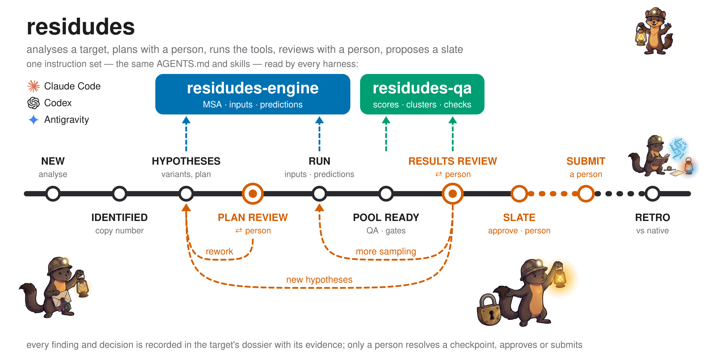

# How it works

What the agent does on a target, in the order it does it. The short version is in
[the README](../README.md); this is the same list with what each step bought on a CASP17 target.

residudes is the DeepFold team's structure-prediction campaign agent. It keeps one dossier per target and takes each
target from its sequence to a slate of five models.

- **It analyses the target first.** That means the construct and its identity, the literature, public structures
  (exact-sequence and foldseek sweeps), MSA depth and its gaps, templates, and the stoichiometry evidence. Every
  finding is recorded as evidence.
- **It reads the literature on the target and on each partner, and that reading is what it acts on.** Where a partner
  binds, how many copies there are, which chemistry the sequence does not carry, which published structure is the
  right template and which state it is: all of it comes from the papers, and each claim is recorded with its source.
  On H2319 the antibody's epitope (from escape selection in its own paper) became a structural gate and the antigen's
  recent crystals — missing from the default template database — became the template: model 1 scored DockQ 0.93,
  against 0.67 for the pool's most confident model. See [what the literature gives a target](literature.md).
- **Every decision rests on those priors.** Stoichiometry, input variants, sampling and the slate each name the
  evidence they rely on and the alternatives they rejected. `residudes report` shows which prior reached which
  decision.
- **It works it out with a person at two checkpoints.** The prediction plan is discussed after the analysis, and the
  first results are reviewed before the slate. Unusual results lead to another round only if the person decides so.
- **It builds better inputs when the defaults fall short.**
  - **An empty MSA gets a family crawl.** `residudes msa T --crawl --family PF…` (the family comes from the analysis)
    collects the Pfam/InterPro family members, runs hmmsearch over
    UniRef90 and MGnify, and aligns every sequence to the query with OTalign. In the T1331 replay the agent's own crawl
    took the default MSA of 0 sequences to 28,968 (27,319 covering at least half the query). The CASP17 MSA of that
    family took AF3's median lDDT from 0.33 to 0.70. A shallow MSA with no family gets plmMSA (`--plm`; T1357
    0.59 → 0.88, T2371 0.37 → 0.87).
  - **A public assembly becomes an AF3 multimer template built on the target's own sequences** (`residudes-modeller`,
    MODELLER). A homolog's 24-mer took T2461o from DockQ 0.46 to 0.88. The released H2422 complex, with its missing
    residues built, took H2422 from 0.35 to 0.94.
  - **Chemistry the FASTA leaves out goes into the input.** H2388's description said "phosphopeptide"; the 14-3-3
    motif picked the serine, and af3's median DockQ went from 0.24 to 0.82.
- **It selects by what it knows, then by confidence.** The analysis's sites (an epitope from escape mutants, a pocket
  from the literature, a reference for a rigid part) become structural gates and a site census (`residudes gate`). Among
  the models that pass, af3's most confident leads and the predictors alternate after it. In CASP17, choosing by
  gates first and confidence second gave model 1 a mean DockQ of 0.651 over 37 complexes, against 0.564 for the
  highest ranking_score across predictors (paired difference +0.088, Wilcoxon p = 0.001; against af3's confidence
  alone, +0.059). See
  [what CASP17 taught residudes](casp17_cases.md), case by case, [the gate reference](gates.md), and
  [what the metrics are](metrics.md).
- **It runs the tools.** [residudes-engine](../../residudes-engine/) makes the predictions and [residudes-qa](../../residudes-qa/) assesses the
  pool, both through sbatch or pueue.
- **A person approves and submits.** The agent never does. After approval, `residudes package` checks the slate's
  geometry and writes the CASP files through the team's casp17-utils. Anything it flags waits for a person.

**The stage line.** Thirteen stages from a sequence to a packaged slate. The two ringed stations
are the checkpoints, where the agent writes a brief and stops until a person resolves it; orange marks every
move reserved for a person. The dashed curves are the three loops back, and the bands above show which stretch
drives residudes-engine and which drives residudes-qa. Under the title is where it runs: **Claude Code, Codex and
Antigravity all read the same `AGENTS.md` and skills**, and so does the Claude Agent SDK runner that `residudes
agent step` and `residudes daemon` use. The three marks say which harnesses read those files, not which have been
exercised:
what each was actually tried in is
[below](#built-for-claude-code-codex-and-antigravity-run-in-claude-code).

In a real dossier every decision cites the priors the analysis found, and `residudes report` prints that map:
on T1416, a live replay, twelve priors reached ten decisions, two of them through the person's checkpoint.

The same command writes the analysis as a document, and it leads with the target rather than with the record:
what it is (organism, family and fold with their Pfam or InterPro ids, the construct and its numbering offset),
the sequence counted chain by chain, how deep the MSAs are per chain and per database, the structures the searches
returned with the identity and coverage they reported, and the slate with residudes-qa's predicted DockQ beside each
predictor's own confidence. It draws a map of each chain carrying the residues a gate would use, and links the
coverage plot. [`examples/H1388`](../examples/H1388/) is a run from the first command to a packaged slate, and its
[`analysis.md`](../examples/H1388/analysis.md) is what the document looks like.

## What this does not show

The evidence for residudes is one campaign's worth, and it is worth knowing where it is thin before relying on it.

- **The selection result rests on 56 targets, 37 of them complexes, from CASP17 alone**, scored against natives as
  they were released rather than on a held-out benchmark. The margin over ranking the whole pool by confidence is
  solid (+0.088 DockQ, Wilcoxon *p* = 0.001); the margin over af3's own confidence, which is what a
  single-predictor pipeline would use, is +0.059, and 9 to 11 of those targets came out worse
  ([`docs/casp17_cases.md`](casp17_cases.md)).
- **The gates were set per target by a person who could see the pool.** No part of this is an automatic rule
  measured on data it had not seen, and on H2321 the submitted model failed one of its own gates while being the
  best model in the pool: the choice that produced it was never written down. That case is the argument for the
  dossier, not for the rubric.
- **The per-target cases are selected.** Each is there because an intervention measurably changed the outcome;
  nobody counted the times it changed nothing.
- **The interface scorer is validated on a benchmark, not on single-target pools**, and CASP17 produced a target
  where it ranked the pool backwards (ρ = −0.28). residudes leaves it out of the slate by default for that reason.
- **Two of the three harnesses have never been run**, only laid out and tested against their documented rules.
- **Five replays, no live campaign.** The agent has taken CASP17 targets from a dossier to a proposed slate; no
  target has gone from a fresh sequence to a submission under it, and no slate has been approved.
