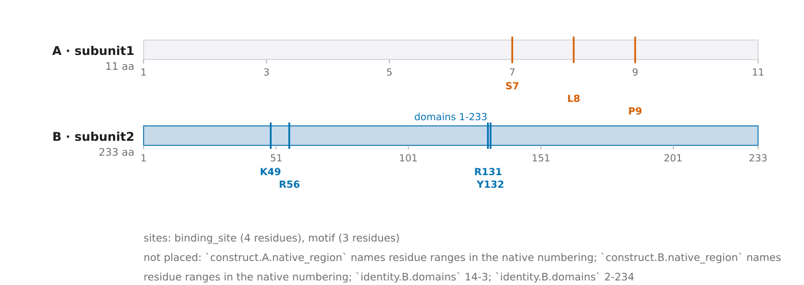
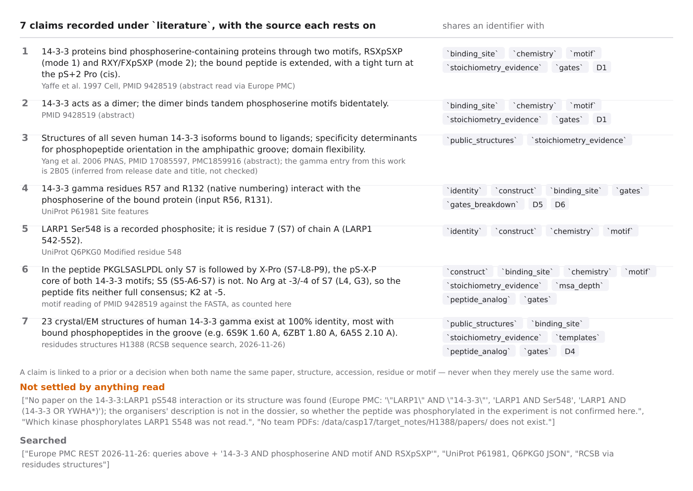
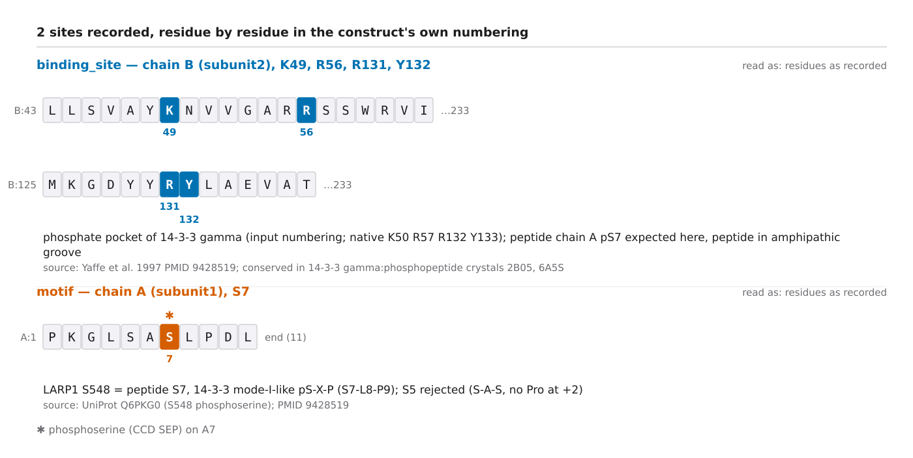
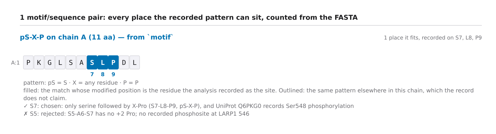
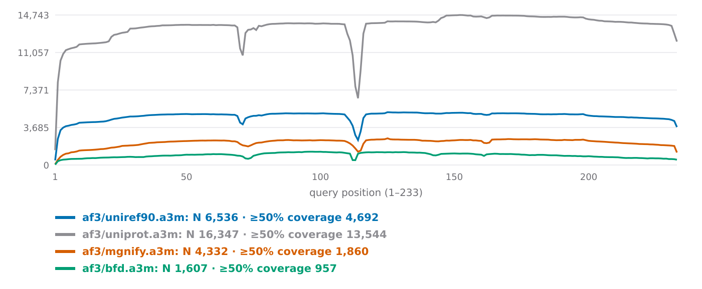

# H1388 — checkpoint C1 (plan)

Opened by agent at stage PLAN_REVIEW.

## Questions

1. Q1 pocket gate: (a) pS7 phosphate within 4 A of B56/B131/B132 [recommended: 6S9K contacts these, not K49] (b) require B49 too
2. Q2 dimer: (a) A1B1 only as declared [recommended] (b) add 5 af3 A2B2 seeds as a geometry check, ~+1 GPU-h, not submitted
3. Q3 template: (a) pin 6S9K chain A in af3 lead arm, unpinned control alongside [recommended: pS-L-P analog, 1.6 A] (b) no pinned template
4. Q4 unmodified arm: (a) eligible for the slate only if it passes the pocket gate [recommended] (b) slate from SEP models only

## Brief

# H1388 plan review

Deck: `<WORK>/targets/H1388/report/report.pdf`. My own slide is the last one: the 6S9K pocket.

## 1. The target in three lines
- **Chain A.** An 11-mer, `PKGLSASLPDL`: human LARP1 542–552 (Q6PKG0), with `input = native − 541`.
- **Chain B.** Human 14-3-3 gamma (P61981 3–234) with an N-terminal S. The C-terminal tail 235–247 is absent.
- **Stoichiometry.** A1B1, as declared.
- **The question.** This is a phosphopeptide-in-groove problem. Everything turns on the peptide's register and direction in the amphipathic groove.

## 2. What we know
- **Chemistry** (`chemistry`, `motif`).
  - UniProt records LARP1 S548 (= A7) as a phosphoserine.
  - A7 is the only serine followed by X-Pro: S7-L8-P9, the pS-X-P core of the 14-3-3 motifs (Yaffe 1997, PMID 9428519).
  - I rejected S5 (no +2 Pro).
  - The FASTA carries no modification, and I do not have the organisers' description.
- **Literature** (`literature`).
  - The 14-3-3 groove binds pS/pT peptides in an extended conformation, with a turn at the +2 Pro (PMID 9428519).
  - Structures exist for all seven human isoforms (Yang 2006, PMID 17085597).
  - **Not known:** I found no paper on 14-3-3 and LARP1 pS548. The peptide lacks the Arg at −3/−4 of mode 1 and mode 2. I read the abstracts only, and there are no team PDFs.
- **Public structures** (`public_structures`, `templates`, `peptide_analog`).
  - Chain B has 23 PDB entities at 100 % identity. Chain A has none.
  - The closest analog is **6S9K** (1.60 Å), with the caspase-2 peptide *DL-pS-L-P-F*. It shares pS, +1 Leu and +2 Pro with LARP1's *SA-pS-L-P-D*. This is a strong register prior.
- **MSA** (`msa_depth`). Chain B has 10,377 sequences, which is deep. Chain A is single-sequence, as expected for an 11-mer. No deepening is needed.
- **Site** (`binding_site`).
  - The phosphate pocket is B49, B56, B131 and B132 in input numbering (native K50, R57, R132, Y133).
  - In 6S9K the phosphate is within 3.5 Å of R57, R132 and Y133, but not of K50.
- **Stoichiometry** (`stoichiometry_evidence`). 14-3-3 is a constitutive dimer, but A1B1 is declared.

## 3. What is uncertain, and how the plan covers it
- **Whether the peptide was phosphorylated in the experiment.** The plan runs SEP-A7 and unmodified af3 arms side by side (D1, D5), and the gate decides between them.
- **Register and direction in the groove.** Without a −3/−4 Arg the pose is less constrained. The plan covers this with the pocket gate, the 6S9K pinned template (D4), and more seeds only if the results split.
- **Dimer.** The declared A1B1 is the scored unit, so no A2B2 arm is planned (see Q2).

## 4. The plan (D1–D6)
- **Stoichiometry.** A1B1 only (D2).
- **Inputs.**
  - MSA: ColabFold for B; A single-sequence (D3).
  - Templates: B search templates plus 6S9K chain A pinned at rank 1; no multimer template (D4).
  - PTM: SEP at A7 for af3 and Protenix; for Boltz-2 and OF3 only if their converters carry it (D5).
- **Seeds** (D6), about 300 models in all:

  | arm | seeds × samples |
  |---|---|
  | af3 + SEP (lead) | 20 × 5 |
  | af3 unmodified (control) | 10 × 5 |
  | Protenix + SEP | 10 × 5 |
  | Boltz-2 | 10 × 5 |
  | OF3 | 10 × 5 |

- **GPU.** About 5 GPU-h, capped at 20 of the 400 h budget.
- **QA and gates.**
  - The pocket gate: the pS7 phosphate within 4 Å of B56, B131 and B132.
  - Then interface QA, and confidence ranked within each predictor.

## 5. Questions
- **Q1: Pocket gate residues.**
  - (a) B56, B131 and B132, which is what 6S9K actually contacts. **[recommended]**
  - (b) All four, including B49 (K50).

  B49 is not within 3.5 Å in 6S9K, so requiring it would reject correct poses. This changes the gate spec only.
- **Q2: Dimer.**
  - (a) A1B1 only, as declared. **[recommended]**
  - (b) Add an A2B2 arm of 5 af3 seeds as a check of the groove geometry, at about +1 GPU-h. It would not be submitted.
- **Q3: Pinned 6S9K template.**
  - (a) Pin it in the af3 lead arm, with the unpinned af3 control. **[recommended]**
  - (b) Run no pinned template.
- **Q4: Unmodified arm in the slate.**
  - (a) Unmodified models can enter the slate only if they pass the pocket gate. **[recommended]**
  - (b) Use SEP models only.

## 6. The default
If no answer comes by the deadline, I take every recommended option, proceed to INPUTS_READY, and run D6 as written.

## The figures

Drawn from this dossier, each from the evidence it is about; every one is also a page of `report/report.pdf`.

- [`chain_map.svg`](../report/figs/chain_map.svg) — Each chain to scale, with the domains that were recorded and the residues a gate would use
- [`literature.svg`](../report/figs/literature.svg) — Every claim the analysis read, its source, and the priors and decisions that share it
- [`sites.svg`](../report/figs/sites.svg) — Each recorded site in its own sequence, with what the record says it does
- [`motif.svg`](../report/figs/motif.svg) — Every place the recorded motifs can sit in the sequence they were recorded on

## The analysis behind it

Stage **PLAN_REVIEW**. 12 kinds of evidence and 6 decisions, recorded by agent.

Sequence: 244 residues in 2 chains (11, 233). Given stoichiometry: A1B1.

## In one page

- **What it is.** **A** (11 aa) subunit1 — Homo sapiens (Eukaryota; Metazoa; Chordata; Mammalia; Primates); Q6PKG0 (LARP1_HUMAN), residues 542-552; La-related protein 1 (LARP1); the peptide is an intrinsically disordered linker segment, n · **B** (233 aa) subunit2 — Homo sapiens (Eukaryota; Metazoa; Chordata; Mammalia; Primates); P61981 (1433G_HUMAN, YWHAG), residues 3-234 plus an N-terminal S in place of native V2; 14-3-3 protein family. Given stoichiometry **A1B1**.
- **The chemistry the FASTA does not carry.** **A7** phosphoserine (CCD SEP) — S7 chosen; S5 rejected
- **MSA depth.** deepest `B` **10,377** sequences, thinnest `A` 0, over 2 measured alignments
- **Structures that exist.** **24** PDB entries named in the record: `2b05`, `3uzd`, `4e2e`, `4j6s`, `4o46`, `5d3e`, `6a5s`, `6byj` …
- **What nobody knows.** ["No paper on the 14-3-3:LARP1 pS548 interaction or its structure was found (Europe PMC: '\"LARP1\" AND \"14-3-3\"', 'LARP1 AND Ser548', 'LARP1 AND (14-3-3 OR YWHA*)'); the organisers' description is not in the dossier, so whether the peptide was phosphorylated in the experiment is not confirmed here.", "Which kinase phosphorylates LARP1 S548 was not read.", "No team PDFs: /data/casp17/target_notes/H1388/papers/ doe…

## The target, written up

<!-- target.md -->

### 1. Identification

| field | value |
|---|---|
| CASP id | H1388 |
| organisers' description | not in the dossier (only the FASTA was registered) |
| declared stoichiometry | A1B1 (dossier `stoichiometry.given`) |
| chain A | 11 aa, `PKGLSASLPDL`, human LARP1 (Q6PKG0) 542–552 |
| chain B | 233 aa, human 14-3-3 gamma (P61981, YWHAG) 3–234 with an N-terminal S |
| method | not known |
| dossier created | 2026-11-26 |

### 2. The chains

#### Chain A: LARP1 542–552
- It is an exact, single-occurrence substring of Q6PKG0 at 542–552, as counted here from the UniProt FASTA. `input = native − 541`.
- It has two serines. S5 is native S546. S7 is native S548, which UniProt Q6PKG0 records as a phosphoserine.
- It is a linker segment with no Pfam domain. There is no public structure of it (`residudes structures`, 0 entities at ≥ 90 % identity).

#### Chain B: 14-3-3 gamma
- Input 2–233 is identical to P61981 3–234, so `input = native − 1`.
- Input S1 stands in for native M1–V2. I infer it is a cleavage or cloning remnant; that is not sourced.
- The C-terminal tail, native 235–247 (`SDQQDDDGGEGNN`), is absent.
- The whole construct is the 14-3-3 domain: Pfam PF00244; InterPro IPR000308, IPR023410, IPR036815 and IPR023409 (UniProt cross-references).
- The phosphoserine-contact residues, in input numbering, are K49, R56, R131 and Y132 (native K50, R57, R132, Y133). I checked each identity against the FASTA.

### 3. The biology that bears on the structure

14-3-3 proteins bind phosphoserine or phosphothreonine motifs. Peptide libraries gave two consensuses, RSXpSXP (mode 1) and RXY/FXpSXP (mode 2). The bound peptide lies extended in the amphipathic groove, with a turn at the pS+2 proline [1]. 14-3-3 is a dimer, with one groove per protomer, and the dimer can bind two motifs at once [1]. Structures exist for all seven human isoforms bound to ligands [2].

In this peptide only S7 is followed by X-Pro (S7-L8-P9), which is the pS-X-P core of both motifs. There is no Arg at −3 or −4 (L4, G3), so the peptide fits neither full consensus; there is a Lys at −5 (as counted here). UniProt records Ser548 (= S7) as phosphorylated [3].

I found no paper on the 14-3-3–LARP1 pS548 interaction itself.

### 4. Sites and chemistry (input numbering)

| what | where | becomes | source |
|---|---|---|---|
| phosphoserine, CCD SEP | A7 (LARP1 S548); S5 rejected, as it has no +2 Pro | an af3 input **variant**, next to the unmodified input | [1], [3] |
| motif pS-X-P | A7–A9 | motif figure | [1] |
| phosphate pocket | B49, B56, B131, B132 | **contact gate**: A7 to B56/B131/B132 | UniProt P61981 sites; 6S9K check below |

The pocket check, as counted here in 6S9K (14-3-3 gamma with the caspase-2 phosphopeptide, 1.60 Å): the SEP139 phosphate oxygens lie within 3.5 Å of R57, R132 and Y133 (native numbering). K50 is not within 3.5 Å in that entry.

### 5. What is uncertain
- **Is the peptide phosphorylated in the experiment?** The FASTA carries no modification, and I do not have the organisers' description. The plan answers this by running both the SEP-A7 and the unmodified input and gating on the pocket contact.
- **Copy number.** 14-3-3 is a dimer in the family [1], but A1B1 is declared. Plan: model A1B1 as declared, and possibly A2B2 as a check of the groove geometry. That is a decision for the plan checkpoint.
- **Peptide register and direction in the groove.** The pose is set by pS7 and the +2 Pro turn. Without a basic −3/−4 residue the register is less constrained than for a canonical mode-1 peptide.

### 6. The structures that exist

Chain B has 23 PDB entities at 100 % identity and 100 % coverage (`residudes structures H1388`, 2026-11-26). Chain A has none. The local PDB mmCIF mirror is from 2026-04-25 (215 days old).

| PDB | method | res. (Å) | state | template use |
|---|---|---|---|---|
| 6S9K | X-ray | 1.60 | caspase-2 phosphopeptide | yes, best peptide-bound; pocket checked |
| 6ZBT / 6ZC9 | X-ray | 1.80 / 1.90 | Nedd4-2 peptide | yes |
| 3UZD | X-ray | 1.86 | 14-3-3 gamma | yes (receptor) |
| 6A5S | X-ray | 2.10 | TFEB peptide | yes |
| 4E2E | X-ray | 2.25 | TH/TPH-activator complex | receptor |
| 7A6Y / 7A6R | X-ray | 2.50 / 2.70 | DAPK2 peptide | yes |
| 2B05 | X-ray | 2.55 | phosphopeptide | yes |
| 6GKF / 6GKG | X-ray | 2.60 / 2.85 | caspase-2 | yes |
| 6BZD | X-ray | 2.67 | R57E mutant, GlcNAc peptide | no: the pocket is mutated |
| 5D3E | X-ray | 2.75 | CFTR peptide | yes |
| 6SAD | X-ray | 2.75 | doubly phosphorylated peptide | yes |
| 6FEL | X-ray | 2.84 | CaMKK2 peptide | yes |
| 4O46 | X-ray | 2.90 | influenza NS1 tail | yes |
| 6BYJ / 6BYL | X-ray | 2.90 / 3.35 | O-GlcNAc peptides | a different chemistry |
| 6Y4K / 6Y6B | X-ray | 3.00 / 3.08 | CaMKK2 | yes |
| 8XI3 | EM | 3.00 | mouse SCMC complex | no |
| 4J6S | X-ray | 3.08 | TH N-terminal peptide | yes |
| 9CI3 | EM | 3.96 | LRRK2 complex | no |

The ColabFold template hits for chain B agree with this (6byj_A 100 %, qcov 2–233, E 1.5e-116; `msas/colabfold/msa/templates_B.m8`). AF3's own search hides these near-identical entries, so a peptide-bound entry has to be passed in explicitly. I did not run HHsearch: chain B already has exact-sequence structures, and an 11-mer cannot be placed by a profile search.

### 7. MSA depth and figures

These come from `residudes-engine msa --source colabfold`, then `residudes msa H1388 --depth`:

| chain | N | N cov ≥ 50 % | median coverage | thin regions |
|---|---|---|---|---|
| A | 0 | 0 | 0 | the whole peptide (expected for an 11-mer) |
| B | 10,377 | 8,105 | 7,660 | none |

There is 1 paired row. No deepening is needed.

Figure: `report/figs/msa_coverage.svg`, the per-residue coverage drawn by `residudes msa --depth` from `msas/colabfold/msa/unpaired_{A,B}.a3m`.

### 8. References
1. Yaffe MB et al. (1997) The structural basis for 14-3-3:phosphopeptide binding specificity. *Cell*. PMID 9428519. I read the abstract only, through the Europe PMC REST API; the full text would give the zeta pocket residues explicitly.
2. Yang X et al. (2006) Structural basis for protein-protein interactions in the 14-3-3 protein family. *PNAS*. PMID 17085597, PMC1859916. I read the abstract only.
3. UniProt P61981 (1433G_HUMAN) and Q6PKG0 (LARP1_HUMAN), rest.uniprot.org JSON and FASTA, read 2026-11-26. The local copies are `dl/P61981.fasta` and `dl/Q6PKG0.fasta`.
4. PDB 6S9K, `dl/pdb/6S9K.pdb`, for the pocket contacts counted here.
5. I found nothing on the 14-3-3–LARP1 pS548 interaction in Europe PMC. The team folder `/data/casp17/target_notes/H1388/papers/` does not exist.

## What the target is

| | recorded |
|---|---|
| chains | H1388,subunit1 — 11 aa, H1388,subunit2 — 233 aa |
| stoichiometry given by CASP | A1B1 |
| `identity.A.organism` | Homo sapiens (Eukaryota; Metazoa; Chordata; Mammalia; Primates) |
| `identity.B.organism` | Homo sapiens (Eukaryota; Metazoa; Chordata; Mammalia; Primates) |
| `identity.A.family` | La-related protein 1 (LARP1); the peptide is an intrinsically disordered linker segment, no domain |
| `identity.B.family` | 14-3-3 protein family |
| `identity.B.domains` | **name**: 14-3-3 domain; **pfam**: PF00244; **interpro**: IPR000308, IPR023410, IPR036815, IPR023409; **range_input**: 1-233 (whole construct); **range_native**: 2-234 |
| `identity.A.uniprot` | Q6PKG0 (LARP1_HUMAN), residues 542-552 |
| `identity.A.basis` | exact substring of Q6PKG0 at 542-552 (single occurrence), as counted here from the UniProt FASTA |
| `identity.B.uniprot` | P61981 (1433G_HUMAN, YWHAG), residues 3-234 plus an N-terminal S in place of native V2 |
| `identity.B.basis` | input 2-233 identical to P61981 3-234 (as counted here); P61981 Pfam/InterPro cross-references from rest.uniprot.org/uniprotkb/P61981.json |
| `identity.description` | not given in the dossier; the pair is human 14-3-3 gamma with a LARP1-derived peptide (the CASP H1388 description is not in the dossier) |
| `construct.A.length` | 11 |
| `construct.A.native_region` | LARP1 Q6PKG0 542-552 |
| `construct.A.numbering` | input = native - 541; input S7 = LARP1 Ser548 (UniProt: Phosphoserine at 548) |
| `construct.A.mutations` | none |
| `construct.A.tag` | none |
| `construct.A.notes` | two serines, S5 (native S546) and S7 (native S548); FASTA carries no modification |
| `construct.B.length` | 233 |
| `construct.B.native_region` | P61981 3-234 (native length 247; C-terminal 235-247 SDQQDDDGGEGNN absent) |
| `construct.B.numbering` | input = native - 1 for input 2-233 |
| `construct.B.n_term` | input S1 replaces native M1-V2: likely a protease-cleavage/cloning remnant (inferred, not sourced) |
| `construct.B.mutations` | none beyond S1 |
| `construct.B.tag` | none visible |
| `construct.B.notes` | C-terminal tail truncated at T234 |

## The sequence itself

Counted from the dossier's FASTA, so this is arithmetic and not a prediction. A repetitive window or a long run of one residue is where an MSA and a template are most often thin.

| chain | residues | charged D/E/K/R | hydrophobic A/V/I/L/M/F/W/Y | G/P | S/T | Cys | His | longest run | most repetitive 30-mer |
|---|---|---|---|---|---|---|---|---|---|
| H1388,subunit1 | 11 | 18% | 36% | 27% | 18% | 0 | 0 | 1× S | – |
| H1388,subunit2 | 233 | 30% | 41% | 4% | 12% | 3 | 4 | 3× A | 7/30 identical, from residue 64 |

## What the literature says, claim by claim

Each claim as it was recorded, with its source. The last column is drawn, not asserted: a prior or a decision appears there when it names the same paper, structure, accession, residue or motif as the claim.

| # | claim | source | shares an identifier with |
|---|---|---|---|
| 1 | 14-3-3 proteins bind phosphoserine-containing proteins through two motifs, RSXpSXP (mode 1) and RXY/FXpSXP (mode 2); the bound peptide is extended, with a tight turn at the pS+2 Pro (cis). | Yaffe et al. 1997 Cell, PMID 9428519 (abstract read via Europe PMC) | `binding_site`, `chemistry`, `motif`, `stoichiometry_evidence`, D1 |
| 2 | 14-3-3 acts as a dimer; the dimer binds tandem phosphoserine motifs bidentately. | PMID 9428519 (abstract) | `binding_site`, `chemistry`, `motif`, `stoichiometry_evidence`, D1 |
| 3 | Structures of all seven human 14-3-3 isoforms bound to ligands; specificity determinants for phosphopeptide orientation in the amphipathic groove; domain flexibility. | Yang et al. 2006 PNAS, PMID 17085597, PMC1859916 (abstract); the gamma entry from this work is 2B05 (inferred from release date and title, not checked) | `public_structures`, `stoichiometry_evidence` |
| 4 | 14-3-3 gamma residues R57 and R132 (native numbering) interact with the phosphoserine of the bound protein (input R56, R131). | UniProt P61981 Site features | `identity`, `construct`, `binding_site`, D5, D6 |
| 5 | LARP1 Ser548 is a recorded phosphosite; it is residue 7 (S7) of chain A (LARP1 542-552). | UniProt Q6PKG0 Modified residue 548 | `identity`, `construct`, `chemistry`, `motif` |
| 6 | In the peptide PKGLSASLPDL only S7 is followed by X-Pro (S7-L8-P9), the pS-X-P core of both 14-3-3 motifs; S5 (S5-A6-S7) is not. No Arg at -3/-4 of S7 (L4, G3), so the peptide fits neither full consensus; K2 at -5. | motif reading of PMID 9428519 against the FASTA, as counted here | `construct`, `binding_site`, `chemistry`, `motif`, `stoichiometry_evidence`, `msa_depth`, `peptide_analog`, D1 |
| 7 | 23 crystal/EM structures of human 14-3-3 gamma exist at 100% identity, most with bound phosphopeptides in the groove (e.g. 6S9K 1.60 A, 6ZBT 1.80 A, 6A5S 2.10 A). | residudes structures H1388 (RCSB sequence search, 2026-11-26) | `public_structures`, `binding_site`, `stoichiometry_evidence`, `templates`, `peptide_analog`, D4 |

**Not settled by anything read:** ["No paper on the 14-3-3:LARP1 pS548 interaction or its structure was found (Europe PMC: '\"LARP1\" AND \"14-3-3\"', 'LARP1 AND Ser548', 'LARP1 AND (14-3-3 OR YWHA*)'); the organisers' description is not in the dossier, so whether the peptide was phosphorylated in the experiment is not confirmed here.", "Which kinase phosphorylates LARP1 S548 was not read.", "No team PDFs: /data/casp17/target_notes/H1388/papers/ does not exist."]

**Searched:** ["Europe PMC REST 2026-11-26: queries above + '14-3-3 AND phosphoserine AND motif AND RSXpSXP'", "UniProt P61981, Q6PKG0 JSON", "RCSB via residudes structures"]

## The sites the analysis found

The residues are the ones a gate would use: read by the same function as `residudes gate --init`, which prefers the numbering recorded as a field over the prose beside it. The residue letters come from the target FASTA, so a site on the wrong numbering shows up as the wrong residue.

| evidence | chain | residues | read as | what it is | source |
|---|---|---|---|---|---|
| `binding_site` | B | K49, R56, R131, Y132 | residues as recorded | 14-3-3 gamma phosphate pocket in the amphipathic groove (native K50, R57, R132, Y133): the pS7 phosphate of chain A should sit here | UniProt P61981 sites R57/R132; checked in PDB 6S9K (14-3-3 gamma + caspase-2 phosphopeptide, 1.60 A): SEP139 phosphate oxygens within 3.5 A of R57, R132, Y133 (native numbering), as counted here from… |
| `motif` | A | S7, L8, P9 | residues as recorded | 14-3-3 binding core on the LARP1 peptide (S7-L8-P9) | Yaffe et al. 1997, PMID 9428519 |

Chemistry the FASTA does not carry, placed on a residue: **A7** phosphoserine (CCD SEP).

Not placed: `chemistry.caveat` names chemistry but no residue: the FASTA carries no modification and the organisers' description was 

## The motifs, and every place they can sit

Each pattern the analysis wrote down, matched against the chain it was written about. This is arithmetic on the FASTA, not a claim: it says where the pattern fits, and whether the residue the analysis recorded as the site is one of those places.

| pattern | chain | places it fits | at | recorded site | the record's residue is one of them | from |
|---|---|---|---|---|---|---|
| `pS-X-P` | A | 1 | S7 | S7, L8, P9 | yes | `motif` |

Candidates the analysis weighed: **S7** chosen: only serine followed by X-Pro (S7-L8-P9, pS-X-P), and UniProt Q6PKG0 records Ser548 phosphorylation; **S5** rejected: S5-A6-S7 has no +2 Pro; no recorded phosphosite at LARP1 546.

## How much the MSAs cover

| MSA | sequences | ≥50% coverage | median coverage | median identity |
|---|---|---|---|---|
| `A` | 0 | 0 | 0 | – |
| `B` | 10,377 | 8,105 | 7,660 | 0.529 |

- **`msa_depth.A.assessment`:** empty, expected for an 11-residue peptide; not a lever - the pose comes from the receptor groove and the pS-X-P chemistry
- **`msa_depth.B.thin_regions`:** none
- **`msa_depth.effective`:** B deep, A none
- **`msa_depth.assessment`:** no deepening needed for B; deepening A is not meaningful

## Templates and public structures

What each search reported, not recomputed. `sequence X` is the PDB search of chain X, `foldseek` a structural search of a model, `hhsearch` a profile against a profile.

| entry | found by | match | coverage | method | released | title |
|---|---|---|---|---|---|---|
| `2b05` | sequence B | 100% | 100% | X-ray 2.55 Å | 2005-10-11 | Crystal Structure of 14-3-3 gamma in complex with a phosphoserine pept |
| `3uzd` | sequence B | 100% | 100% | X-ray 1.86 Å | 2012-03-21 | Crystal structure of 14-3-3 GAMMA |
| `4e2e` | sequence B | 100% | 100% | X-ray 2.25 Å | 2012-03-21 | Crystal structure of a tyrosine 3-monooxygenase/tryptophan 5-monooxyge |
| `4j6s` | sequence B | 100% | 100% | X-ray 3.08 Å | 2013-10-02 | 14-3-3gamma complexed with the N-terminal sequence of tyrosine hydroxy |
| `4o46` | sequence B | 100% | 100% | X-ray 2.90 Å | 2014-04-30 | 14-3-3-gamma in complex with influenza NS1 C-terminal tail phosphoryla |
| `5d3e` | sequence B | 100% | 100% | X-ray 2.75 Å | 2016-03-16 | Crystal structure of human 14-3-3 gamma in complex with CFTR R-domain  |
| `6a5s` | sequence B | 100% | 100% | X-ray 2.10 Å | 2019-02-13 | Structure of 14-3-3 gamma in complex with TFEB 14-3-3 binding motif |
| `6byj` | sequence B | 100% | 100% | X-ray 2.90 Å | 2018-05-09 | Structure of human 14-3-3 gamma bound to O-GlcNAc peptide |
| `6byl` | sequence B | 100% | 100% | X-ray 3.35 Å | 2018-05-09 | Structure of 14-3-3 gamma bound to O-GlcNAcylated thr peptide |
| `6fel` | sequence B | 100% | 100% | X-ray 2.84 Å | 2018-01-10 | Structure of 14-3-3 gamma in complex with CaMKK2 14-3-3 binding motif  |
| `6gkf` | sequence B | 100% | 100% | X-ray 2.60 Å | 2018-10-17 | Structure of 14-3-3 gamma in complex with caspase-2 14-3-3 binding mot |
| `6gkg` | sequence B | 100% | 100% | X-ray 2.85 Å | 2018-10-17 | Structure of 14-3-3 gamma in complex with caspase-2 14-3-3 binding mot |
| `6s9k` | sequence B | 100% | 100% | X-ray 1.60 Å | 2020-01-22 | Structure of 14-3-3 gamma in complex with caspase-2 peptide containing |
| `6sad` | sequence B | 100% | 100% | X-ray 2.75 Å | 2020-01-22 | Structure of 14-3-3 gamma in complex with double phosphorylated caspas |
| `6y4k` | sequence B | 100% | 100% | X-ray 3.00 Å | 2021-01-27 | Crystal structure of human 14-3-3 gamma in complex with CaMKK2 14-3-3  |
| `6y6b` | sequence B | 100% | 100% | X-ray 3.08 Å | 2021-02-03 | Crystal structure of human 14-3-3 gamma in complex with CaMKK2 14-3-3  |
| `6zbt` | sequence B | 100% | 100% | X-ray 1.80 Å | 2021-07-21 | Structure of 14-3-3 gamma in complex with Nedd4-2 14-3-3 binding motif |
| `6zc9` | sequence B | 100% | 100% | X-ray 1.90 Å | 2021-07-21 | Structure of 14-3-3 gamma in complex with Nedd4-2 14-3-3 binding motif |
| `7a6r` | sequence B | 100% | 100% | X-ray 2.70 Å | 2021-08-25 | Structure of 14-3-3 gamma in complex with DAPK2 peptide containing the |
| `7a6y` | sequence B | 100% | 100% | X-ray 2.50 Å | 2021-08-25 | Structure of 14-3-3 gamma in complex with DAPK2 peptide stabilized by  |
| `8xi3` | sequence B | 100% | 100% | EM 3.00 Å | 2024-10-02 | Structure of mouse SCMC-14-3-3gama complex |
| `9ci3` | sequence B | 100% | 100% | EM 3.96 Å | 2025-09-03 | Structure of the LRRK2/14-3-3 complex |
| `6bzd` | sequence B | 100% | 100% | X-ray 2.67 Å | 2018-05-09 | Structure of 14-3-3 gamma R57E mutant bound to GlcNAcylated peptide |

Chain B has a near-identical public structure (`2b05`, `3uzd`, `4e2e`, `4j6s`, `4o46`, `5d3e` …). AlphaFold 3 filters those out of its own template search, so they only reach a prediction if they are passed in.

## Every prior, as it was recorded

The sections above are read out of these entries. This is the whole record, including the fields they leave out, each at the stage it was found.

### public_structures
*NEW, by agent, 2 entries (latest shown)*

- **A**: no PDB entity >=90% identity (11-residue peptide; residudes structures H1388)
- **B**: 23 PDB entities at 100% identity, 100% coverage (residudes structures H1388, run 2026-11-26): 2B05 2.55 A phosphopeptide; 3UZD 1.86 A; 4E2E 2.25; 4J6S 3.08 TH N-term; 4O46 2.90 NS1 tail; 5D3E 2.75 CFTR; 6A5S 2.10 TFEB peptide; 6BYJ 2.90; 6BYL 3.35; 6BZD 2.67 R57E; 6FEL 2.84 CaMKK2; 6GKF 2.60, 6GKG 2.85 caspase-2; 6S9K 1.60 caspase-2 peptide; 6SAD 2.75; 6Y4K 3.00; 6Y6B 3.08; 6ZBT 1.80, 6ZC9 1.90 Nedd4-2; 7A6R 2.70, 7A6Y 2.50 DAPK2; 8XI3 3.00 EM; 9CI3 3.96 EM LRRK2
- **best peptide bound**: 6S9K 1.60 A (caspase-2 phosphopeptide); 6ZBT 1.80 A (Nedd4-2); 6A5S 2.10 A (TFEB)
- **complex**: no public structure of 14-3-3 with the LARP1 peptide found by sequence search
- **template db age**: PDB mmCIF mirror 2026-04-25 (215 days, stale); foldseek PDB 2026 copy 2026-08-02
- **note**: all chain-B hits are near-identical and are filtered by AF3's own template search; must be passed explicitly

### identity
*NEW, by agent*

- **A**:
  - **organism**: Homo sapiens (Eukaryota; Metazoa; Chordata; Mammalia; Primates)
  - **uniprot**: Q6PKG0 (LARP1_HUMAN), residues 542-552
  - **family**: La-related protein 1 (LARP1); the peptide is an intrinsically disordered linker segment, no domain
  - **domains**: none
  - **basis**: exact substring of Q6PKG0 at 542-552 (single occurrence), as counted here from the UniProt FASTA
- **B**:
  - **organism**: Homo sapiens (Eukaryota; Metazoa; Chordata; Mammalia; Primates)
  - **uniprot**: P61981 (1433G_HUMAN, YWHAG), residues 3-234 plus an N-terminal S in place of native V2
  - **family**: 14-3-3 protein family
  - **domains**:
      - **name**: 14-3-3 domain
        - **pfam**: PF00244
        - **interpro**: IPR000308, IPR023410, IPR036815, IPR023409
        - **range input**: 1-233 (whole construct)
        - **range native**: 2-234
  - **basis**: input 2-233 identical to P61981 3-234 (as counted here); P61981 Pfam/InterPro cross-references from rest.uniprot.org/uniprotkb/P61981.json
- **description**: not given in the dossier; the pair is human 14-3-3 gamma with a LARP1-derived peptide (the CASP H1388 description is not in the dossier)

### construct
*NEW, by agent*

- **A**:
  - **length**: 11
  - **native region**: LARP1 Q6PKG0 542-552
  - **numbering**: input = native - 541; input S7 = LARP1 Ser548 (UniProt: Phosphoserine at 548)
  - **mutations**: none
  - **tag**: none
  - **notes**: two serines, S5 (native S546) and S7 (native S548); FASTA carries no modification
- **B**:
  - **length**: 233
  - **native region**: P61981 3-234 (native length 247; C-terminal 235-247 SDQQDDDGGEGNN absent)
  - **numbering**: input = native - 1 for input 2-233
  - **n term**: input S1 replaces native M1-V2: likely a protease-cleavage/cloning remnant (inferred, not sourced)
  - **mutations**: none beyond S1
  - **tag**: none visible
  - **notes**: C-terminal tail truncated at T234

### literature
*NEW, by agent*

- **claims**:

| claim | source |
|---|---|
| 14-3-3 proteins bind phosphoserine-containing proteins through two motifs, RSXpSXP (mode 1) and RXY/FXpSXP (mode 2); the bound peptide is extended, with a tight turn at the pS+2 Pro (cis). | Yaffe et al. 1997 Cell, PMID 9428519 (abstract read via Europe PMC) |
| 14-3-3 acts as a dimer; the dimer binds tandem phosphoserine motifs bidentately. | PMID 9428519 (abstract) |
| Structures of all seven human 14-3-3 isoforms bound to ligands; specificity determinants for phosphopeptide orientation in the amphipathic groove; domain flexibility. | Yang et al. 2006 PNAS, PMID 17085597, PMC1859916 (abstract); the gamma entry from this work is 2B05 (inferred from release date and title, not checked) |
| 14-3-3 gamma residues R57 and R132 (native numbering) interact with the phosphoserine of the bound protein (input R56, R131). | UniProt P61981 Site features |
| LARP1 Ser548 is a recorded phosphosite; it is residue 7 (S7) of chain A (LARP1 542-552). | UniProt Q6PKG0 Modified residue 548 |
| In the peptide PKGLSASLPDL only S7 is followed by X-Pro (S7-L8-P9), the pS-X-P core of both 14-3-3 motifs; S5 (S5-A6-S7) is not. No Arg at -3/-4 of S7 (L4, G3), so the peptide fits neither full consensus; K2 at -5. | motif reading of PMID 9428519 against the FASTA, as counted here |
| 23 crystal/EM structures of human 14-3-3 gamma exist at 100% identity, most with bound phosphopeptides in the groove (e.g. 6S9K 1.60 A, 6ZBT 1.80 A, 6A5S 2.10 A). | residudes structures H1388 (RCSB sequence search, 2026-11-26) |

- **not known**: No paper on the 14-3-3:LARP1 pS548 interaction or its structure was found (Europe PMC: '"LARP1" AND "14-3-3"', 'LARP1 A…, Which kinase phosphorylates LARP1 S548 was not read., No team PDFs: /data/casp17/target_notes/H1388/papers/ does not exist.
- **searched**: Europe PMC REST 2026-11-26: queries above + '14-3-3 AND phosphoserine AND motif AND RSXpSXP', UniProt P61981, Q6PKG0 JSON, RCSB via residudes structures

### binding_site
*NEW, by agent, 2 entries (latest shown)*

- **chain**: B
- **residues**: 49, 56, 131, 132
- **what**: 14-3-3 gamma phosphate pocket in the amphipathic groove (native K50, R57, R132, Y133): the pS7 phosphate of chain A should sit here
- **source**: UniProt P61981 sites R57/R132; checked in PDB 6S9K (14-3-3 gamma + caspase-2 phosphopeptide, 1.60 A): SEP139 phosphate oxygens within 3.5 A of R57, R132, Y133 (native numbering), as counted here from <WORK>/targets/H1388/dl/pdb/6S9K.pdb; K50 not within 3.5 A there, kept by homology to the 14-3-3zeta pocket (PMID 9428519)
- **partner**:
  - **chain**: A
  - **residues**: 7
- **numbering**: input = native - 1 (checked: input K49, R56, R131, Y132 in FASTA)
- **use**: contact gate: chain A residue 7 within ~4 A of chain B 56/131/132

### chemistry
*NEW, by agent*

- **modification**: phosphoserine (CCD SEP) on chain A residue 7 (LARP1 Ser548)
- **chain**: A
- **residues**: 7
- **candidates**:
  - **S7**: chosen: only serine followed by X-Pro (S7-L8-P9, pS-X-P), and UniProt Q6PKG0 records Ser548 phosphorylation
  - **S5**: rejected: S5-A6-S7 has no +2 Pro; no recorded phosphosite at LARP1 546
- **motif**: pS-X-P
- **source**: PMID 9428519; UniProt Q6PKG0
- **caveat**: the FASTA carries no modification and the organisers' description was not available in the dossier

### motif
*NEW, by agent*

- **chain**: A
- **residues**: 7, 8, 9
- **pattern**: pS-X-P
- **what**: 14-3-3 binding core on the LARP1 peptide (S7-L8-P9)
- **source**: Yaffe et al. 1997, PMID 9428519

### stoichiometry_evidence
*IDENTIFIED, by agent, 2 entries (latest shown)*

- **given**: A1B1
- **given source**: organisers' declared stoichiometry (dossier stoichiometry.given)
- **family**: 14-3-3 is a constitutive homodimer (PMID 9428519); each protomer has its own amphipathic groove that binds one phosphopeptide, so the biological unit with saturating peptide is A2B2
- **homolog assemblies**: the 23 exact-sequence 14-3-3 gamma entries (residudes structures H1388, e.g. 2B05, 6A5S, 6S9K, 6ZBT) are crystal structures of the dimer or of a protomer related to its partner by crystal symmetry, with one peptide per groove; the peptide contacts a single protomer, so an A1B1 model contains the whole peptide interface
- **n sweep**: not run: the copy numbers are declared (rule 5, stage-2 style override); a peptide:14-3-3 sweep beyond 1:1 and 2:2 has no biological basis
- **seq2symm**: not run (declared count; B is a known C2 dimer)
- **reading**: A1B1 is what is scored; A2B2 is the biological assembly and is kept as an auxiliary run only to check that the peptide pose in one groove is the same with the dimer partner present
- **source**: PMID 9428519; PMID 17085597; residudes structures H1388 (2026-11-26)

### msa_depth
*NEW, by agent, 2 entries (latest shown)*

- **source**: colabfold API (residudes-engine msa --source colabfold, 2026-11-26), <WORK>/targets/H1388/msas/colabfold/msa
- **A**:
  - **file**: unpaired_A.a3m
  - **n**: 0
  - **n cov50**: 0
  - **coverage median**: 0
  - **assessment**: empty, expected for an 11-residue peptide; not a lever - the pose comes from the receptor groove and the pS-X-P chemistry
- **B**:
  - **file**: unpaired_B.a3m
  - **n**: 10377
  - **n cov50**: 8105
  - **coverage median**: 7660
  - **median identity**: 0.529
  - **thin regions**: none
- **paired rows**: 1
- **effective**: B deep, A none
- **assessment**: no deepening needed for B; deepening A is not meaningful
- **plot**: report/figs/msa_coverage.svg

### templates
*NEW, by agent*

- **B colabfold**: 6byj_A 100% id, qcov 2-233/233, E 1.5e-116; 6y6b_B 100%; 6bzd_B 99.5% (R57E); 6zc9_A 99.1%; 6fel_D 98.2%; 7v9b_A 64.6% (other isoform); file msas/colabfold/msa/templates_B.m8
- **A**: none (peptide)
- **hhsearch**: not run this step: chain B already has 23 exact-sequence structures and chain A is an 11-mer a profile search cannot place
- **note**: AF3 hides >=95% templates in its own search; pass a peptide-bound gamma entry (e.g. 6S9K, 6ZBT, 6A5S) explicitly

### report
*PLAN_REVIEW, by agent, 2 entries (latest shown)*

- **pdf**: <WORK>/targets/H1388/report/report.pdf
- **with retro**: False
- **figures**: none

### peptide_analog
*PLAN_REVIEW, by agent*

- **entry**: 6S9K
- **chain receptor**: A (14-3-3 gamma)
- **chain peptide**: B (caspase-2)
- **peptide seqres start**: DYDL(SEP)LPFPVCESCPLYKKLRLSTDT
- **core match**: 6S9K caspase-2 pS139-L-P and LARP1 pS548-L-P (input A7-L8-P9) share pS, +1 Leu and +2 Pro; -1 is Leu in caspase-2 and Ala in LARP1
- **use**: the closest public pS-L-P pose in 14-3-3 gamma; register prior for the gate and the pinned template (D4)
- **source**: <WORK>/targets/H1388/dl/pdb/6S9K.pdb SEQRES, as counted here
- **figure**: <WORK>/targets/H1388/report/figs/pocket_6s9k.png

## Decisions and the priors they rest on

| id | stage | type | chose | rests on | confidence | rejected |
|---|---|---|---|---|---|---|
| D1 | NEW | variant | phosphoserine (SEP) on chain A residue 7 (LARP1 S548), af3 only, run next to the unmodified input | `construct`, `literature`, `binding_site`, `chemistry`, `motif` | medium | unmodified only: rejected as the sole input, since 14-3-3 binding is phospho-dependent (PM |
| D2 | IDENTIFIED | stoichiometry | A1B1 (declared): one LARP1 phosphopeptide in the groove of one 14-3-3 gamma protomer; all five slate models A1B1 | `public_structures`, `literature`, `binding_site`, `motif`, `stoichiometry_evidence` | high | A1B2 (dimer, one peptide): rejected, no tandem motif on an 11-mer to bind bidentately |
| D3 | HYPOTHESES | variant | MSA: ColabFold MSA for chain B (14-3-3 gamma, 10,377 seqs, deep); chain A (11-mer LARP1 peptide) single-sequence (empty unpaired MSA), no paired MSA (a peptide  | `identity`, `construct`, `msa_depth` | high | family crawl / plmMSA for the peptide: rejected, an 11-residue window carries no coevoluti; paired MSA: rejected, nothing to pair for a peptide |
| D4 | HYPOTHESES | variant | Templates: chain B search templates (top 4) plus 6S9K chain A pinned at rank 1 (1.60 A, 100% id, phosphopeptide-bound groove) with --pin-template, since AF3 fil | `public_structures`, `literature`, `binding_site`, `templates` | medium | multimer template from 6S9K/6ZBT with the foreign peptide: rejected, wrong sequence regist; no templates: rejected, 23 exact-sequence structures exist and only help chain B; 6ZBT or 6A5S pin: kept as fallback if 6S9K chain parsing fails |
| D5 | HYPOTHESES | variant | PTM wiring: phosphoserine as an AF3/Protenix modification {ptmType: SEP, ptmPosition: 7} on chain A, added to the built input.json after residudes-engine inputs | `construct`, `chemistry`, `motif` | medium | phosphomimetic S7E: rejected, a weaker mimic of the dianionic phosphate that the K49/R56/R; SEP only, no unmodified control: rejected, the unmodified run tells whether the pose depen |
| D6 | HYPOTHESES | sampling | Sampling, all A1B1 (244 residues): af3 SEP 20 seeds x5 samples (lead arm); af3 unmodified 10 seeds x5 (control); protenix SEP 10 seeds x5; boltz-2 10 seeds x5;  | `binding_site`, `chemistry`, `motif`, `stoichiometry_evidence`, `msa_depth`, `templates` | medium | 100+ af3 seeds up front: rejected, a small well-templated complex; loop:RUNNING if the poo; af3 only: rejected, predictor agreement on the groove pose is evidence; A2B2 dimer arm: rejected by D2, declared A1B1 |

## Prior → decision map

Each column is a decision; ● means the decision cites that prior.

| prior | D1 | D2 | D3 | D4 | D5 | D6 |
|---|---|---|---|---|---|---|
| `public_structures` |  | ● |  | ● |  |  |
| `identity` |  |  | ● |  |  |  |
| `construct` | ● |  | ● |  | ● |  |
| `literature` | ● | ● |  | ● |  |  |
| `binding_site` | ● | ● |  | ● |  | ● |
| `chemistry` | ● |  |  |  | ● | ● |
| `motif` | ● | ● |  |  | ● | ● |
| `stoichiometry_evidence` |  | ● |  |  |  | ● |
| `msa_depth` |  |  | ● |  |  | ● |
| `templates` |  |  |  | ● |  | ● |
| `report` |  |  |  |  |  |  |
| `peptide_analog` |  |  |  |  |  |  |
| a person's note |  |  |  |  |  |  |

Found but not cited by any decision: `report`, `peptide_analog`.

## Between the agent and a person

- 01:48 **person**: dossier created
- 01:48 **person**: automation on, up to PACKAGED: the default at registration
- 01:51 **agent**: FYI: replay hindsight - the residudes-intake skill quotes this exact peptide (H2388: 14-3-3 gamma + LARP1 phosphopeptide, SEP at S7) and names H1388 with 23 exact 14-3-3 gamma entries / 6A5S. Those lines are hindsight; decisions here cite only the evidence collected in this step (UniProt, PMID 9428519, residudes structures).
- 01:56 **agent**: FYI: input build at INPUTS_READY needs a post-step that injects modifications [{ptmType: SEP, ptmPosition: 7}] into chain A of the af3/protenix input.json (D5); verify 6S9K chain A exists as the 14-3-3 chain before pinning (D4).

## What this proposes, and what it is asking

The decisions above in one line each, the two models the pool's two scales each prefer, and the questions a person has to answer before anything runs.

- **variant.** phosphoserine (SEP) on chain A residue 7 (LARP1 S548), af3 only, run next to the unmodified input; MSA: ColabFold MSA for chain B (14-3-3 gamma, 10,377 seqs, deep); chain A (11-mer LARP1 peptide) single-sequence (empty unpaired MSA), no paired MSA …; Templates: chain B search templates (top 4) plus 6S9K chain A pinned at rank 1 (1.60 A, 100% id, phosphopeptide-bound groove) with --pin-template, si…; PTM wiring: phosphoserine as an AF3/Protenix modification {ptmType: SEP, ptmPosition: 7} on chain A, added to the built input.json after residudes-en…
- **stoichiometry.** A1B1 (declared): one LARP1 phosphopeptide in the groove of one 14-3-3 gamma protomer; all five slate models A1B1
- **sampling.** Sampling, all A1B1 (244 residues): af3 SEP 20 seeds x5 samples (lead arm); af3 unmodified 10 seeds x5 (control); protenix SEP 10 seeds x5; boltz-2 10…

## References

What the analysis read, and which priors rest on it. A prior whose source is not written down cannot be checked against the paper later, and `residudes retro` cannot score it.

| # | source | supports |
|---|---|---|
| 1 | UniProt P61981 sites R57/R132; checked in PDB 6S9K (14-3-3 gamma + caspase-2 phosphopeptide, 1.60 A): SEP139 phosphate oxygens within 3.5 A of R57, R132, Y133 (native numbering), as counted here from <WORK>/targets/H1388/dl/pdb/6S9K.pdb; K50 not within 3.5 A there, kept by homology to the 14-3-3zeta pocket (PMID 9428519) (PMID 17085597) | `literature`, `binding_site`, `chemistry`, `motif`, `stoichiometry_evidence`, `peptide_analog` |
| 2 | Yang et al. 2006 PNAS, PMID 17085597, PMC1859916 (abstract); the gamma entry from this work is 2B05 (inferred from release date and title, not checked) | `literature` |
| 3 | UniProt P61981 Site features | `literature` |
| 4 | UniProt Q6PKG0 Modified residue 548 | `literature` |
| 5 | residudes structures H1388 (RCSB sequence search, 2026-11-26) | `literature` |
| 6 | organisers' declared stoichiometry (dossier stoichiometry.given) | `stoichiometry_evidence` |

**No source recorded**: `public_structures`, `identity`, `construct`, `templates`. Say where each came from (a paper, a structure, an experiment, or a calculation run here).
